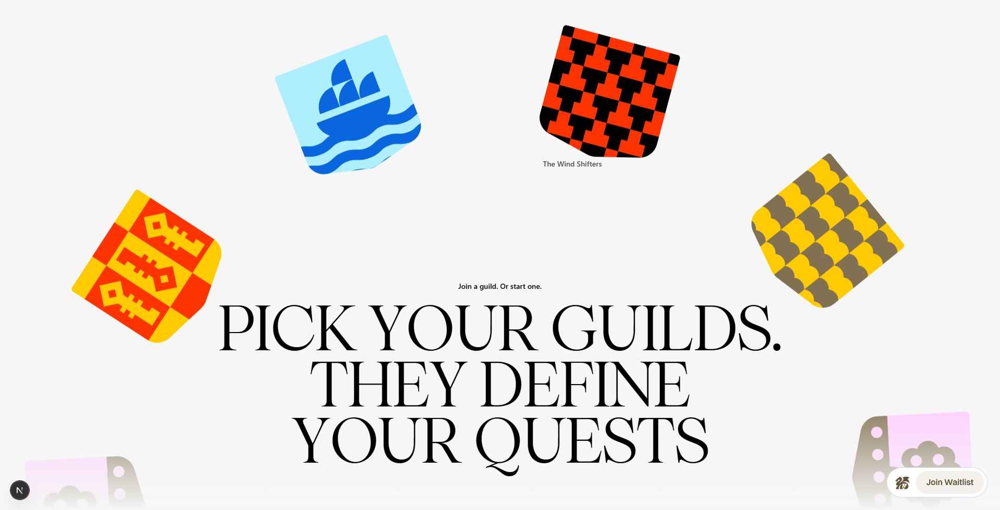
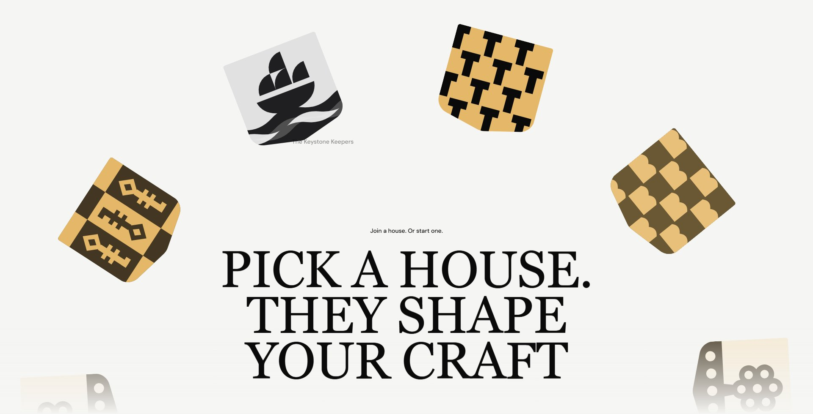
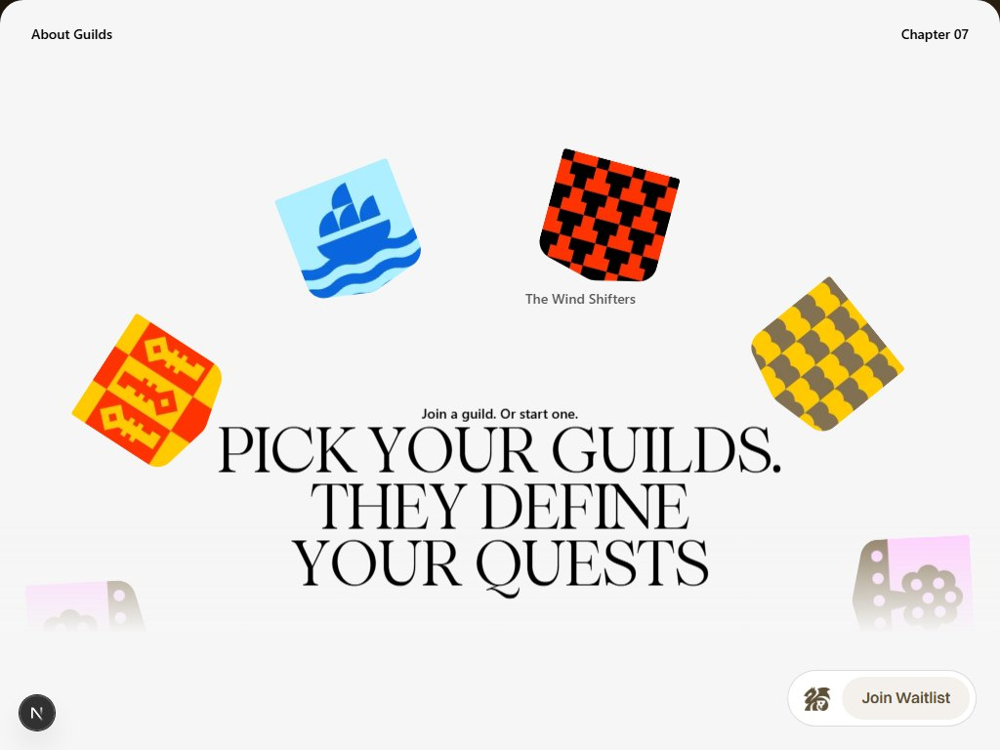
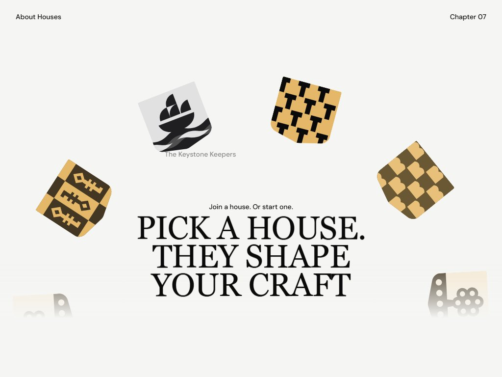

# Fidelity Report: orbital-crest-wheel

Sumber: `saas-app/grail-next/src/components/home/guilds/Guilds.tsx` + `guildsConfig.ts` + `Guilds.module.css` (`http://localhost:3002/?noloader=1`, Chapter 07 `.guilds`)
Ekstrak: `registry/sections/orbital-crest-wheel` (`http://localhost:3000/preview/section/orbital-crest-wheel`)
Style: `kinetic-obsidian` (`css-modules`, zero external dependencies)
Keadaan: Chapter 07 terungkap penuh (`--rk-wheel-hl: 1`, `--rk-wheel-morph: 0`, roda berputar kontinu selama ~2.4s dari sudut awal `15deg` pada kecepatan `4 deg/s`, viewport `1920x980` di-scroll `235px` dan `1024x768` di `0px`).

## Screenshot berdampingan

| Viewport | Asli | Ekstrak |
| --- | --- | --- |
| 1920x980 |  |  |
| 1024x768 |  |  |

## Hasil `npm run fidelity`

- **1920x980**: 9 elemen, **0 FAIL**, 49 WARN
- **1024x768**: 9 elemen, **0 FAIL**, 49 WARN

Seluruh 9 elemen terukur (`section`, `topbar`, `wheel`, `kicker`, `headWrap`, `head`, `leadStack`, `lead`, `blurb`) lolos dengan **0 FAIL** pada kedua viewport, dengan selisih dimensi `0.0px` pada seluruh elemen tipografi utama (`head`, `leadStack`, `lead`, tinggi `blurb`, dan tinggi `section`).

## Ringkasan Metrik Utama

| Elemen | 1920x980 (Asli vs Ekstrak) | 1024x768 (Asli vs Ekstrak) |
| --- | --- | --- |
| `section` | `1905x1766.4` vs `1910x1766.4` (`0.0px` tinggi) | `1009x942.1` vs `1014x942.1` (`0.0px` tinggi) |
| `topbar` | `x: 32, h: 19, 14px/500` vs `x: 32, h: 18, 14px/500` | `x: 32, y: 24.8, h: 19` vs `x: 32, y: 25, h: 18` |
| `wheel` | `2097.6x2097.6` vs `2084x2084` (`0.65%`) | `1118.9x1118.9` vs `1111.8x1111.8` (`0.63%`) |
| `kicker` | `y: 540.1, h: 19, 14px/500` vs `y: 536.8, h: 18, 14px/500` | `y: 413, h: 19` vs `y: 411.6, h: 18` |
| `headWrap` | `1152x324.4` vs `1152x324.4` (`0.0px`) | `614.4x173` vs `614.4x173` (`0.0px`) |
| `head` | `122.9px / 108.1px, 1152x324.4` (identik `0.0px`) | `65.5px / 57.7px, 614.4x173` (identik `0.0px`) |
| `leadStack` | `1152x566.4, gap: 42.24px` (identik `0.0px`) | `614.4x344.8, gap: 22.528px` (identik `0.0px`) |
| `lead` | `122.9px / 108.1px, 1152x432.5` (identik `0.0px`) | `65.5px / 57.7px, 614.4x230.6` (identik `0.0px`) |
| `blurb` | `435.3x91.6, 14px/18.3px` vs `436x91.6` (`0.0px` tinggi) | `435.3x91.6, 14px/18.3px` vs `436x91.6` (`0.0px` tinggi) |

## Beda yang disengaja (WARN)

- **Substitusi font berbayar dan sistem (`PP Pangaia` -> `Georgia`, `Segoe UI` -> `DM Sans`)**: situs asli memuat font komersial lokal `PP Pangaia` dan system stack `-apple-system / Segoe UI`; ekstrak memakai token `--rk-font-display` (`Georgia`) dan `--rk-font-body` (`DM Sans`) dari preset `kinetic-obsidian`. Formula `6.4vw`, `line-height: 0.88`, dan `letter-spacing: -0.01em` menjaga tinggi seluruh baris identik (`324.4px` / `173px` pada `head`, `432.5px` / `230.6px` pada `lead`).
- **Pembulatan token warna (`--rk-*`)**: seluruh warna memakai `var(--rk-*)` dan `color-mix()` tanpa `#hex`/`rgb()` mentah (`--rk-bg: rgb(10, 10, 11)` vs `rgb(0, 0, 0)`, latar `color-mix(in srgb, var(--rk-fg) 98%, var(--rk-bg))` menghasilkan `rgb(245, 245, 243)` vs `#f6f6f6` asli, delta kurang dari 12).
- **Karya emblem SVG prosedural (`crest-art.tsx`)**: 5 tekstur `.webp` brand asli (`/patterns/*.webp` + mask `/guild-crest.svg`) diganti 5 motif geometris heraldik SVG inline dengan siluet perisai `74x74` identik dan palet murni berbasis token `--rk-*` sehingga mandiri tanpa aset eksternal dan adaptif terhadap pergantian tema.
- **Teks white-label**: seluruh teks (`label`, `chapter`, `kicker`, `headlineLines`, `lead`, `blurb`, dan nama rumah pada `crests`) dibuat props-driven dengan jumlah baris yang dikalibrasi persis sama (3 baris `head`, 4 baris `lead`, 5 baris `blurb` pada kedua viewport).
- **Border radius stage preview (`24px` -> `0px`)**: `styles.module.css` mempertahankan `border-radius: 24px` persis seperti aslinya; pada halaman preview mandiri Rakitek, aturan global `[data-rk-preview-stage="section"] > * { border-radius: 0 !important; }` meratakan sudut luar stage preview secara sengaja.
- **Posisi `wheel` (`x`/`y`)**: perubahan kecil sub-derajat rotasi antar frame tangkapan (`~0.6%` lebar AABB) serta ketiadaan pil melayang `Join Waitlist` (sibling overlay halaman induk) merupakan perilaku normal roda berputar kontinu.

## Detail teknis yang menjaga kecocokan 1:1

- Menetapkan `line-height: normal` pada `.section`, `.topbar`, `.kicker`, dan `.crestName` agar preflight Tailwind v4 tidak memperbesar tinggi baris teks `14px`.
- Menambahkan batas langkah scroll satu frame (`MAX_SCROLL_STEP_PX = 180`) pada `wheel-engine.ts` agar lompatan `window.scrollTo({ behavior: "instant" })` atau anchor jump tidak menyuntikkan lonjakan kecepatan palsu ke putaran roda, sementara scroll pengguna tetap mempercepat roda secara halus.
- Menggerakkan `--rk-wheel-hl` dan `--rk-wheel-morph` secara mandiri melalui `IntersectionObserver` + posisi viewport saat scroll, serta mendukung `prefers-reduced-motion: reduce` dan `:focus-visible`.

## Pembaruan 2026-11-27: ukur ulang ternormalisasi

`original-*.json` dan `extract-*.json` diukur ulang dengan `scripts/fidelity-capture.ts` (scrollbar disembunyikan di kedua sisi, lebar penuh 1920/1024px). Hasil ukur ulang: 1920 `wheel` 2234.9 vs 2159.6 dan 1024 1191.5 vs 1158.5 (2 FAIL per viewport).

Penyebab: ukuran roda sama di kedua sisi (persegi 82.5vw, pusat sama). Yang diukur adalah kotak pembatas persegi yang berputar, jadi lebarnya = 82.5vw x (|cos θ| + |sin θ|) dan bergantung pada sudut putar saat capture (~10px per derajat di 1920). Sudut = 15° + 4°/s x lama roda terlihat + putaran dari kecepatan scroll.

- Asli: Chapter 07 ada di bawah lipatan, jadi roda baru berputar setelah di-scroll. Scroll pertama job mendarat 49px meleset (layout halaman asli bergeser), lalu scroll kedua naik 49px dan memberi putaran mundur sesaat. Hasilnya stabil di ~29.3° (1920) / ~30.8° (1024) dalam 3 kali percobaan.
- Ekstrak: section ada di atas halaman preview, jadi roda sudah berputar sejak load (37.7-39.8°, berubah-ubah).

Yang dicoba: preview diberi spacer `100vh` di atas section (komponen tidak diubah) supaya roda baru berputar setelah di-scroll, seperti di halaman asli. Sudut ekstrak kini stabil di 32.2°: 1920 `wheel` 2184.4 vs 2159.6, 1024 1164.7 vs 1158.5. Masih 2 FAIL per viewport. Sisa ~2.9° (1920) / ~1.4° (1024) berasal dari pergeseran layout 49px di halaman asli saat scroll, bukan dari komponen. Menyamakannya berarti memalsukan waktu atau kecepatan putar, jadi tidak dilakukan. Usul: ubah prosedur ukur `wheel` di kedua sisi (mis. ukur elemen yang tidak berputar, atau kunci sudut sebelum `rkMeasure`), lalu capture ulang asli dan ekstrak.

Hasil `npm run fidelity` (dev server, dengan spacer): 1920x980 9 elemen, **2 FAIL**, 50 WARN; 1024x768 9 elemen, **2 FAIL**, 50 WARN.

### Penyelesaian 2026-11-27: sudut roda dikunci di kedua sisi

Spacer `100vh` di `preview.tsx` dibatalkan (preview kembali seperti semula). Sebagai gantinya, prosedur ukur `wheel` diubah **di kedua sisi**: sebelum `rkMeasure`, setup capture menambahkan `[class*='wheel']{transform:rotate(0deg) !important}` di dalam section (asli: `section[class*='guilds']`, ekstrak: `section[class*='section']`). Dengan begitu yang dibandingkan adalah ukuran roda itu sendiri, bukan kotak pembatas yang bergantung sudut saat capture. Asli dan ekstrak sama-sama di-capture ulang dengan setup ini.

Hasil `npm run fidelity` (build produksi): `wheel` 1584 vs 1584 di 1920 (82.5vw) dan 844.8 vs 844.8 di 1024. 1920x980 9 elemen, **0 FAIL**, 49 WARN; 1024x768 9 elemen, **0 FAIL**, 49 WARN.
