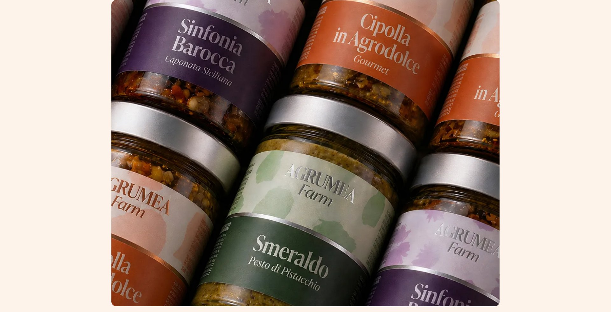
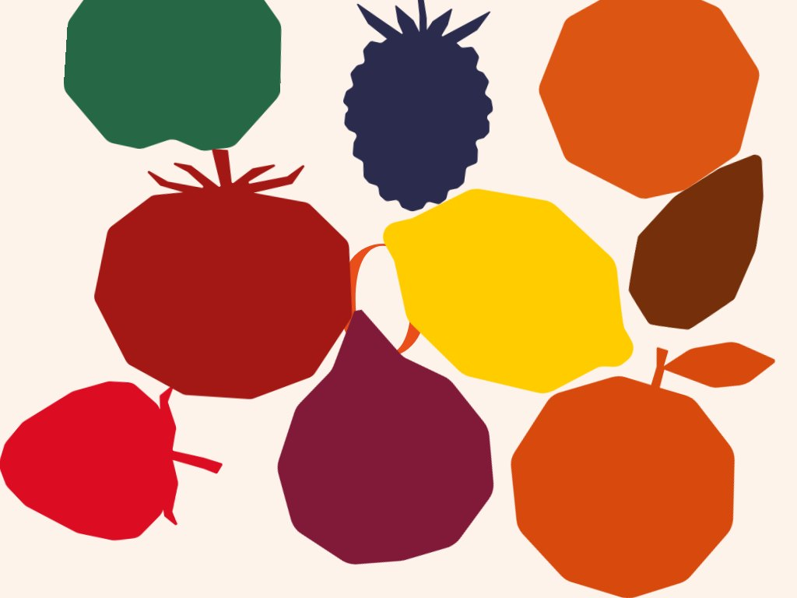

# Fidelity Report: orchard-closing-parallax-frame

- **Kind / Level:** `section` / `organism`
- **Composes:** tidak ada
- **Reference Source:** `fnb-bakery/agrumea-farm` (`http://localhost:3041/en/chi-siamo`)
- **Live Extract Preview:** `http://localhost:3045/preview/section/orchard-closing-parallax-frame`

## Hasil pengukuran (`npm run fidelity`)

| Viewport | Elemen | FAIL | WARN |
| --- | ---: | ---: | ---: |
| 1920x980 | 3 | **0** | 3 |
| 1024x768 | 3 | **0** | 3 |

## Screenshot berdampingan

| Viewport | Asli | Ekstrak |
| --- | --- | --- |
| 1920x980 |  |  |
| 1024x768 |  |  |

## Beda yang disengaja (WARN)

- `fontRendered` (6x): Font berbayar (ivystyle-sans, ivymode) diganti font gratis Outfit / Italiana.

## Catatan

- Parallax gambar memakai helper `parallax.ts` milik komponen ini (salinan lokal dari helper `initParallax` aslinya); tidak ada import lintas folder.
