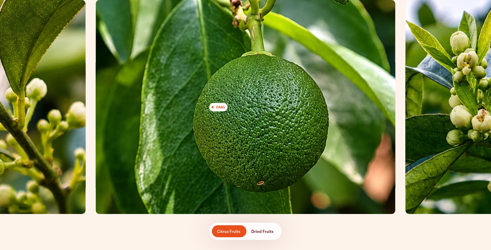
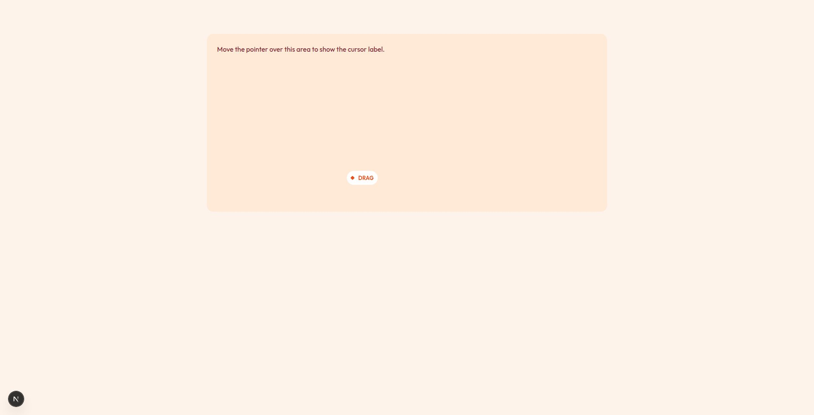
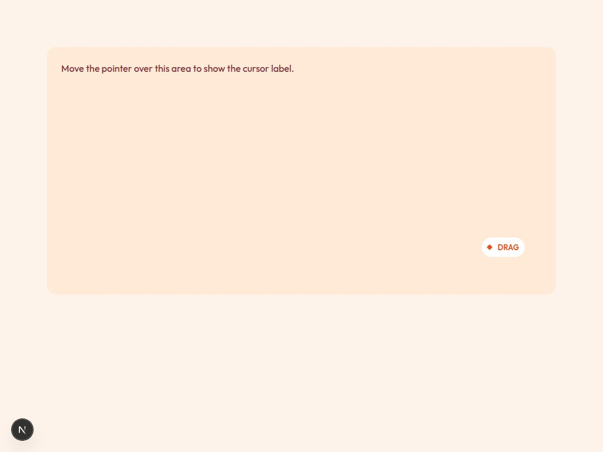

# Fidelity Report: orchard-cursor-label

- **Kind / Level:** `ui` / `atom`
- **Composes:** tidak ada
- **Reference Source:** `fnb-bakery/agrumea-farm` (`http://localhost:3041/en/produzione`)
- **Live Extract Preview:** `http://localhost:3045/preview/ui/orchard-cursor-label`

## Hasil pengukuran (`npm run fidelity`)

| Viewport | Elemen | FAIL | WARN |
| --- | ---: | ---: | ---: |
| 1920x980 | 4 | **0** | 4 |
| 1024x768 | 4 | **0** | 4 |

## Screenshot berdampingan

| Viewport | Asli | Ekstrak |
| --- | --- | --- |
| 1920x980 |  |  |
| 1024x768 |  |  |

## Beda yang disengaja (WARN)

- `fontRendered` (8x): Font berbayar (ivystyle-sans, ivymode) diganti font gratis Outfit / Italiana.

## Catatan

- Browser headless secara default melapor `hover: none`, padahal label hanya aktif untuk pointer halus. Pengukuran memakai Brave dengan `--blink-settings=primaryHoverType=2,primaryPointerType=4` (hover + pointer halus) di sisi asli dan ekstrak, lalu mengirim `pointermove` ke (800, 420) dan `mouseover` ke zona slider. Pill diukur setelah transisi masuk selesai.
- Di versi asli label ini dikendalikan toko status shell; di sini cukup prop `label` (null menyembunyikannya).
