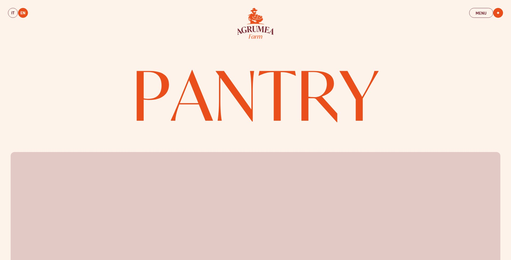
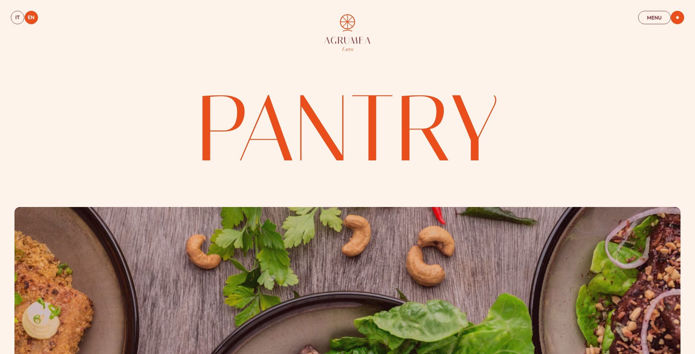
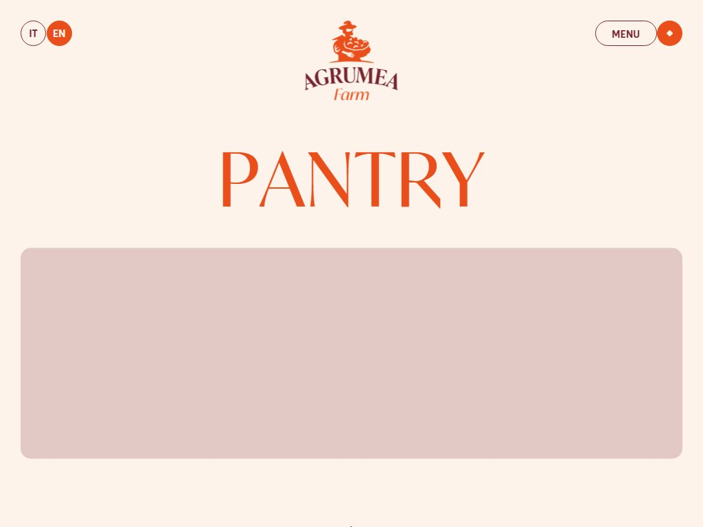
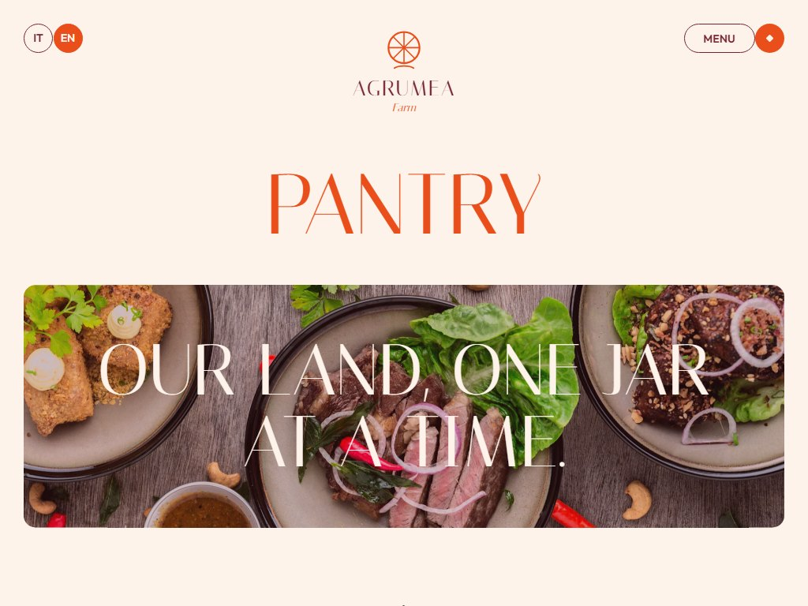

# Fidelity Report: orchard-editorial-demo-page

- **Kind / Level:** `page` / `page`
- **Composes:** `templates/orchard-editorial-template`, `sections/orchard-top-header`, `sections/orchard-editorial-page-hero`, `sections/orchard-rhombus-intro`, `sections/orchard-product-showcase`, `sections/orchard-parallax-poster-band`, `sections/orchard-spec-ledger-section`, `sections/orchard-expanding-cover-outro`, `sections/orchard-editorial-footer`, `ui/orchard-floating-pill-nav`
- **Reference Source:** `fnb-bakery/agrumea-farm` (`http://localhost:3041/en/dispensa`)
- **Live Extract Preview:** `http://localhost:3045/preview/page/orchard-editorial-demo-page`

## Hasil pengukuran (`npm run fidelity`)

| Viewport | Elemen | FAIL | WARN |
| --- | ---: | ---: | ---: |
| 1920x980 | 9 | **0** | 16 |
| 1024x768 | 9 | **0** | 16 |

## Screenshot berdampingan

| Viewport | Asli | Ekstrak |
| --- | --- | --- |
| 1920x980 |  |  |
| 1024x768 |  |  |

## Beda yang disengaja (WARN)

- `fontRendered` (18x): Font berbayar (ivystyle-sans, ivymode) diganti font gratis Outfit / Italiana.
- `text` (14x): Copy putih-label (white-label): teks asli diganti teks contoh netral tanpa merek.

## Catatan

Verifikasi 2 langkah halaman:

1. **Langkah 1 (perakitan, data asli):** `demo-data.ts` sementara berisi copy asli `/en/dispensa`. Hasil ukur 9 wilayah (`header`, `pageHero`, `intro`, `jams`, `creams`, `savoury`, `monopack`, `outro`, `footer`) disimpan di `original-*.json` vs `extract-*.json`: **0 FAIL** di 1920x980 dan 1024x768. Tinggi `pageHero` 1847px, `jams` 2068px, `footer` 1094px identik dengan web asli.
2. **Langkah 2 (data netral):** `demo-data.ts` diganti merek fiktif `HOLLOW Orchard`, alamat `example`, email `hello@example.com`, dan teks contoh dengan panjang karakter yang disetel mendekati aslinya. Diukur ulang dengan selector yang sama terhadap `original-*.json`: 0 FAIL di 1920x980 dan 0 FAIL di 1024x768. Dicek lewat `document.documentElement.scrollWidth == innerWidth` (tanpa overflow horizontal) dan tidak ada teks yang terpotong (`scrollWidth > clientWidth` pada elemen ber-overflow: 0). Screenshot netral dilihat langsung: header, judul `PANTRY`, dan cover tidak tumpang tindih.

Karena `demo-data.ts` diubah ke data netral setelah ukur langkah 1, `npm run fidelity:all` memberi WARN "bukti lebih tua dari kode" untuk halaman ini. Itu disengaja: bukti JSON adalah bukti perakitan dengan data asli, dan JSON tidak disunting.
