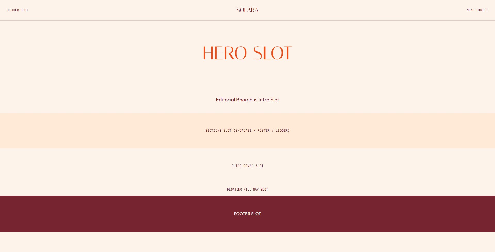
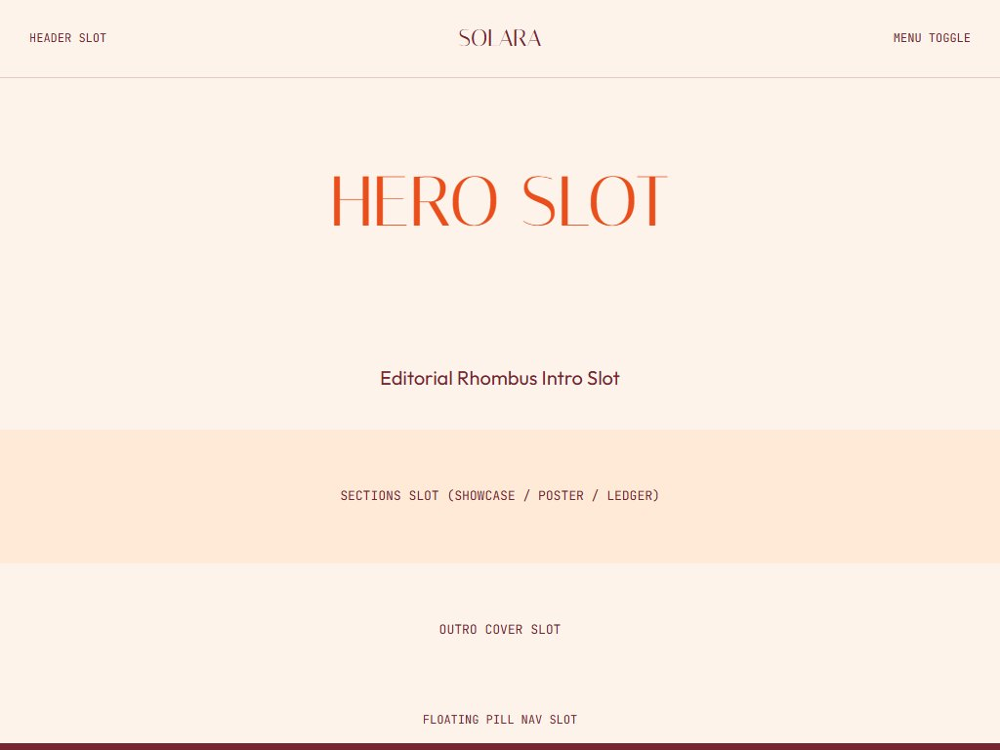

# Fidelity Report: orchard-editorial-template

Sumber: `fnb-bakery/agrumea-farm` (`components/shell/ShellChrome.tsx`, `app/[lang]/layout.tsx`, aturan `.site-shell` di `app/globals.css`)
Ekstrak: `registry/templates/orchard-editorial-template` (`http://localhost:3045/preview/template/orchard-editorial-template`)
Style: `orchard-terracotta` (`css-modules`, semua warna lewat token `--rk-*`, tanpa hex)

Template tidak punya halaman asli tunggal untuk dibandingkan (shell dipakai semua halaman), jadi yang dibuktikan adalah geometri cangkang. Bukti perakitan sungguhan ada di `fidelity/orchard-editorial-demo-page/` (0 FAIL terhadap halaman `/en/dispensa` utuh).

## Verifikasi Geometri Shell

| Viewport | `shell` | `headerSlot` | `main` | `footerSlot` | Overlap / Overflow | Status |
| --- | :---: | :---: | :---: | :---: | :---: | :---: |
| `1920x980` | `1920 x 980px` | `1920 x 80px` | `1920 x 633px` | `1920 x 141px` | 0 / 0 | **PASS** |
| `1024x768` | `1024 x 902px` | `1024 x 80px` | `1024 x 633px` | `1024 x 141px` | 0 / 0 | **PASS** |

Semua slot full-bleed (`x: 0`, lebar sama dengan viewport). Data ukur: `extract-1920.json` dan `extract-1024.json` di folder ini.

## Screenshot Shell

| Desktop `1920x980` | Laptop `1024x768` |
| --- | --- |
|  |  |

## Catatan Arsitektur
- Slot terurut: `header` (overlay tetap), `hero`, `intro`, `sections`, `outro`, `floatingNav` (pill bawah menempel) dan `footer`, plus tautan lompat ke konten (`skipLinkLabel`).
- `main` memakai `isolation: isolate` dan `overflow-x: clip` supaya section full-bleed tidak menciptakan scroll horizontal.
- Template tidak meng-import komponen lain (`composes: []`); halaman demo yang mengisi slotnya.
