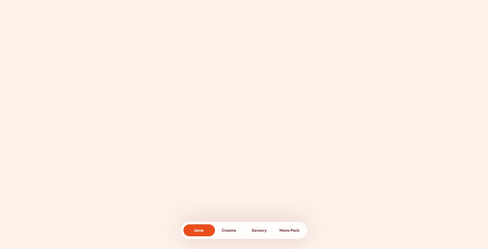
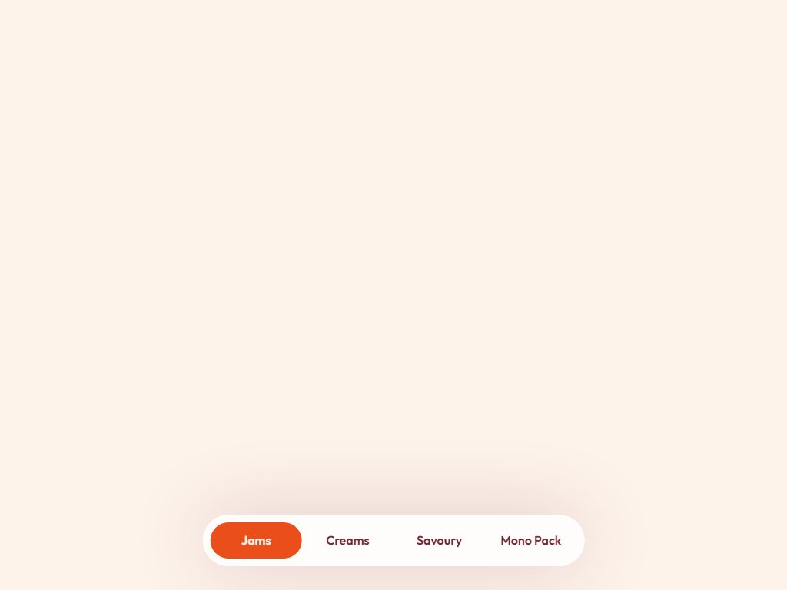

# Fidelity Report: orchard-floating-pill-nav

- **Kind / Level:** `ui` / `molecule`
- **Composes:** tidak ada
- **Reference Source:** `fnb-bakery/agrumea-farm` (`http://localhost:3041/en/dispensa`)
- **Live Extract Preview:** `http://localhost:3045/preview/ui/orchard-floating-pill-nav`

## Hasil pengukuran (`npm run fidelity`)

| Viewport | Elemen | FAIL | WARN |
| --- | ---: | ---: | ---: |
| 1920x980 | 5 | **0** | 7 |
| 1024x768 | 5 | **0** | 7 |
| 375x812 | 4 | **0** | 4 |

## Screenshot berdampingan

| Viewport | Asli | Ekstrak |
| --- | --- | --- |
| 1920x980 |  |  |
| 1024x768 |  |  |
| 375x812 |  |  |

## Beda yang disengaja (WARN)

- `fontRendered` (14x): Font berbayar (ivystyle-sans, ivymode) diganti font gratis Outfit / Italiana.
- `width` (4x): Lebar teks berbeda karena font pengganti (ivystyle-sans -> Outfit, ivymode -> Italiana).
