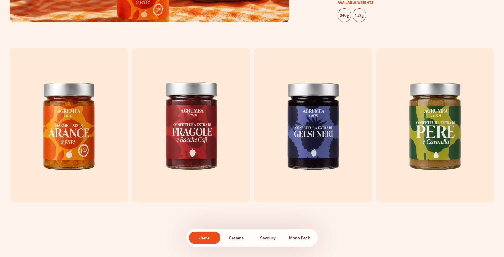
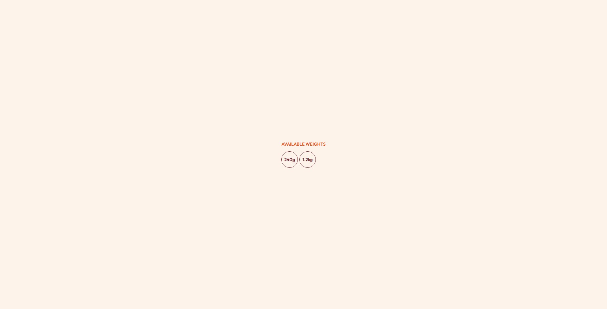
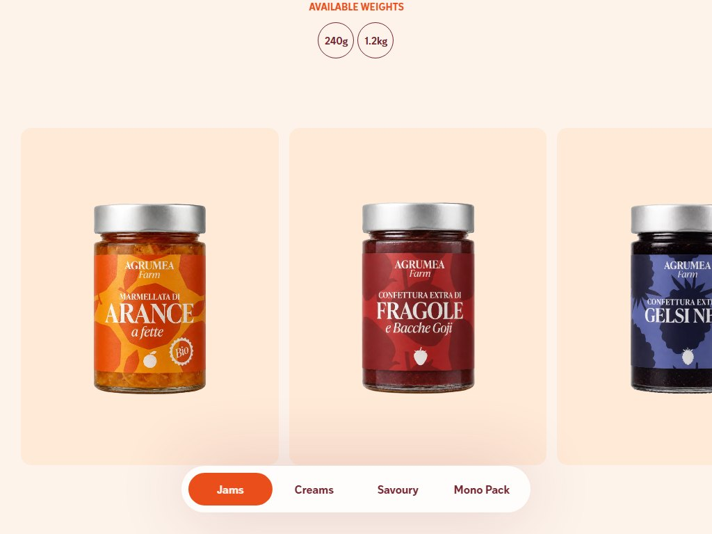
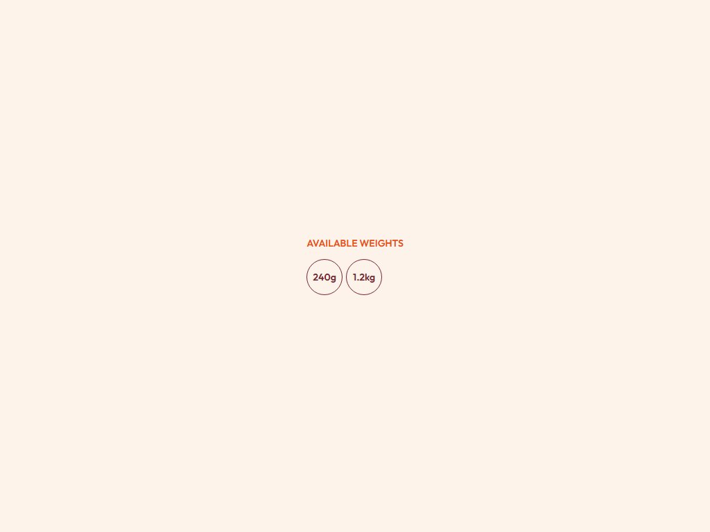

# Fidelity Report: orchard-format-badge

- **Kind / Level:** `ui` / `atom`
- **Composes:** tidak ada
- **Reference Source:** `fnb-bakery/agrumea-farm` (`http://localhost:3041/en/dispensa`)
- **Live Extract Preview:** `http://localhost:3045/preview/ui/orchard-format-badge`

## Hasil pengukuran (`npm run fidelity`)

| Viewport | Elemen | FAIL | WARN |
| --- | ---: | ---: | ---: |
| 1920x980 | 5 | **0** | 18 |
| 1024x768 | 5 | **0** | 18 |

## Screenshot berdampingan

| Viewport | Asli | Ekstrak |
| --- | --- | --- |
| 1920x980 |  |  |
| 1024x768 |  |  |

## Beda yang disengaja (WARN)

- `x` (10x): Posisi horizontal (x) bergeser karena font pengganti mengubah lebar baris.
- `y` (10x): Posisi vertikal dalam toleransi.
- `fontRendered` (10x): Font berbayar (ivystyle-sans, ivymode) diganti font gratis Outfit / Italiana.
- `width` (6x): Lebar teks berbeda karena font pengganti (ivystyle-sans -> Outfit, ivymode -> Italiana).
