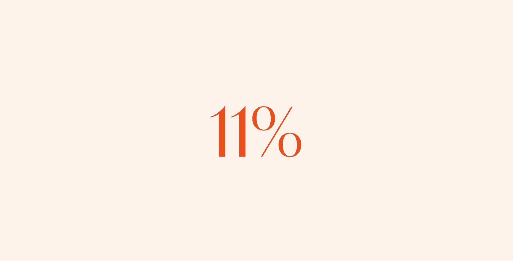
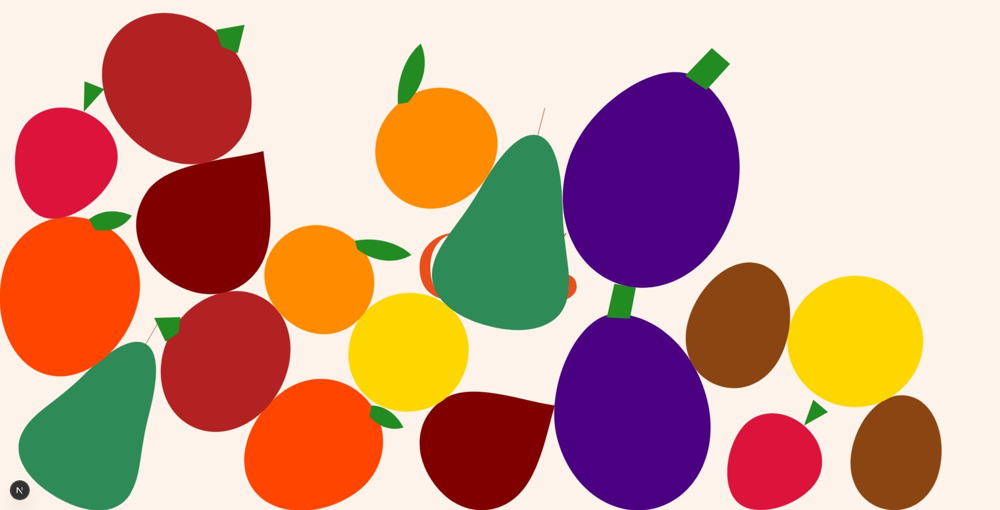
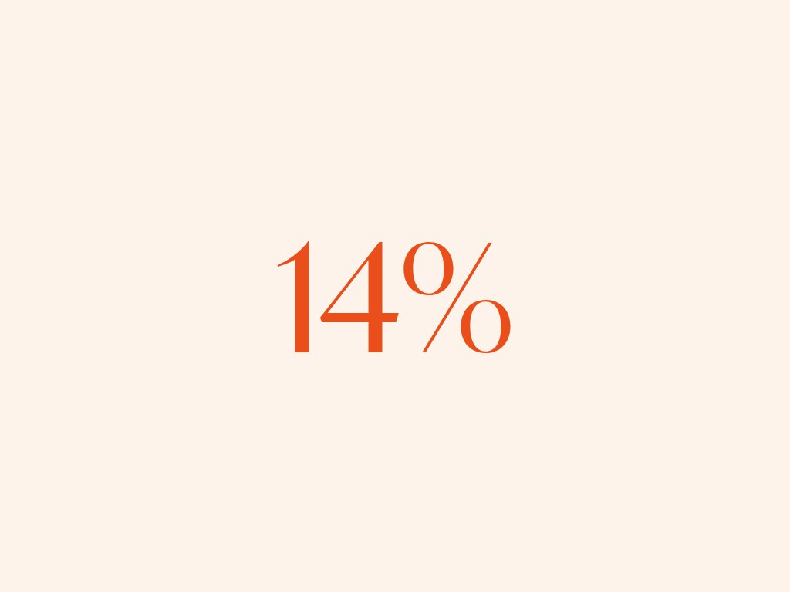
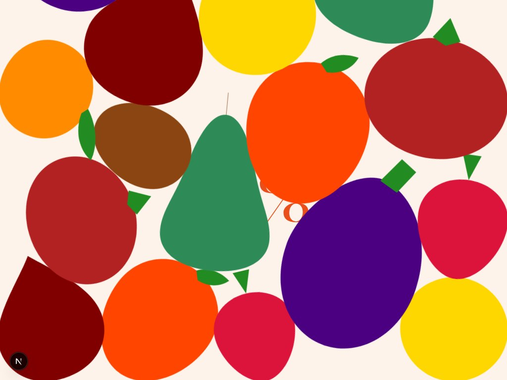

# Fidelity Report: orchard-fruit-loader

- **Kind / Level:** `section` / `organism`
- **Composes:** `ui/orchard-fruit-stage`
- **Reference Source:** `fnb-bakery/agrumea-farm` (`http://localhost:3041/en`)
- **Live Extract Preview:** `http://localhost:3045/preview/section/orchard-fruit-loader?hold=1`

## Hasil pengukuran (`npm run fidelity`)

| Viewport | Elemen | FAIL | WARN |
| --- | ---: | ---: | ---: |
| 1920x980 | 5 | **0** | 8 |
| 1024x768 | 5 | **0** | 8 |

## Screenshot berdampingan

| Viewport | Asli | Ekstrak |
| --- | --- | --- |
| 1920x980 |  |  |
| 1024x768 |  |  |

## Beda yang disengaja (WARN)

- `fontRendered` (10x): Font berbayar (ivystyle-sans, ivymode) diganti font gratis Outfit / Italiana.
- `text` (6x): Copy putih-label (white-label): teks asli diganti teks contoh netral tanpa merek.

## Catatan

- Keadaan ukur: sekitar 1 detik setelah muat, saat penghitung sudah tampil dan buah masih jatuh. Yang dibandingkan adalah kontainer penuh layar, latar, stage, dan lapisan sapuan. Angka penghitung, posisi buah (acak), dan fase penutupan (`is-closing`, sapuan panel 1,8 detik) tidak deterministik/tidak bisa dihentikan di web asli, jadi tidak diukur.
- Di preview, `?hold` membekukan penghitung dan timer penutup (`paused`) agar tata letak bisa diukur; tanpa itu loader menutup sendiri setelah paling lama 2 detik ditambah 1,8 detik sapuan, lalu tombol "Replay loader" muncul. Jadi preview tidak pernah tertutup selamanya.
- `prefers-reduced-motion`: buah langsung tersusun statis, `onSettled` dipanggil segera dan loader menutup setelah penghitung selesai.
