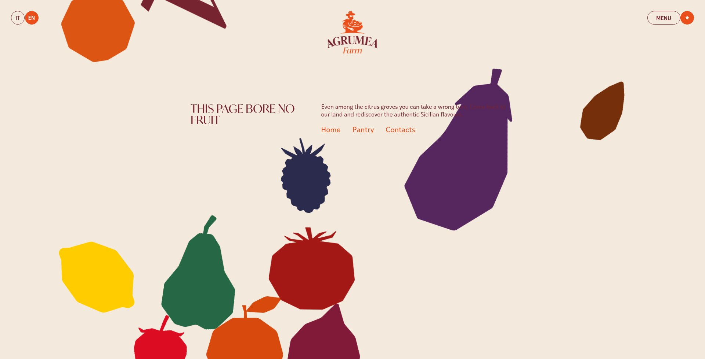
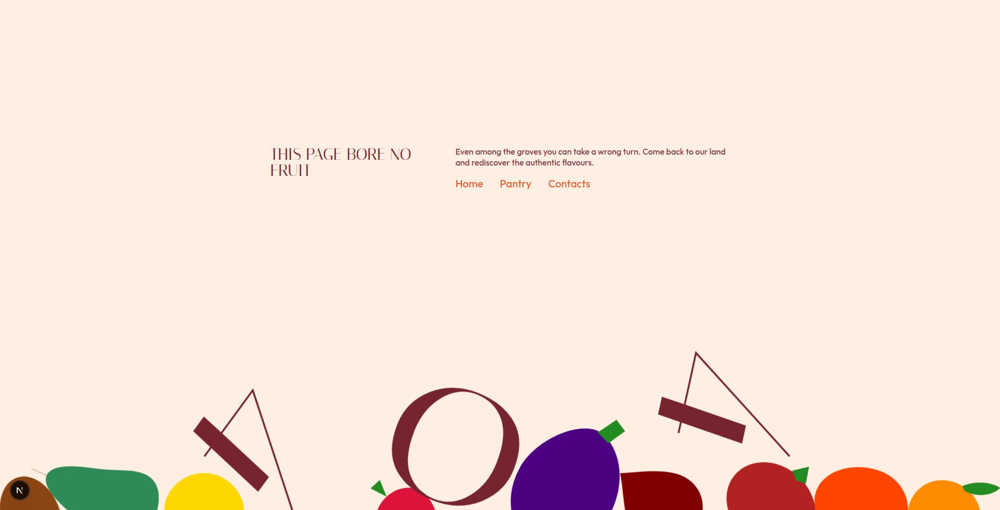
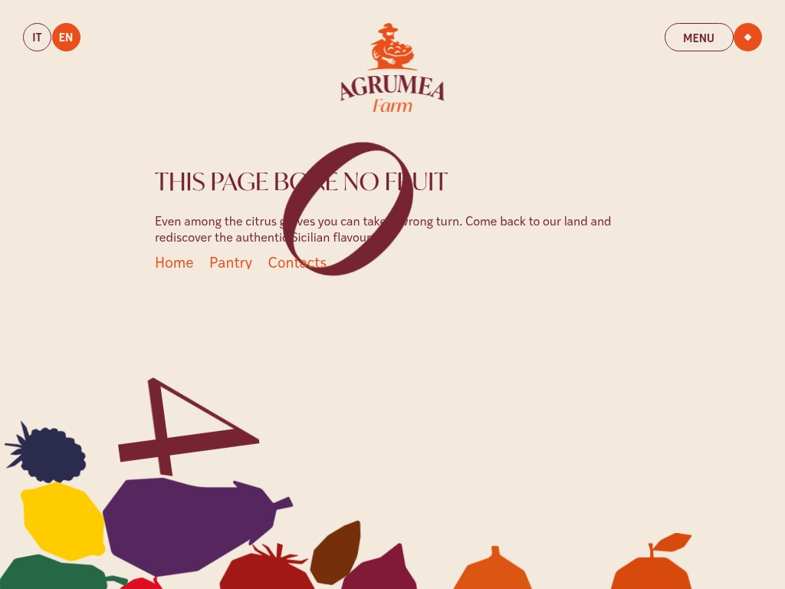
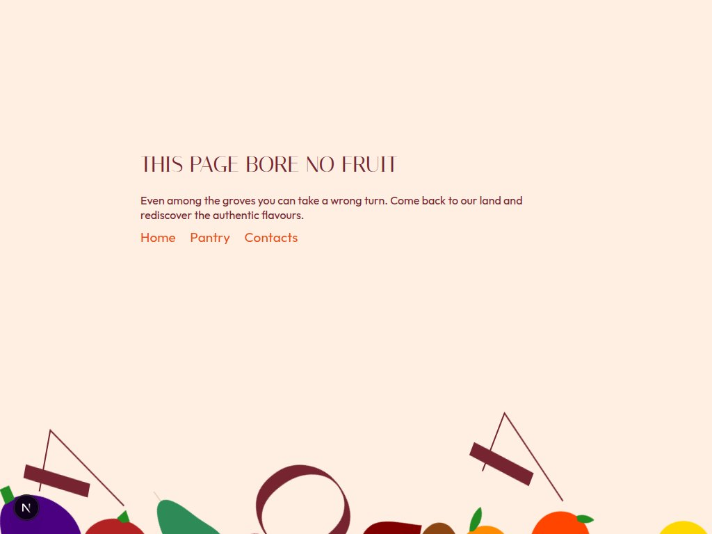

# Fidelity Report: orchard-fruit-not-found

- **Kind / Level:** `section` / `organism`
- **Composes:** `ui/orchard-fruit-stage`
- **Reference Source:** `fnb-bakery/agrumea-farm` (`http://localhost:3041/en/nonexistent`)
- **Live Extract Preview:** `http://localhost:3045/preview/section/orchard-fruit-not-found`

## Hasil pengukuran (`npm run fidelity`)

| Viewport | Elemen | FAIL | WARN |
| --- | ---: | ---: | ---: |
| 1920x980 | 10 | **0** | 17 |
| 1024x768 | 10 | **0** | 17 |

## Screenshot berdampingan

| Viewport | Asli | Ekstrak |
| --- | --- | --- |
| 1920x980 |  |  |
| 1024x768 |  |  |

## Beda yang disengaja (WARN)

- `fontRendered` (20x): Font berbayar (ivystyle-sans, ivymode) diganti font gratis Outfit / Italiana.
- `text` (12x): Copy putih-label (white-label): teks asli diganti teks contoh netral tanpa merek.
- `backgroundColor` (2x): Warna latar dipetakan ke token --rk-*.

## Catatan

- Yang diukur: kontainer, panel konten, judul, paragraf, daftar tautan, dan stage fisika. Posisi buah dan tiga digit status jatuh secara acak dengan fisika, sehingga tidak diukur (didokumentasikan sebagai tidak deterministik); stage-nya terbukti 1920 x 1058 (108vh) sama dengan aslinya.
- Header situs asli tidak termasuk komponen (itu `orchard-top-header`).
- Engine dipisah ke `ui/orchard-fruit-stage` yang dipakai juga oleh loader. Di layar <= 480px hanya setengah buah yang dijatuhkan seperti aslinya; dengan `prefers-reduced-motion` buah dan digit tersusun statis di dasar (digit berputar sesuai `--tilt`).
- Warna latar `.not-found` asli adalah krem tetap; di sini dibuat dari campuran token surface/bg sehingga selisih warna kecil muncul sebagai WARN.
