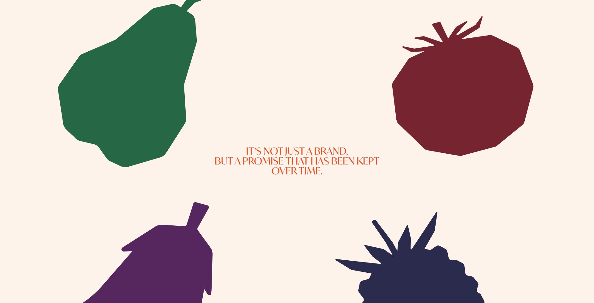
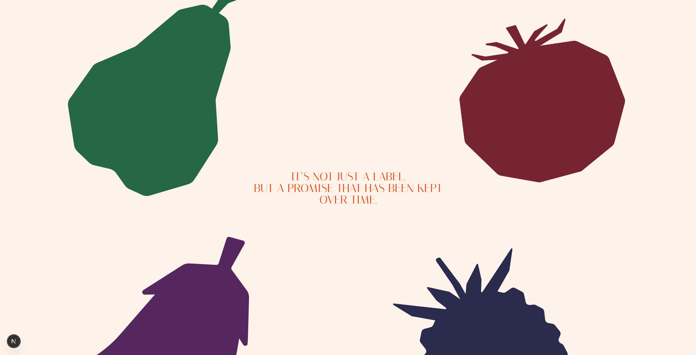
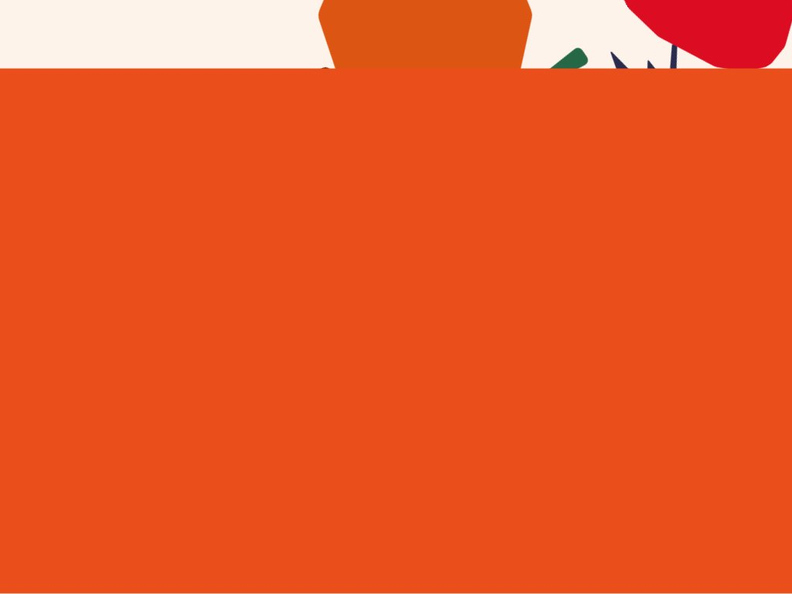
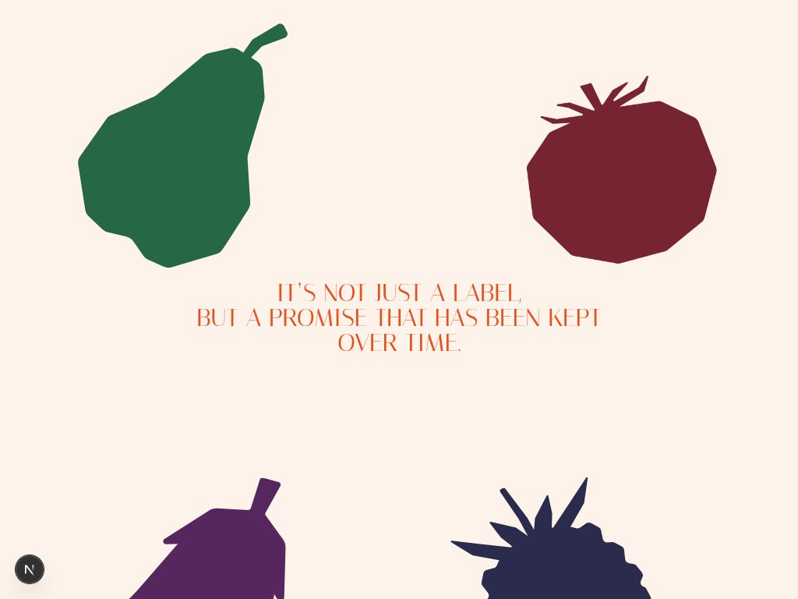

# Fidelity Report: orchard-fruit-pause-stage

- **Kind / Level:** `section` / `organism`
- **Composes:** tidak ada
- **Reference Source:** `fnb-bakery/agrumea-farm` (`http://localhost:3041/en/chi-siamo`)
- **Live Extract Preview:** `http://localhost:3045/preview/section/orchard-fruit-pause-stage`

## Hasil pengukuran (`npm run fidelity`)

| Viewport | Elemen | FAIL | WARN |
| --- | ---: | ---: | ---: |
| 1920x980 | 7 | **0** | 12 |
| 1024x768 | 7 | **0** | 12 |

## Screenshot berdampingan

| Viewport | Asli | Ekstrak |
| --- | --- | --- |
| 1920x980 |  |  |
| 1024x768 |  |  |

## Beda yang disengaja (WARN)

- `fontRendered` (14x): Font berbayar (ivystyle-sans, ivymode) diganti font gratis Outfit / Italiana.
- `text` (6x): Copy putih-label (white-label): teks asli diganti teks contoh netral tanpa merek.
- `width` (2x): Lebar teks berbeda karena font pengganti (ivystyle-sans -> Outfit, ivymode -> Italiana).
- `x` (2x): Posisi horizontal (x) bergeser karena font pengganti mengubah lebar baris.

## Catatan

- Keadaan ukur: halaman digulir ke `top section + 1.5 x tinggi viewport` (akhir timeline scrub, buah sudah di posisi CSS akhirnya, judul terlihat). Cara yang sama dipakai di web asli (`/en/chi-siamo`, `.about-pause`) dan di preview.
- `pin` GSAP membungkus `stage` dengan elemen `pin-spacer`; selector ekstrak memakai atribut `data-pause-stage` agar tidak salah sasaran.
- Warna isi SVG buah dikonversi dari hex ke `rgb()` (lint melarang hex); bentuk path identik dengan aslinya.
- Judul contoh diganti teks netral dengan 3 baris seperti aslinya.
