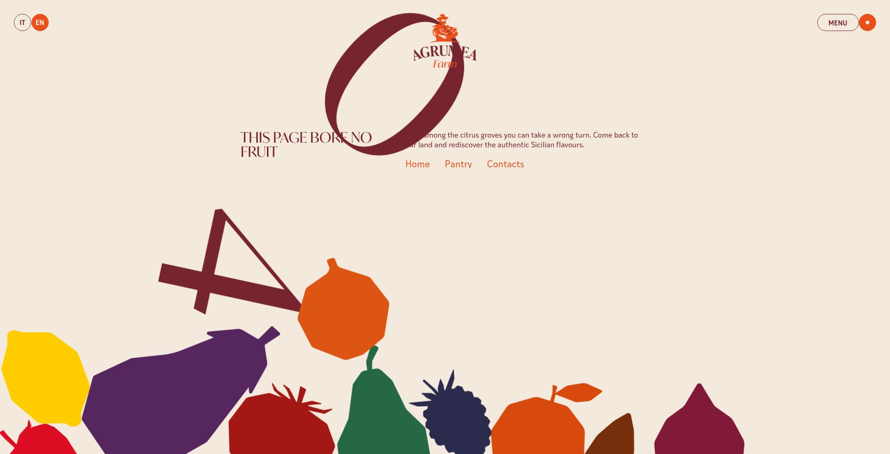
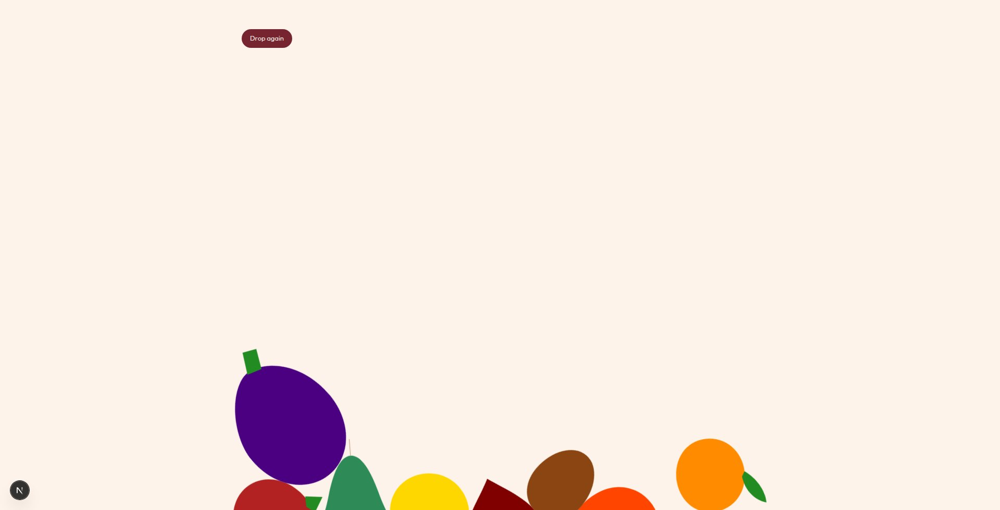
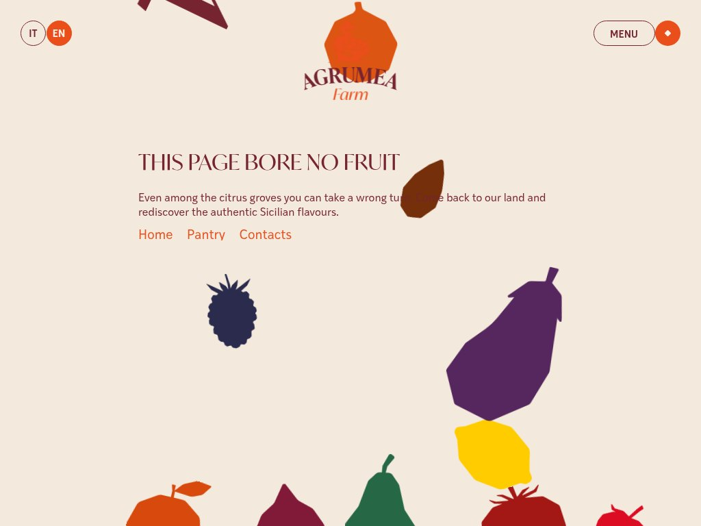
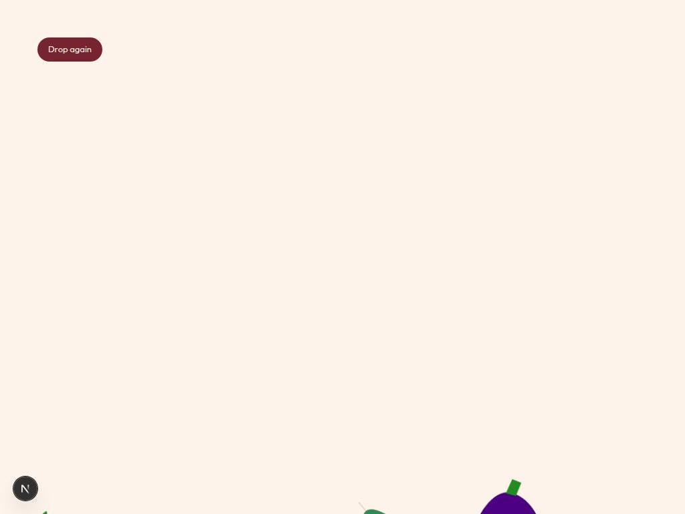

# Fidelity Report: orchard-fruit-stage

- **Kind / Level:** `ui` / `molecule`
- **Composes:** tidak ada
- **Reference Source:** `fnb-bakery/agrumea-farm` (`http://localhost:3041/en/nonexistent`)
- **Live Extract Preview:** `http://localhost:3045/preview/ui/orchard-fruit-stage`

## Hasil pengukuran (`npm run fidelity`)

| Viewport | Elemen | FAIL | WARN |
| --- | ---: | ---: | ---: |
| 1920x980 | 1 | **0** | 5 |
| 1024x768 | 1 | **0** | 5 |

## Screenshot berdampingan

| Viewport | Asli | Ekstrak |
| --- | --- | --- |
| 1920x980 |  |  |
| 1024x768 |  |  |

## Beda yang disengaja (WARN)

- `width` (2x): Lebar teks berbeda karena font pengganti (ivystyle-sans -> Outfit, ivymode -> Italiana).
- `x` (2x): Posisi horizontal (x) bergeser karena font pengganti mengubah lebar baris.
- `y` (2x): Posisi vertikal dalam toleransi.
- `text` (2x): Copy putih-label (white-label): teks asli diganti teks contoh netral tanpa merek.
- `fontRendered` (2x): Font berbayar (ivystyle-sans, ivymode) diganti font gratis Outfit / Italiana.

## Catatan

- Yang diukur adalah kotak `stage` (inset `0 0 -8vh`, 108% tinggi viewport) milik halaman 404 asli. Posisi buah acak (matter-js dengan seed acak), jadi tidak ada ukuran per buah yang deterministik; yang dibuktikan adalah kontainernya, dan dua perilaku yang diuji lewat kode: `prefers-reduced-motion` memakai tata letak statis satu baris di dasar (tanpa fisika), dan `onSettled` dipanggil segera.
- Siluet buah memakai set 10 bentuk vektor yang sama dengan `orchard-gravity-contact-stage` (disederhanakan dari artwork asli yang 240 KB), bukan SVG asli; hull tumbukan dihitung dari path SVG saat dimuat.
- Tidak menutup preview: tumpukan buah mengendap lalu mesin berhenti; tombol "Drop again" mengulang.
