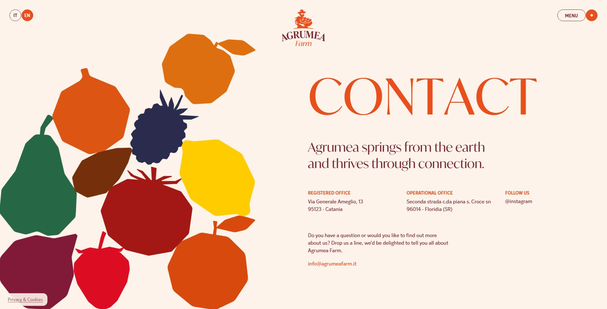
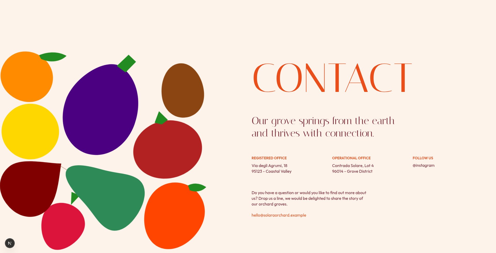
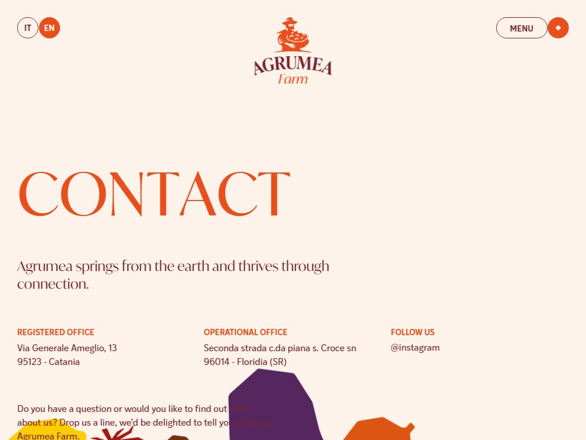
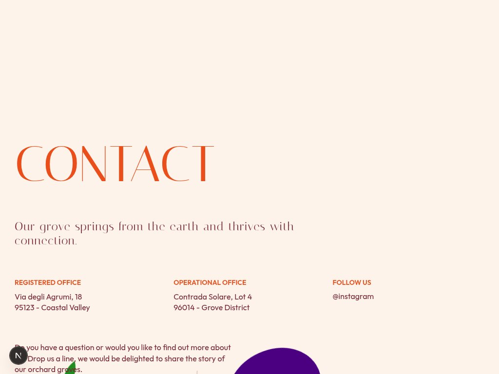

# Fidelity Report: orchard-gravity-contact-stage

- **Kind / Level:** `section` / `organism`
- **Composes:** tidak ada
- **Reference Source:** `fnb-bakery/agrumea-farm` (`http://localhost:3041/en/contatti`)
- **Live Extract Preview:** `http://localhost:3045/preview/section/orchard-gravity-contact-stage`

## Hasil pengukuran (`npm run fidelity`)

| Viewport | Elemen | FAIL | WARN |
| --- | ---: | ---: | ---: |
| 1920x980 | 7 | **0** | 13 |
| 1024x768 | 7 | **0** | 14 |

## Screenshot berdampingan

| Viewport | Asli | Ekstrak |
| --- | --- | --- |
| 1920x980 |  |  |
| 1024x768 |  |  |

## Beda yang disengaja (WARN)

- `fontRendered` (14x): Font berbayar (ivystyle-sans, ivymode) diganti font gratis Outfit / Italiana.
- `text` (12x): Copy putih-label (white-label): teks asli diganti teks contoh netral tanpa merek.
- `letterSpacing` (1x): Letter-spacing token display/body berbeda dari nilai browser asli.
