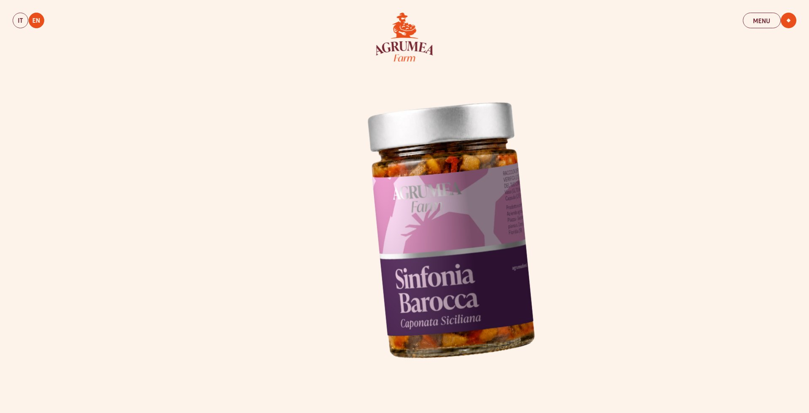
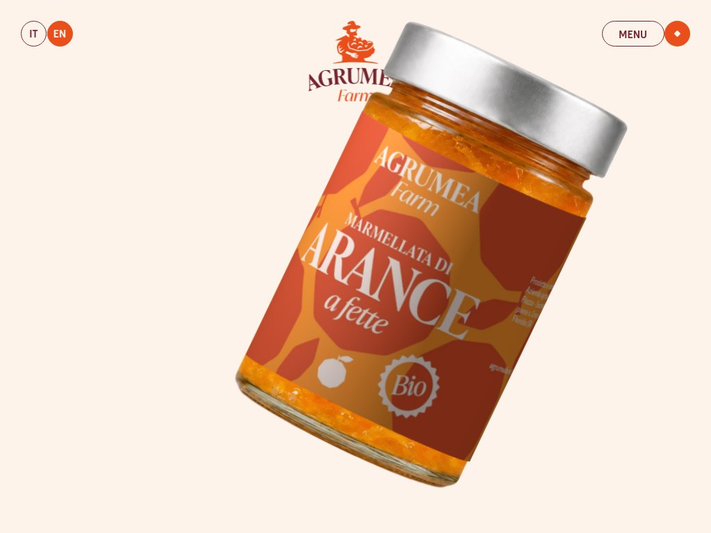

# Fidelity Report: orchard-jar-flight

- **Kind / Level:** `section` / `organism`
- **Composes:** `ui/orchard-spinning-jar`
- **Reference Source:** `fnb-bakery/agrumea-farm` (`http://localhost:3041/en/dispensa/marmellata_arancia`)
- **Live Extract Preview:** `http://localhost:3045/preview/section/orchard-jar-flight`

## Hasil pengukuran (`npm run fidelity`)

| Viewport | Elemen | FAIL | WARN |
| --- | ---: | ---: | ---: |
| 1920x980 | 3 | **0** | 3 |
| 1024x768 | 3 | **0** | 3 |

## Screenshot berdampingan

| Viewport | Asli | Ekstrak |
| --- | --- | --- |
| 1920x980 |  |  |
| 1024x768 |  |  |

## Beda yang disengaja (WARN)

- `fontRendered` (6x): Font berbayar (ivystyle-sans, ivymode) diganti font gratis Outfit / Italiana.

## Catatan

- Keadaan ukur: pose awal (t = 0) klon toples. Di web asli, `requestAnimationFrame` dibekukan lalu toples tengah di beranda diklik, sehingga klon tidak sempat bergerak; angka `from`/`to` (posisi tengah, ukuran, rotasi -5,59 deg dan skala 0,85 di 1920; rotasi 25,59 deg dan skala 1,44 di 1024) dibaca dari gaya klon asli dan dipakai sebagai data contoh preview.
- Gerak penuh (2 detik, easing cubic-bezier(.22,1,.36,1), putaran label easeInOutQuint, mendarat lalu memudar 180 ms, batas aman 6 detik) bergantung waktu dan tidak diukur; kodenya porting langsung dari aslinya. Klon dihapus lewat `onFinish`, jadi tidak menutup preview.
