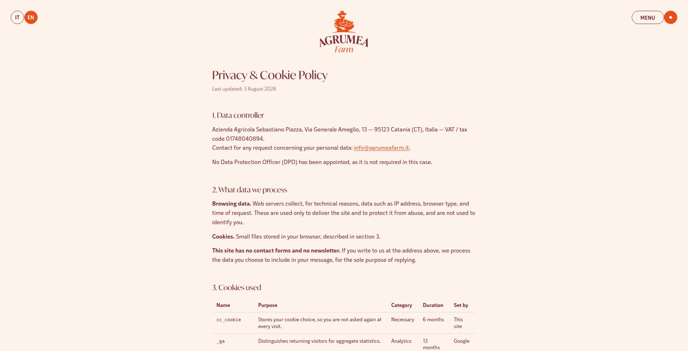
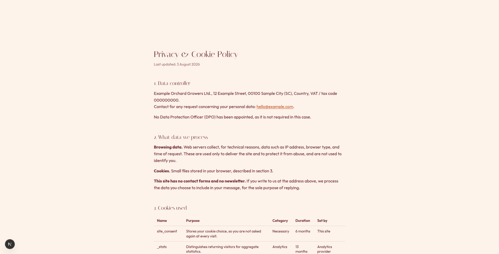
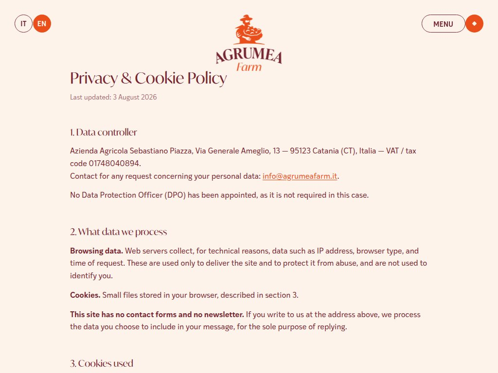
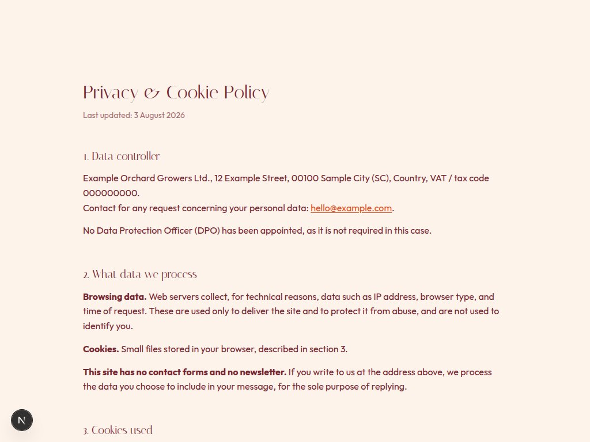

# Fidelity Report: orchard-legal-document

- **Kind / Level:** `section` / `organism`
- **Composes:** tidak ada
- **Reference Source:** `fnb-bakery/agrumea-farm` (`http://localhost:3041/en/privacy`)
- **Live Extract Preview:** `http://localhost:3045/preview/section/orchard-legal-document`

## Hasil pengukuran (`npm run fidelity`)

| Viewport | Elemen | FAIL | WARN |
| --- | ---: | ---: | ---: |
| 1920x980 | 12 | **0** | 15 |
| 1024x768 | 12 | **0** | 15 |

## Screenshot berdampingan

| Viewport | Asli | Ekstrak |
| --- | --- | --- |
| 1920x980 |  |  |
| 1024x768 |  |  |

## Beda yang disengaja (WARN)

- `fontRendered` (24x): Font berbayar (ivystyle-sans, ivymode) diganti font gratis Outfit / Italiana.
- `text` (6x): Copy putih-label (white-label): teks asli diganti teks contoh netral tanpa merek.

## Catatan

- Teks kebijakan di preview adalah contoh netral (penyedia fiktif, `example.com`) yang panjangnya disetel agar tinggi tiap bagian cocok dengan aslinya; isi hukum aslinya tidak dibawa.
- Tombol "Change your cookie preferences" memakai prop `action.onClick`; di aslinya tombol ini membuka pengelola cookie milik shell.
