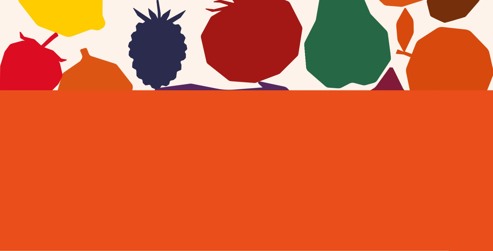

# Fidelity Report: orchard-page-transition

- **Kind / Level:** `ui` / `atom`
- **Composes:** tidak ada
- **Reference Source:** `fnb-bakery/agrumea-farm` (`http://localhost:3041/en/produzione`)
- **Live Extract Preview:** `http://localhost:3045/preview/ui/orchard-page-transition`

## Hasil pengukuran (`npm run fidelity`)

| Viewport | Elemen | FAIL | WARN |
| --- | ---: | ---: | ---: |
| 1920x980 | 3 | **0** | 3 |
| 1024x768 | 3 | **0** | 3 |

## Screenshot berdampingan

| Viewport | Asli | Ekstrak |
| --- | --- | --- |
| 1920x980 |  |  |
| 1024x768 |  |  |

## Beda yang disengaja (WARN)

- `fontRendered` (6x): Font berbayar (ivystyle-sans, ivymode) diganti font gratis Outfit / Italiana.

## Catatan

- Keadaan ukur: akhir fase `covering` (panel menutupi viewport, garis di dasar). Di web asli fase ini disimulasikan dengan menambahkan kelas `is-covering` pada `.page-transition` lalu menunggu 1,3 detik, karena transisi sungguhan langsung berpindah halaman; di preview tombol "Cover" memicu fase yang sama.
- Fase `lifting` memakai animasi yang sama arah sebaliknya dan tidak diukur terpisah. Durasi animasi diambil dari kelas (`--page-cover-duration` 0,9 detik, `--page-lift-duration` 975 ms); dengan `prefers-reduced-motion` durasi dipangkas menjadi 0,01 ms.
