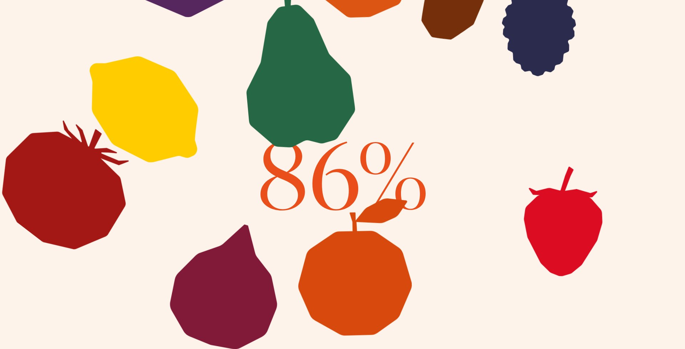
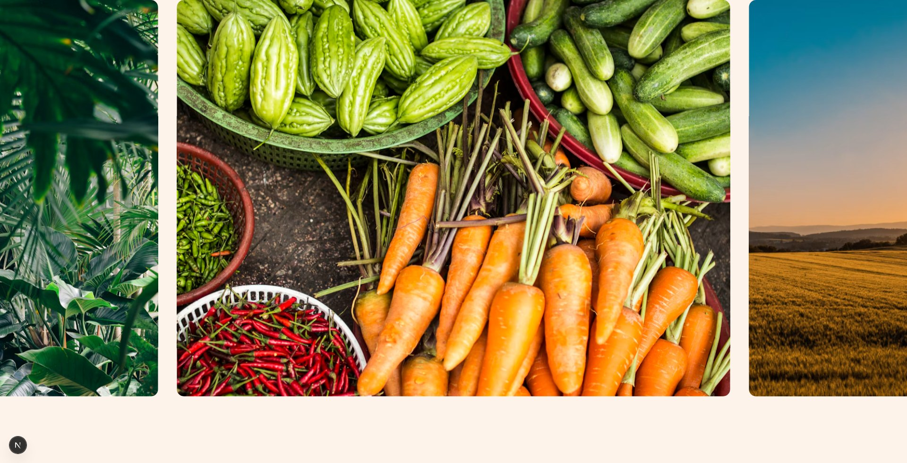
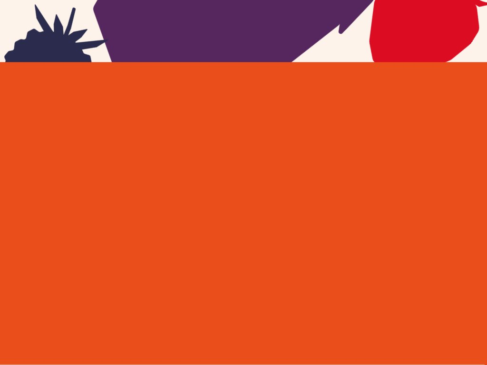
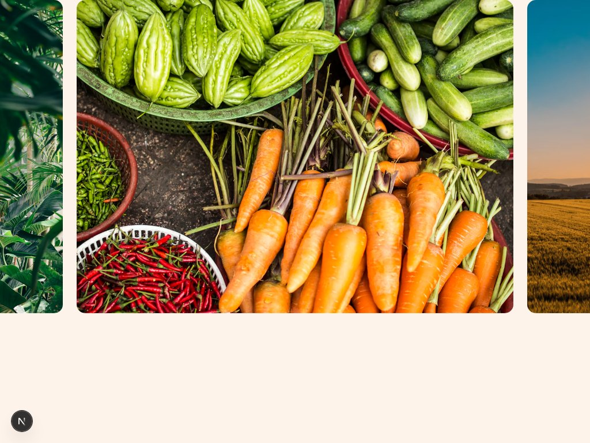

# Fidelity Report: orchard-photo-drag-slider

- **Kind / Level:** `section` / `organism`
- **Composes:** tidak ada
- **Reference Source:** `fnb-bakery/agrumea-farm` (`http://localhost:3041/en/produzione`)
- **Live Extract Preview:** `http://localhost:3045/preview/section/orchard-photo-drag-slider`

## Hasil pengukuran (`npm run fidelity`)

| Viewport | Elemen | FAIL | WARN |
| --- | ---: | ---: | ---: |
| 1920x980 | 4 | **0** | 5 |
| 1024x768 | 4 | **0** | 5 |

## Screenshot berdampingan

| Viewport | Asli | Ekstrak |
| --- | --- | --- |
| 1920x980 |  |  |
| 1024x768 |  |  |

## Beda yang disengaja (WARN)

- `fontRendered` (8x): Font berbayar (ivystyle-sans, ivymode) diganti font gratis Outfit / Italiana.
- `text` (2x): Copy putih-label (white-label): teks asli diganti teks contoh netral tanpa merek.

## Catatan

- Yang diukur: pembungkus, track, slide pertama (di tengah) dan gambar slide pertama. Slide lain bergantung pada jumlah foto dan posisi seret, jadi tidak dibandingkan.
- Label kursor "Drag" milik shell asli dijadikan prop `onCursorLabel` (opsional); tanpa itu slider tetap bekerja penuh.
- Teks bantu tersembunyi (`hint`) dan label galeri menjadi prop.
