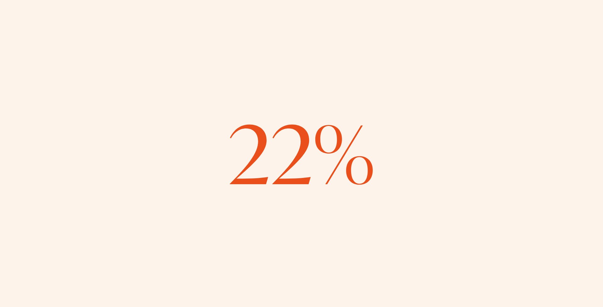
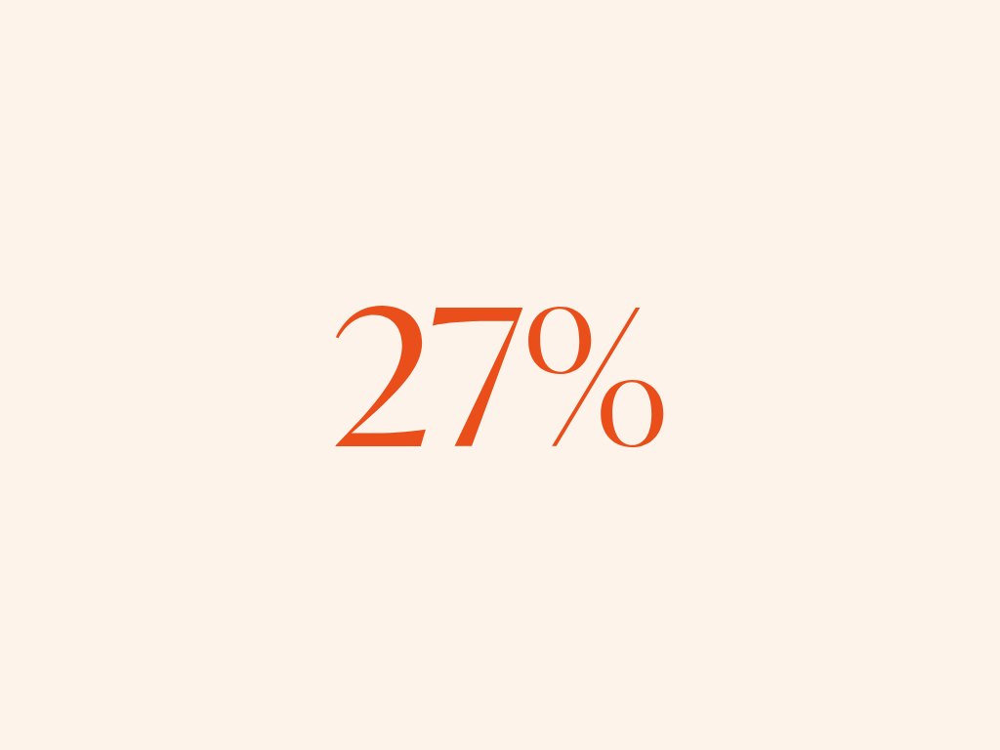

# Fidelity Report: orchard-product-detail-demo-page

- **Kind / Level:** `page` / `page`
- **Composes:** `templates/orchard-editorial-template`, `sections/orchard-top-header`, `sections/orchard-product-detail-hero`, `sections/orchard-rhombus-intro`, `sections/orchard-product-meta-band`, `sections/orchard-photo-drag-slider`, `sections/orchard-related-products-rail`, `sections/orchard-editorial-footer`
- **Reference Source:** `fnb-bakery/agrumea-farm` (`http://localhost:3041/en/dispensa/smeralda`)
- **Live Extract Preview:** `http://localhost:3045/preview/page/orchard-product-detail-demo-page`

## Hasil pengukuran (`npm run fidelity`)

| Viewport | Elemen | FAIL | WARN |
| --- | ---: | ---: | ---: |
| 1920x980 | 6 | **0** | 11 |
| 1024x768 | 6 | **0** | 11 |

## Screenshot berdampingan

| Viewport | Asli | Ekstrak |
| --- | --- | --- |
| 1920x980 |  |  |
| 1024x768 |  |  |

## Beda yang disengaja (WARN)

- `fontRendered` (12x): Font berbayar (ivystyle-sans, ivymode) diganti font gratis Outfit / Italiana.
- `text` (10x): Copy putih-label (white-label): teks asli diganti teks contoh netral tanpa merek.

## Catatan

Verifikasi 2 langkah halaman:

1. **Langkah 1 (perakitan, data asli):** `demo-data.ts` sementara berisi copy asli halaman web (judul, paragraf, tabel, nama produk). Wilayah halaman (hero, intro, setiap section, galeri, nav, footer) diukur pada `original-*.json` vs `extract-*.json`: **0 FAIL** di 1920x980 dan 1024x768. Ukuran asli diambil sebelum animasi `text-reveal` shell (DOM polos, tunggu 0,9 detik), sehingga `line-height` paragraf intro pada halaman ini dipaksa 1,3 lewat `styles.module.css` halaman (komponen `orchard-rhombus-intro` sendiri tetap memakai nilai hasil ukur sesudah reveal); elemen `header` tidak diukur karena masih tersembunyi saat itu (header sudah dibuktikan pada `orchard-editorial-demo-page`).
2. **Langkah 2 (data netral):** `demo-data.ts` diganti merek fiktif `HOLLOW Orchard`, alamat `example`, email `hello@example.com`, dan nama tempat/varietas fiktif dengan panjang karakter yang disetel. Diukur ulang dengan selector yang sama terhadap `original-*.json` (hasil di folder sementara, bukan bukti): tanpa overflow horizontal (`scrollWidth` sama dengan lebar viewport) dan tanpa teks terpotong (satu-satunya elemen ber-overflow adalah teks bantu `visuallyHidden` milik galeri, yang memang sengaja dipotong).

Karena `demo-data.ts` diganti ke data netral setelah ukur langkah 1, `npm run fidelity:all` memberi WARN "bukti lebih tua dari kode" untuk halaman ini. Itu disengaja: bukti JSON adalah bukti perakitan dengan data asli, dan JSON tidak disunting.

- Jeda atas intro memakai `calc(12.5rem + 15vh)` (12.5rem di bawah 1024px, 6.25rem di bawah 480px) lewat kelas di halaman.
