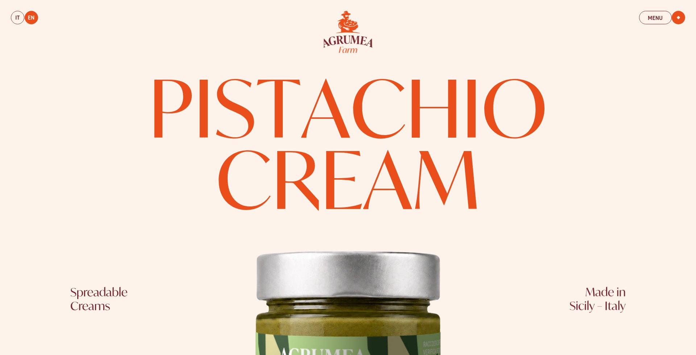
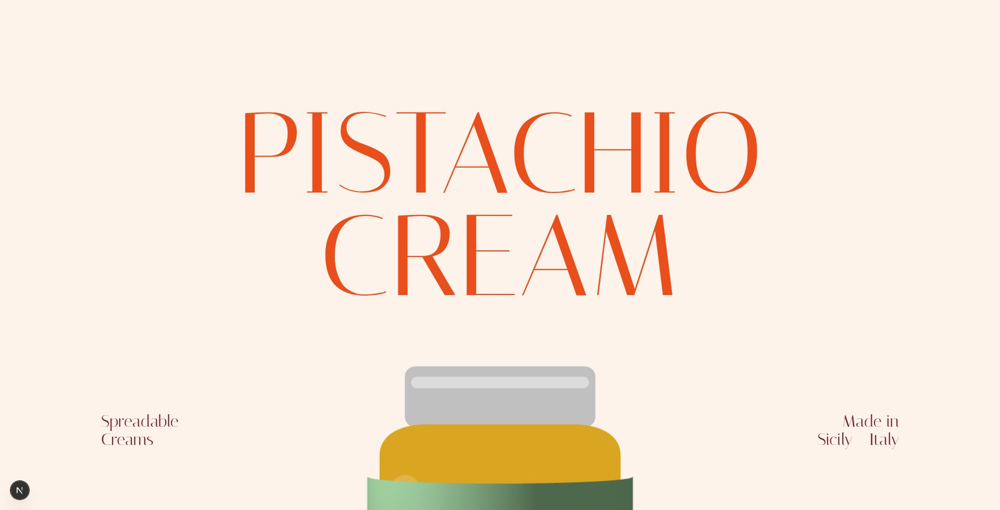
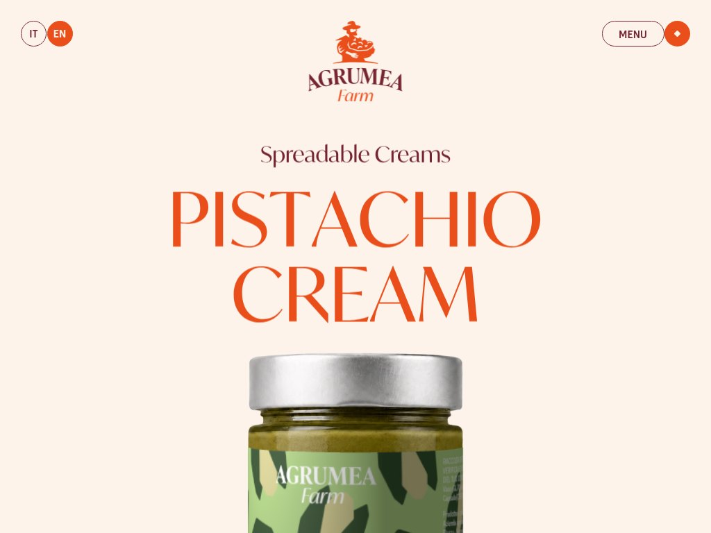
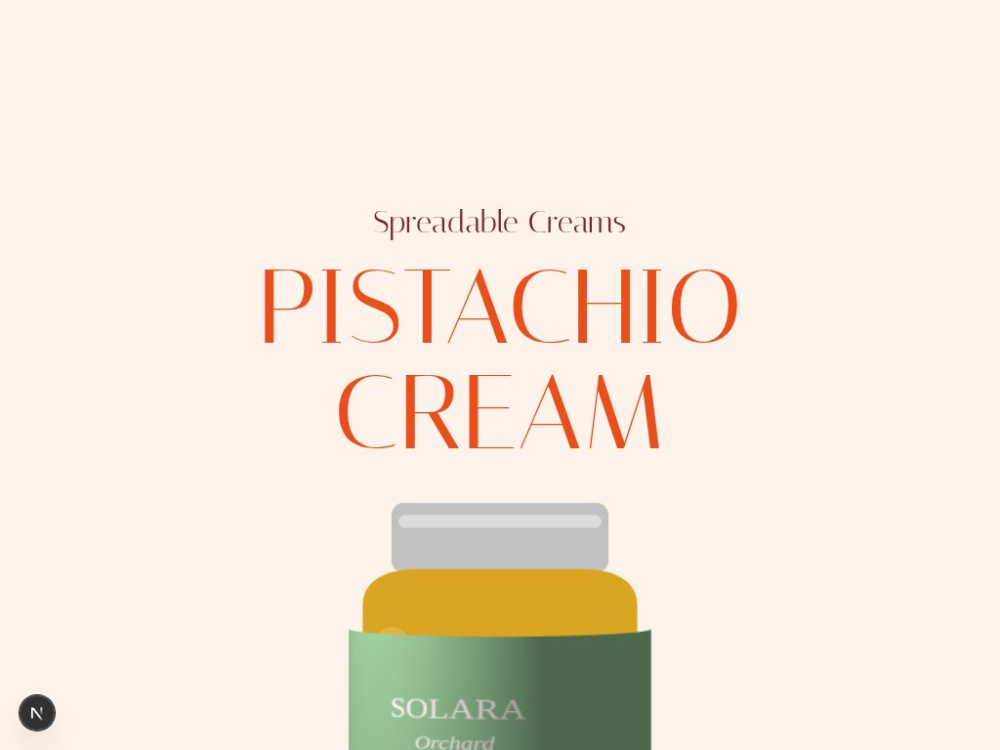

# Fidelity Report: orchard-product-detail-hero

- **Kind / Level:** `section` / `organism`
- **Composes:** `ui/orchard-spinning-jar`
- **Reference Source:** `fnb-bakery/agrumea-farm` (`http://localhost:3041/en/dispensa/smeralda`)
- **Live Extract Preview:** `http://localhost:3045/preview/section/orchard-product-detail-hero`

## Hasil pengukuran (`npm run fidelity`)

| Viewport | Elemen | FAIL | WARN |
| --- | ---: | ---: | ---: |
| 1920x980 | 6 | **0** | 9 |
| 1024x768 | 6 | **0** | 9 |

## Screenshot berdampingan

| Viewport | Asli | Ekstrak |
| --- | --- | --- |
| 1920x980 |  |  |
| 1024x768 |  |  |

## Beda yang disengaja (WARN)

- `fontRendered` (12x): Font berbayar (ivystyle-sans, ivymode) diganti font gratis Outfit / Italiana.
- `text` (6x): Copy putih-label (white-label): teks asli diganti teks contoh netral tanpa merek.

## Catatan

- Keadaan ukur: scroll 0, setelah animasi `text-reveal` selesai (tunggu 7,5 detik) agar judul sudah terlihat. Baris meta kiri/kanan tidak diukur karena teksnya disembunyikan sampai animasi reveal berjalan dan sesudahnya dibungkus elemen yang lebih tinggi.
- Algoritma tata letak aslinya (judul jatuh di belakang toples, batas atas aman header, `--ph-title-fit` untuk judul panjang) dan ScrollTrigger scrub 40% tinggi viewport dipertahankan; toples memakai `ui/orchard-spinning-jar` (three.js).
- `prefers-reduced-motion`: ScrollTrigger dan tata letak dinamis tidak dipasang, hero tetap setinggi viewport dengan judul di posisi awal. Tidak ada elemen yang menutup preview.
- Tinggi aman header memakai variabel `--header-safe-top` (default 146,2px dari variabel header asli).
