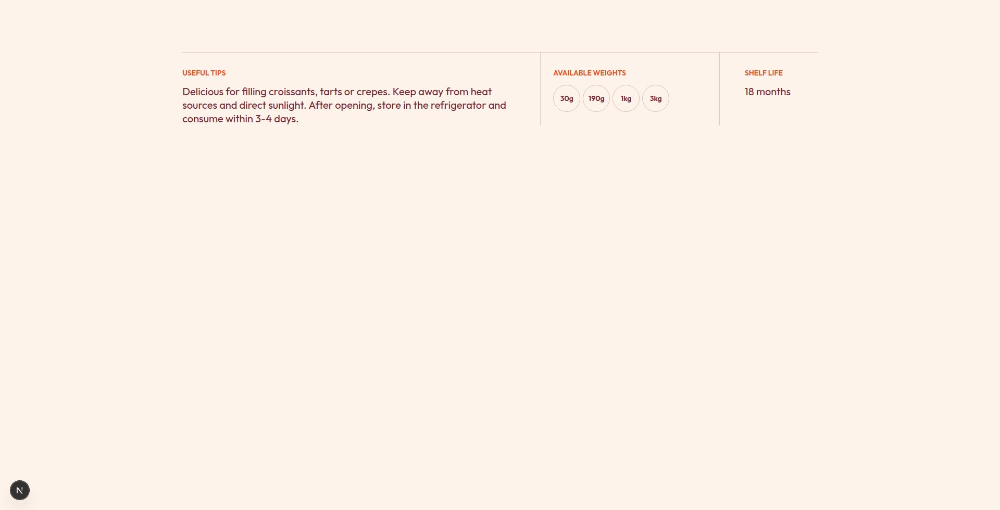
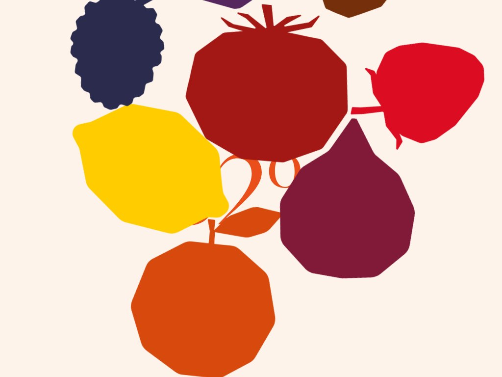
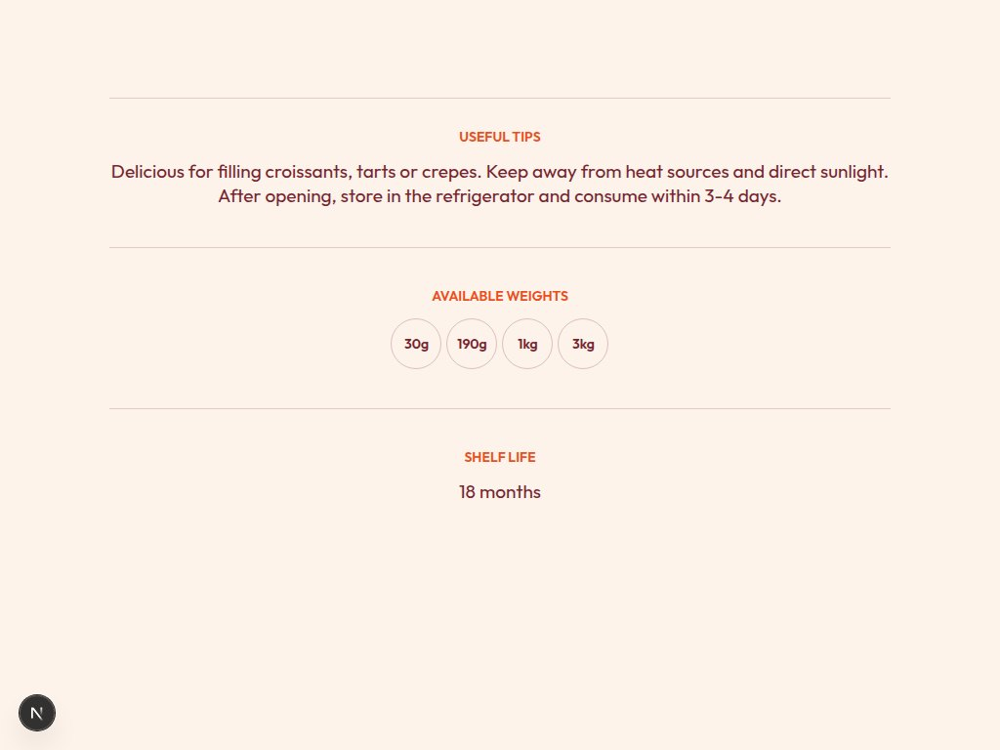

# Fidelity Report: orchard-product-meta-band

- **Kind / Level:** `section` / `organism`
- **Composes:** tidak ada
- **Reference Source:** `fnb-bakery/agrumea-farm` (`http://localhost:3041/en/dispensa/smeralda`)
- **Live Extract Preview:** `http://localhost:3045/preview/section/orchard-product-meta-band`

## Hasil pengukuran (`npm run fidelity`)

| Viewport | Elemen | FAIL | WARN |
| --- | ---: | ---: | ---: |
| 1920x980 | 6 | **0** | 11 |
| 1024x768 | 6 | **0** | 11 |

## Screenshot berdampingan

| Viewport | Asli | Ekstrak |
| --- | --- | --- |
| 1920x980 |  |  |
| 1024x768 |  |  |

## Beda yang disengaja (WARN)

- `fontRendered` (12x): Font berbayar (ivystyle-sans, ivymode) diganti font gratis Outfit / Italiana.
- `text` (10x): Copy putih-label (white-label): teks asli diganti teks contoh netral tanpa merek.

## Catatan

- Animasi `text-reveal` milik shell web asli membungkus baris teks dengan elemen penampung yang sedikit lebih tinggi setelah animasi berjalan, dan menyembunyikan teksnya sebelum itu. Ukuran asli diambil sebelum animasi dimulai (DOM polos, `waitMs` 900 ms), dan elemen teks yang masih tersembunyi (`visible: false`) tidak dimasukkan ke daftar ukur; geometri kolom, garis, dan chip bulat tetap dibandingkan.
