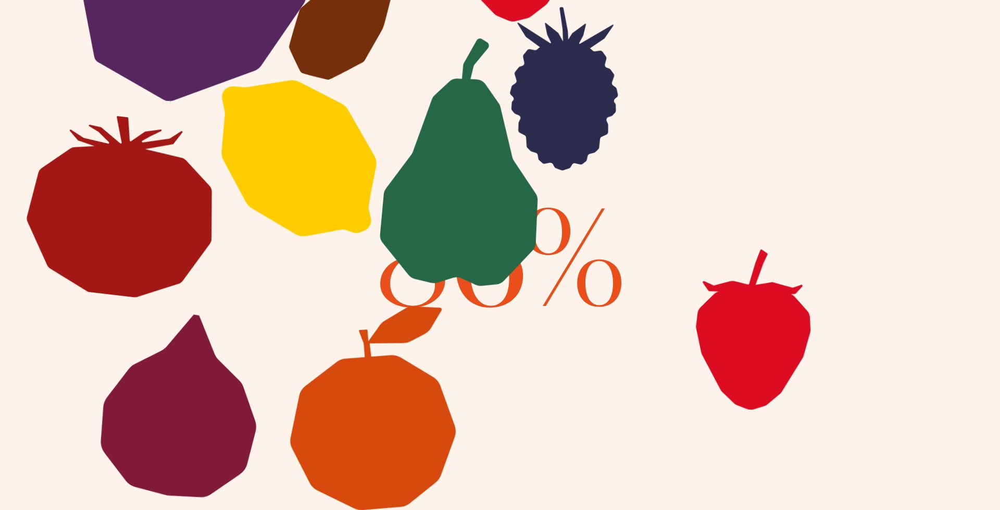
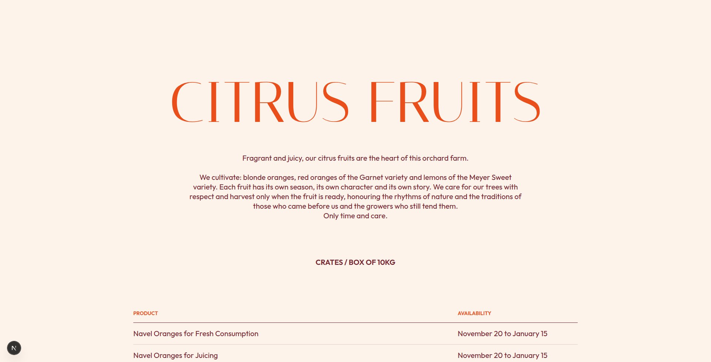
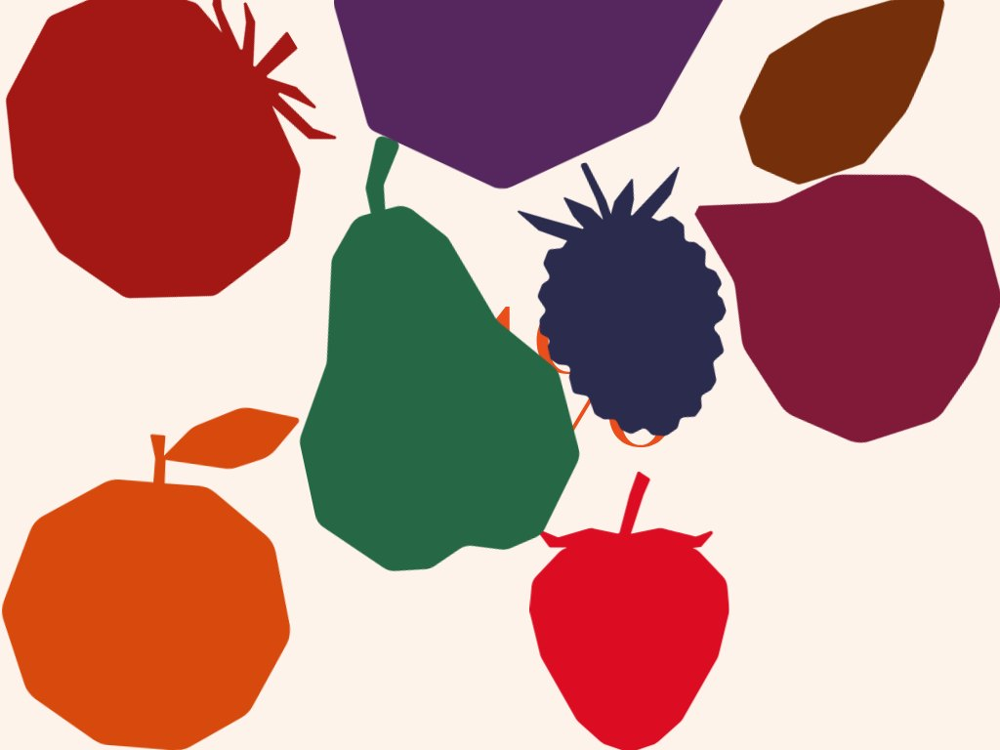
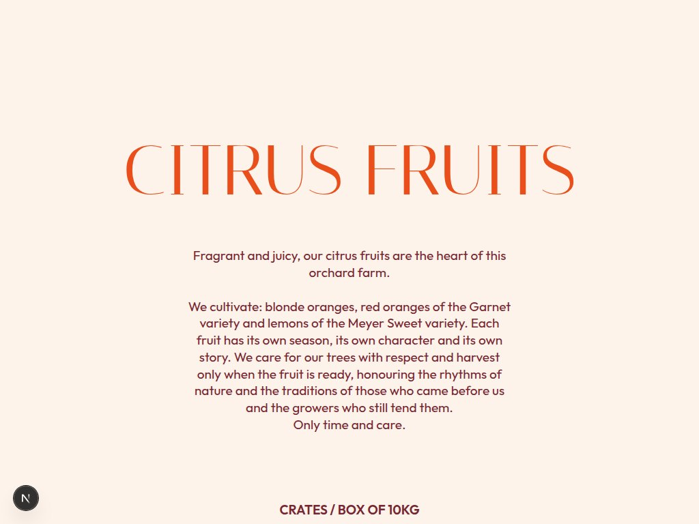

# Fidelity Report: orchard-production-ledger

- **Kind / Level:** `section` / `organism`
- **Composes:** tidak ada
- **Reference Source:** `fnb-bakery/agrumea-farm` (`http://localhost:3041/en/produzione`)
- **Live Extract Preview:** `http://localhost:3045/preview/section/orchard-production-ledger`

## Hasil pengukuran (`npm run fidelity`)

| Viewport | Elemen | FAIL | WARN |
| --- | ---: | ---: | ---: |
| 1920x980 | 5 | **0** | 8 |
| 1024x768 | 5 | **0** | 8 |

## Screenshot berdampingan

| Viewport | Asli | Ekstrak |
| --- | --- | --- |
| 1920x980 |  |  |
| 1024x768 |  |  |

## Beda yang disengaja (WARN)

- `fontRendered` (10x): Font berbayar (ivystyle-sans, ivymode) diganti font gratis Outfit / Italiana.
- `text` (6x): Copy putih-label (white-label): teks asli diganti teks contoh netral tanpa merek.

## Catatan

- Sama seperti `orchard-product-meta-band`: ukuran asli diambil sebelum animasi `text-reveal` shell (DOM polos). Judul dan sub-judul yang masih tersembunyi saat itu tidak dimasukkan ke daftar ukur; tinggi judul terbukti identik lewat posisi `y` teks dan tabel di bawahnya.
- Judul satu baris (`singleLineTitle`) mengecilkan font sampai muat 99% lebar kontainer, sama seperti aslinya.
- Tanda pisah rentang tanggal asli (em dash) diganti kata "to" karena aturan antislop lint melarang em dash di file registry.
