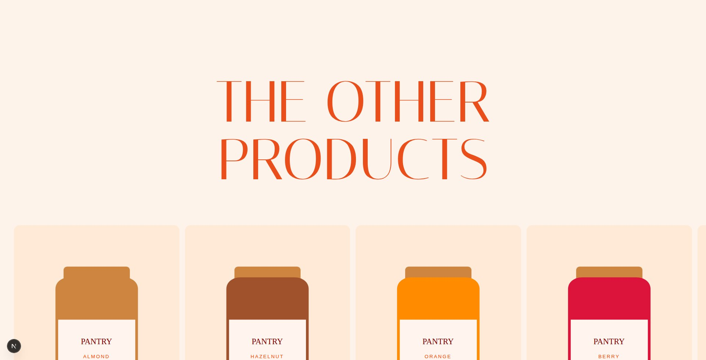
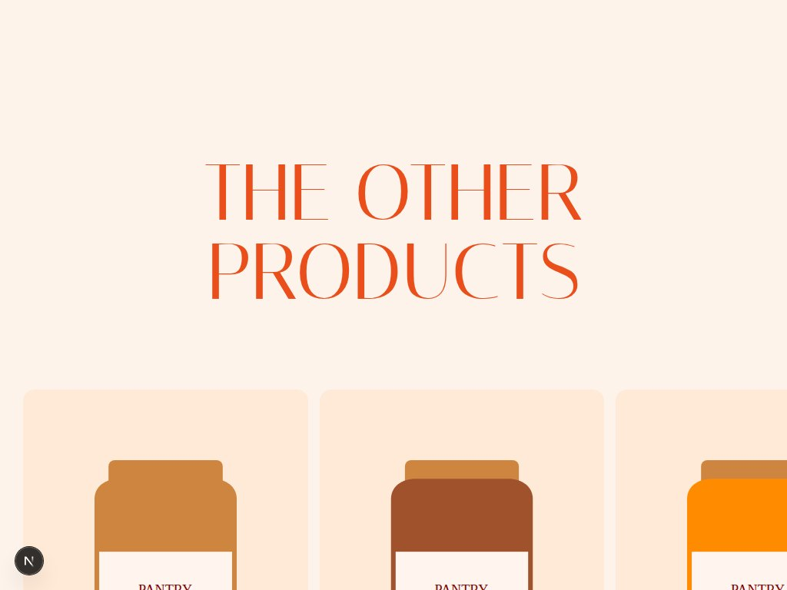

# Fidelity Report: orchard-related-products-rail

- **Kind / Level:** `section` / `organism`
- **Composes:** `ui/orchard-jar-slide-card`
- **Reference Source:** `fnb-bakery/agrumea-farm` (`http://localhost:3041/en/dispensa/smeralda`)
- **Live Extract Preview:** `http://localhost:3045/preview/section/orchard-related-products-rail`

## Hasil pengukuran (`npm run fidelity`)

| Viewport | Elemen | FAIL | WARN |
| --- | ---: | ---: | ---: |
| 1920x980 | 5 | **0** | 7 |
| 1024x768 | 5 | **0** | 7 |

## Screenshot berdampingan

| Viewport | Asli | Ekstrak |
| --- | --- | --- |
| 1920x980 |  |  |
| 1024x768 |  |  |

## Beda yang disengaja (WARN)

- `fontRendered` (10x): Font berbayar (ivystyle-sans, ivymode) diganti font gratis Outfit / Italiana.
- `text` (4x): Copy putih-label (white-label): teks asli diganti teks contoh netral tanpa merek.

## Catatan

- Judul dikeluarkan dari daftar ukur karena pada 1024px teksnya masih tersembunyi oleh animasi reveal shell saat diukur; tingginya terbukti lewat tinggi `section`, posisi `slider`, dan lebar kartu.
- Rel menyalin mesin seret dan lempar dari `orchard-product-showcase` ke folder ini (helper lokal `rail.tsx`), karena komponen tidak boleh mengimpor file helper komponen lain.
