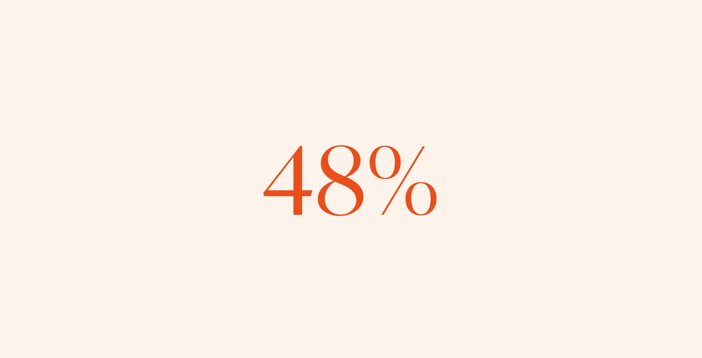
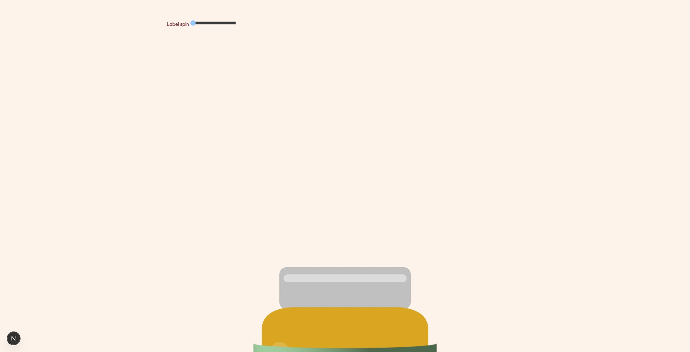
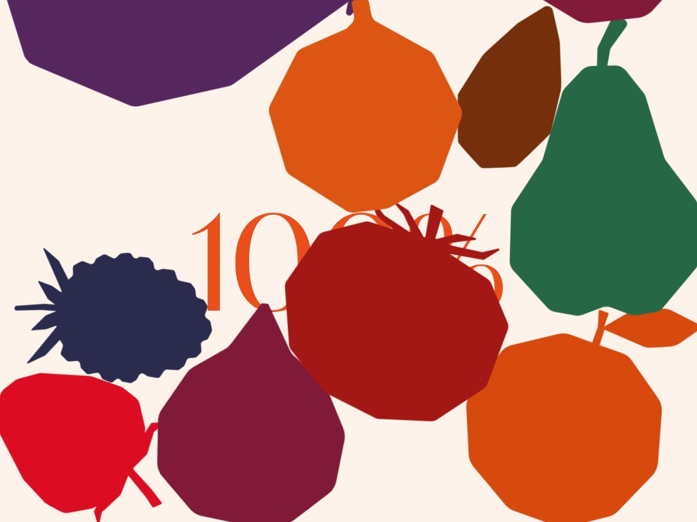
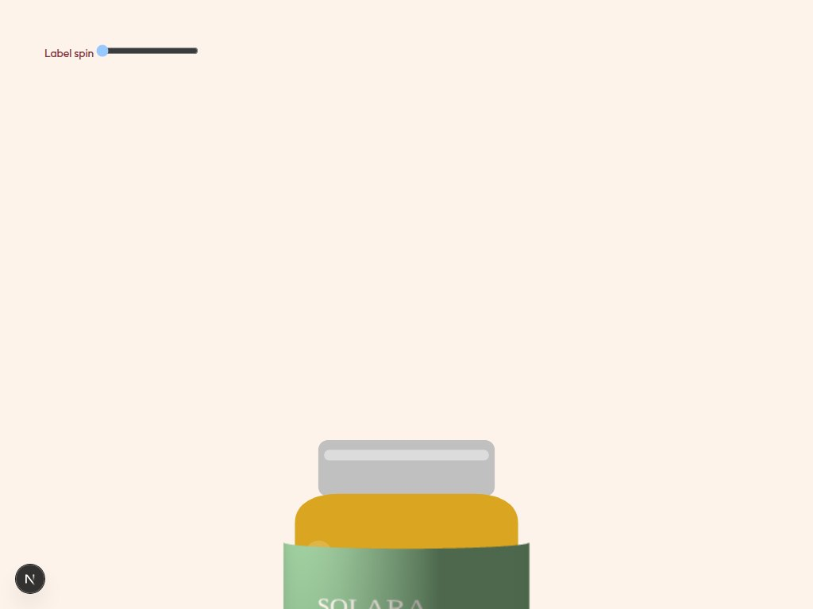

# Fidelity Report: orchard-spinning-jar

- **Kind / Level:** `ui` / `molecule`
- **Composes:** tidak ada
- **Reference Source:** `fnb-bakery/agrumea-farm` (`http://localhost:3041/en/dispensa/smeralda`)
- **Live Extract Preview:** `http://localhost:3045/preview/ui/orchard-spinning-jar`

## Hasil pengukuran (`npm run fidelity`)

| Viewport | Elemen | FAIL | WARN |
| --- | ---: | ---: | ---: |
| 1920x980 | 3 | **0** | 6 |
| 1024x768 | 3 | **0** | 6 |

## Screenshot berdampingan

| Viewport | Asli | Ekstrak |
| --- | --- | --- |
| 1920x980 |  |  |
| 1024x768 |  |  |

## Beda yang disengaja (WARN)

- `y` (6x): Posisi vertikal dalam toleransi.
- `fontRendered` (6x): Font berbayar (ivystyle-sans, ivymode) diganti font gratis Outfit / Italiana.

## Catatan

- Keadaan ukur: hero produk asli pada scroll 0 (`--ph` = 0), toples tampil dengan `scale(1.25)` dan menyembul dari dasar layar. Preview memberi pose yang sama lewat `style` (bottom, translate, scale 1.25) sehingga `jar`, `base`, dan `label` (canvas) sama persis di 1920 dan 1024.
- Engine asli dipertahankan: three.js `LatheGeometry` + shader `onBeforeCompile` yang membungkus label dengan celah 9%, lampu `SpotLight`, kamera ortografik, hasil render disalin ke canvas 2D. Label berputar mengikuti nilai `spin` 0 sampai 1.
- Keamanan: bila WebGL tidak tersedia, `createJarLabel` mengembalikan null dan komponen menampilkan gambar label datar sebagai fallback; `prefers-reduced-motion` tidak mengubah apa pun karena putaran hanya terjadi bila pemanggil mengubah `spin`. Ukuran jelas: lebar lewat `--jar-w` (default `clamp(380px, 24vw)`, `clamp(250px, 40vh, 280px)` di bawah 1024px) dengan rasio 630:1013.
- Render WebGL di Brave headless memakai perender perangkat lunak; isi piksel canvas tidak dibandingkan, hanya kotaknya.
