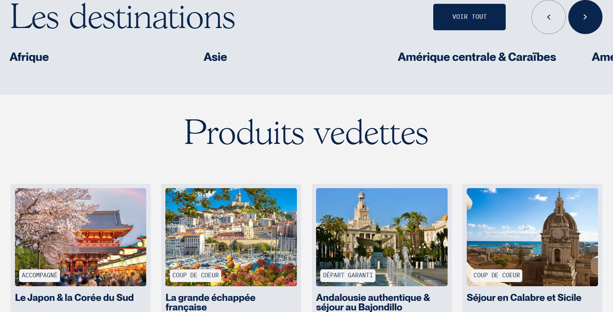
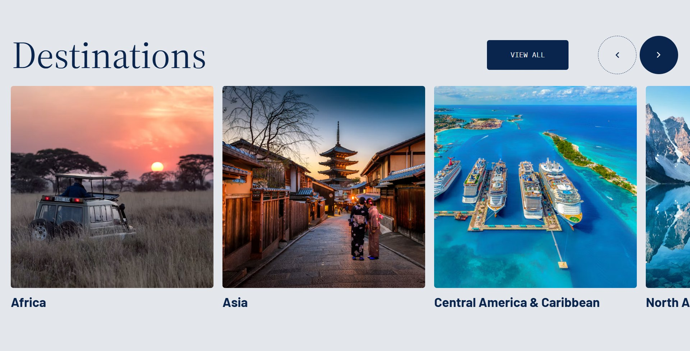
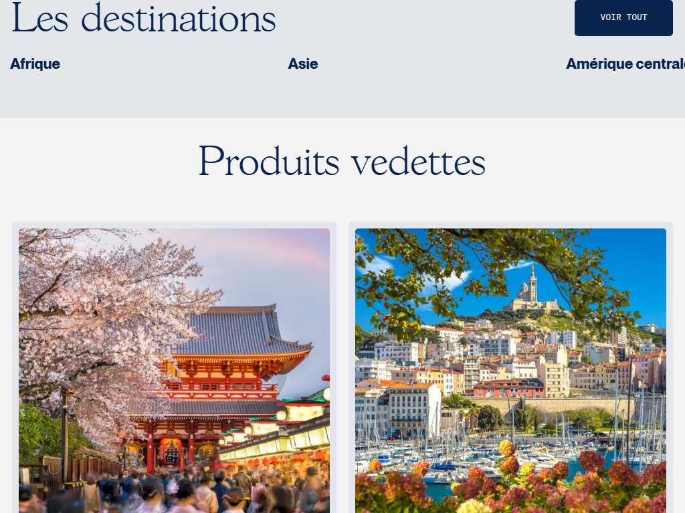
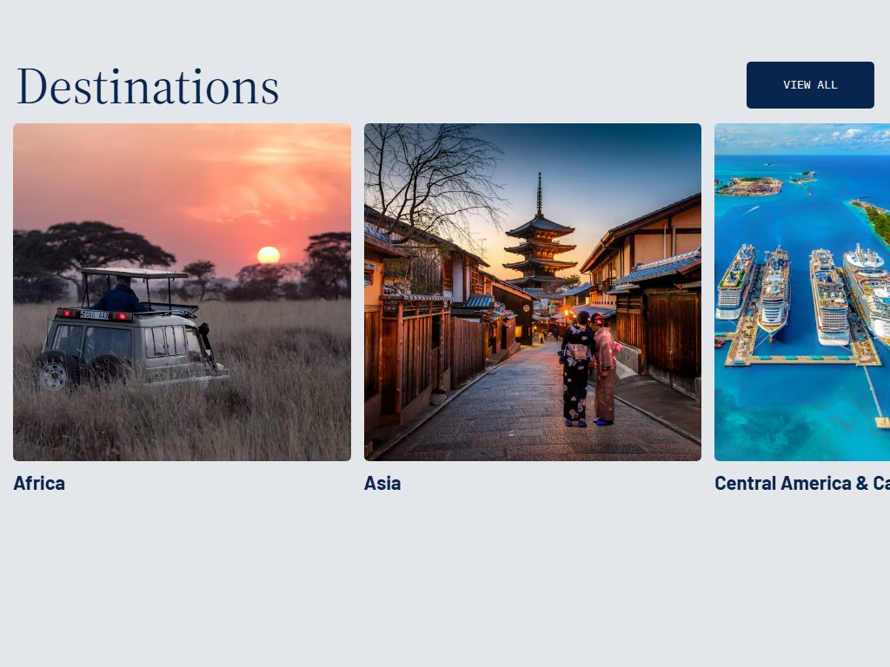

# Fidelity Report: parallax-destination-carousel

Sumber: `travel-services/tours-chanteclerc-nextjs` (`.blue-bg .carrousel` pada `localhost:3001/`)
Ekstrak: `registry/sections/parallax-destination-carousel` (`http://localhost:3005/preview/section/parallax-destination-carousel?style=azure-editorial`)
Keadaan: carousel horizontal dengan kontrol `prevBtn` / `nextBtn` / `viewAllBtn` dan kartu destinasi `aspect-ratio: 1` pada `1920x980` dan `1024x768`.

## Hasil `npm run fidelity:all`

- 1920x980: 6 elemen (`topBar`, `title`, `viewAllBtn`, `prevBtn`, `nextBtn`, `firstSlideTitle`), **0 FAIL**, 15 WARN
- 1024x768: 6 elemen (`topBar`, `title`, `viewAllBtn`, `prevBtn`, `nextBtn`, `firstSlideTitle`), **0 FAIL**, 13 WARN

## Screenshot berdampingan

| Viewport | Asli | Ekstrak |
| --- | --- | --- |
| 1920x980 |  |  |
| 1024x768 |  |  |

## Beda yang disengaja (WARN)

- **Font display & body**: `Gascogne` -> `Source Serif 4` (`--rk-font-display`), `PP Neue Montreal` -> `Barlow` (`--rk-font-body`).
- **Teks & gambar slide**: judul "Destinations", CTA "VIEW ALL", dan kartu regional diganti dataset fiktif berbahasa Inggris (`North America`, `Central America & Caribbean`, `South America`, `Asia`, `Africa`, `Pacific`).
- **Composes UI**: tombol aksi dan panah slider memanggil atom `rolling-cta-button`.

## Catatan investigasi

- Pada target asli `tours-chanteclerc-nextjs`, elemen `.tc-horizontal-parallax` sempat mengalami tinggi 0px akibat aturan `.product-card` vs `.carrousel__slide`. Ekstrak mengunci `aspect-ratio: 1` sesuai aturan tema `tours-chanteclerc.css` sehingga setiap slide merender proporsional di `1920x980` dan `1024x768`.
