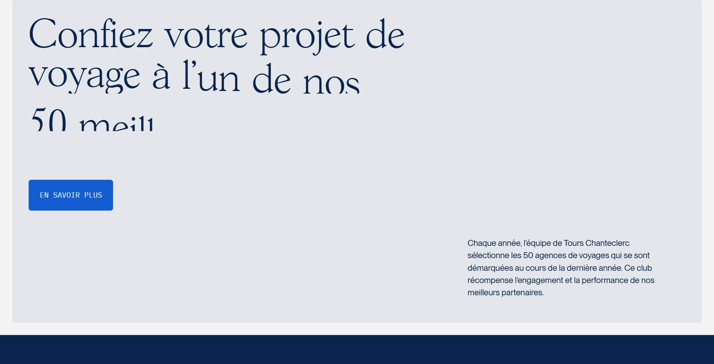
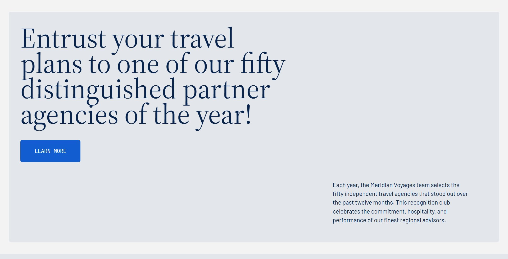
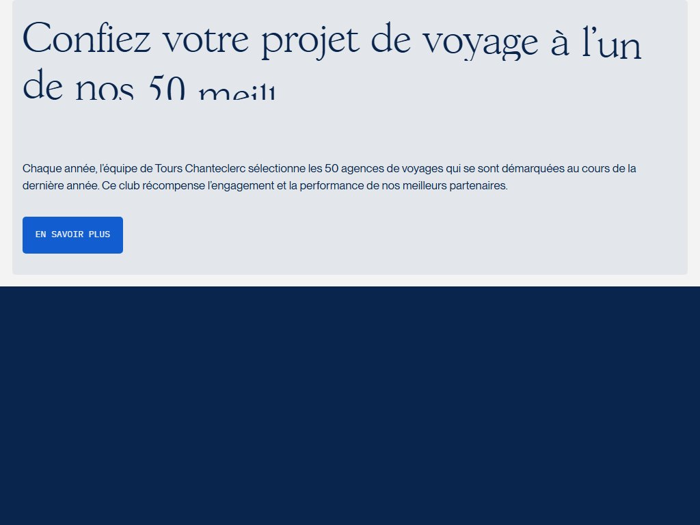
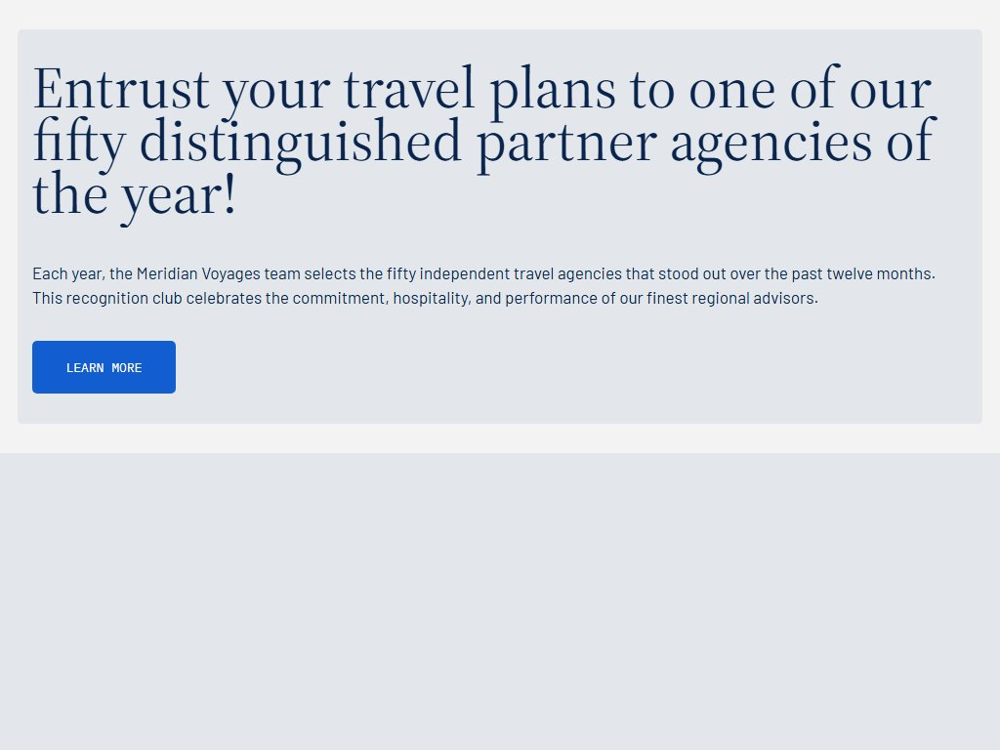

# Fidelity Report: partner-cta-banner

Sumber: `travel-services/tours-chanteclerc-nextjs` (`.textBanner` grid asimetris 2 kolom pada `localhost:3001/`)
Ekstrak: `registry/sections/partner-cta-banner` (`http://localhost:3005/preview/section/partner-cta-banner?style=azure-editorial`)
Keadaan: panel slate-blue beradius dengan judul serif 4 baris di kiri atas, tombol `LEARN MORE`, dan paragraf deskripsi di kanan bawah pada `1920x980` dan `1024x768`.

## Hasil `npm run fidelity:all`

- 1920x980: 5 elemen (`section`, `inner`, `title`, `cta`, `body`), **0 FAIL**, 17 WARN
- 1024x768: 5 elemen (`section`, `inner`, `title`, `cta`, `body`), **0 FAIL**, 16 WARN

## Screenshot berdampingan

| Viewport | Asli | Ekstrak |
| --- | --- | --- |
| 1920x980 |  |  |
| 1024x768 |  |  |

## Beda yang disengaja (WARN)

- **Font display & body**: `Gascogne` -> `Source Serif 4` (`--rk-font-display`), `PP Neue Montreal` -> `Barlow` (`--rk-font-body`).
- **Copy putih-label**: judul & deskripsi program agen mitra Tours Chanteclerc diganti salinan netral bahasa Inggris.

## Temuan yang diperbaiki lewat workflow ini

- Menghapus negative bottom margin `-0.1em` berlebih pada `.line` (`margin-block: -0.13em 0`) yang sempat mengurangi tinggi `.inner` sebesar `10.7px` (`858.5px` vs asli `869.2px` di `1920x980`) dan `6px` di `1024x768`.
- Bersama perbaikan `overflow: hidden` pada `.inner` milik `rolling-cta-button`, tombol `LEARN MORE` merender tepat satu baris bersih.
