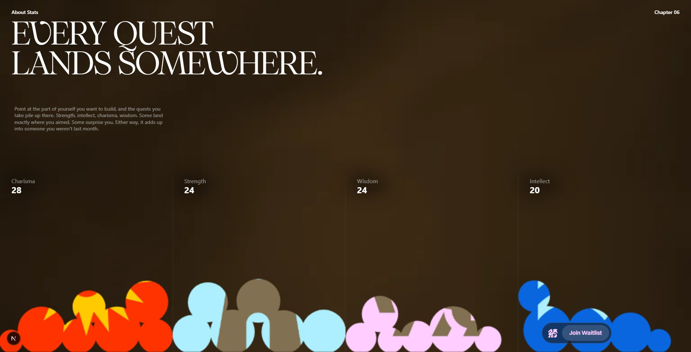
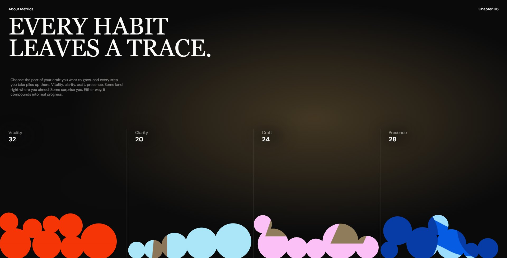
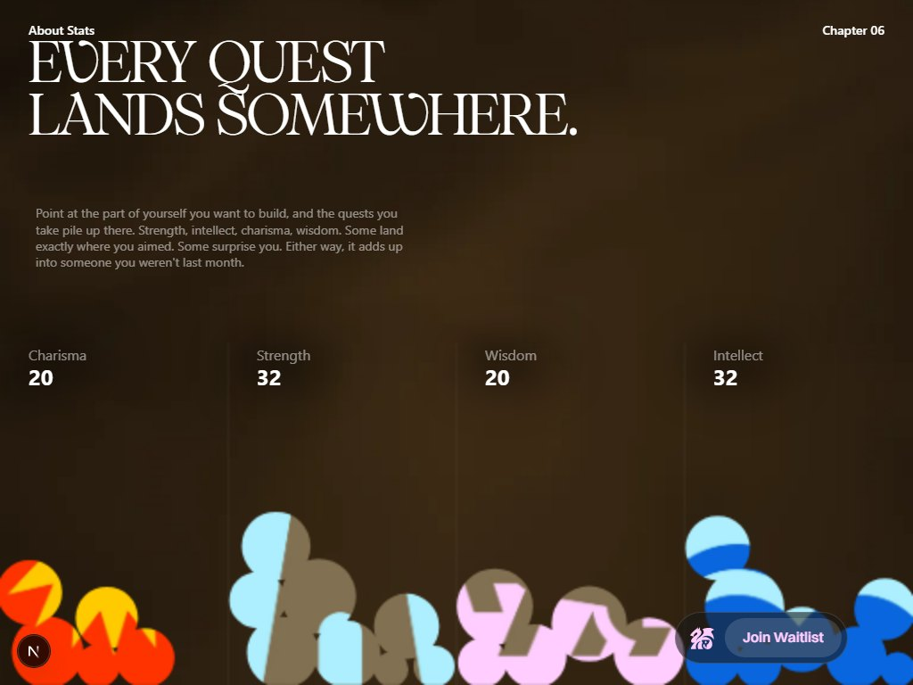
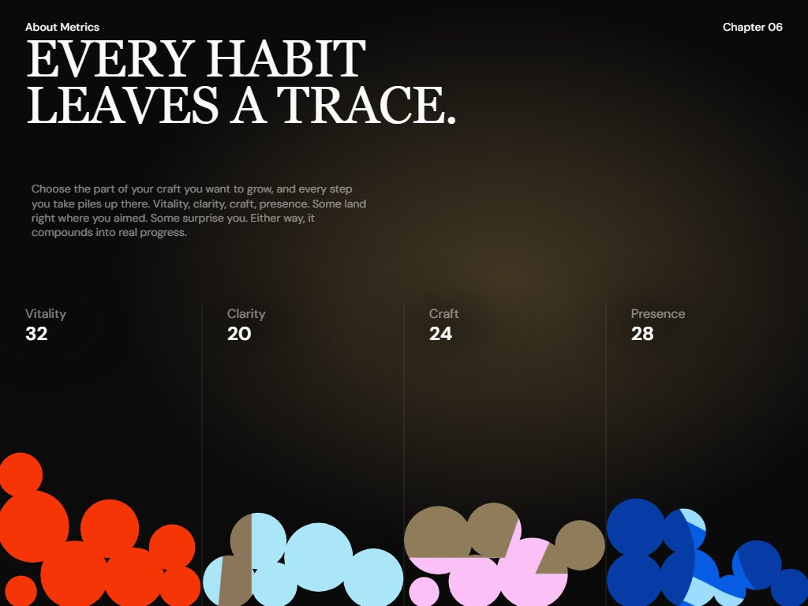

# Fidelity Report: physics-stats-pit

Sumber: `saas-app/grail-next/src/components/home/stats/Stats.tsx` (`http://localhost:3002/?noloader=1`, Chapter 06)
Ekstrak: `registry/sections/physics-stats-pit` (`http://localhost:3000/preview/section/physics-stats-pit`, style `kinetic-obsidian`)
Keadaan: section aktif (`focused` / `.in`), headline & body selesai naik, 4 kolom bola fisika `matter-js` telah menetap, counter kolom terisi.

## Hasil `npm run fidelity`

- `1920x980`: 9 elemen, **0 FAIL**, 45 WARN
- `1024x768`: 9 elemen, **0 FAIL**, 44 WARN

## Screenshot berdampingan

| Viewport | Asli | Ekstrak |
| --- | --- | --- |
| 1920x980 |  |  |
| 1024x768 |  |  |

## Ringkasan Metrik Utama

| Elemen | 1920 Asli (`x, y / w x h / fs / lh`) | 1920 Ekstrak (`x, y / w x h / fs / lh`) | 1024 Asli (`x, y / w x h / fs / lh`) | 1024 Ekstrak (`x, y / w x h / fs / lh`) |
| --- | --- | --- | --- | --- |
| `section` | `0, 0 / 1905 x 980 / 16 / normal` | `0, 0 / 1920 x 980 / 16 / normal` | `0, 0 / 1009 x 768 / 16 / normal` | `0, 0 / 1024 x 768 / 16 / normal` |
| `colontitle` | `32, 25 / 1841 x 18.3 / 14 / 18.3` | `32, 25 / 1856 x 18.3 / 14 / 18.3` | `32, 25 / 945 x 18.3 / 14 / 18.3` | `32, 25 / 960 x 18.3 / 14 / 18.3` |
| `head` | `32, 58.8 / 864.5 x 163.7 / 92 / 81` | `32, 58.8 / 769.9 x 163.7 / 92 / 81` | `32, 46.1 / 615.8 x 116.6 / 65.5 / 57.7` | `32, 46.1 / 548.4 x 116.6 / 65.5 / 57.7` |
| `body` | `40, 294 / 432 x 73.3 / 14 / 18.3` | `40, 294 / 432 x 73.3 / 14 / 18.3` | `40, 230.4 / 432 x 73.3 / 14 / 18.3` | `40, 230.4 / 432 x 73.3 / 14 / 18.3` |
| `labels` | `0, 0 / 1905 x 980` | `0, 0 / 1920 x 980` | `0, 0 / 1009 x 768` | `0, 0 / 1024 x 768` |
| `label1` | `32, 494 / 140 x 47.7` | `32, 494 / 140 x 47.7` | `32, 388 / 140 x 47.7` | `32, 388 / 140 x 47.7` |
| `labelName1` | `32, 494 / 140 x 19.8 / 16 / 19.8` | `32, 494 / 140 x 19.8 / 16 / 19.8` | `32, 388 / 140 x 19.8 / 16 / 19.8` | `32, 388 / 140 x 19.8 / 16 / 19.8` |
| `labelCount1` | `32, 515.8 / 140 x 25.9 / 24 / 25.9` | `32, 515.8 / 140 x 25.9 / 24 / 25.9` | `32, 409.8 / 140 x 25.9 / 24 / 25.9` | `32, 409.8 / 140 x 25.9 / 24 / 25.9` |
| `physicsCanvas` | `0, 0 / 1905 x 980` | `0, 0 / 1920 x 980` | `0, 0 / 1009 x 768` | `0, 0 / 1024 x 768` |

## Beda yang disengaja (WARN)

- **Substitusi font (`PP Pangaia` -> `Georgia`, `Segoe UI` -> `DM Sans`)**: aslinya memakai font komersial `PP Pangaia` dan sistem `-apple-system` (ter-render sebagai `Segoe UI` di Windows). Ekstrak memakai token `--rk-font-display` (`Georgia`) dan `--rk-font-body` (`DM Sans`) dari style `kinetic-obsidian`. Tinggi baris, posisi, dan jumlah baris tetap identik (0.0px deviasi).
- **Pembulatan token warna (`#ffffff` -> `--rk-fg: #fafaf8`, `rgba(255,255,255,0.5)` -> `color-mix(in srgb, var(--rk-fg) 50%, transparent)`)**: komponen memakai 100% token `--rk-*` tanpa hardcoded `#hex`/`rgb()`, dengan delta kanal maksimal 7 (< 24).
- **Teks white-label & counter awal**: teks brand Grail (`About Stats`, `Every quest / lands somewhere.`, `Charisma / Strength / Wisdom / Intellect`) diganti copy netral (`About Metrics`, `Every habit / leaves a trace.`, `Vitality / Clarity / Craft / Presence`) dengan panjang baris terkalibrasi agar `body` tepat 4 baris (`73.3px`) dan `head` tepat 2 baris (`163.7px` di 1920, `116.6px` di 1024).
- **Tekstur pola prosedural & backdrop atmosferik**: aset gambar `/patterns/stats-bg-*.webp` dan WebGL `TotemBackdrop` diganti motif Canvas2D prosedural di `stats-textures.ts` (serta gradien CSS murni untuk grid 2x2 mobile) dan radial glow berlapis di `.backdrop` memakai `--rk-bg` dan `--rk-accent`.
- **Lebar viewport scrollbar**: halaman home asli panjang sehingga lebar konten terukur `1905px` / `1009px` (dikurangi scrollbar 15px), sedangkan preview terisolasi penuh `1920px` / `1024px` (masih di dalam toleransi 2%).

## Pembaruan 2026-11-27: ukur ulang ternormalisasi

`original-*.json` dan `extract-*.json` diukur ulang dengan `scripts/fidelity-capture.ts` (scrollbar disembunyikan di kedua sisi, lebar penuh 1920/1024px). Hasil `npm run fidelity`: 1920x980 9 elemen, **0 FAIL**, 45 WARN; 1024x768 9 elemen, **0 FAIL**, 45 WARN. Catatan "lebar viewport scrollbar 1905/1009px" di atas tidak berlaku lagi: kedua sisi kini diukur 1920/1024px. Tidak ada perubahan CSS.
