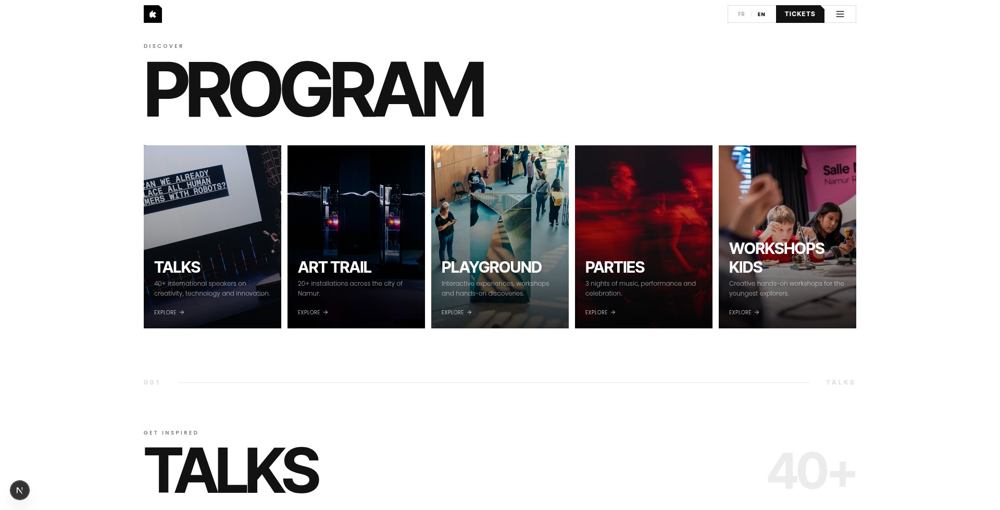
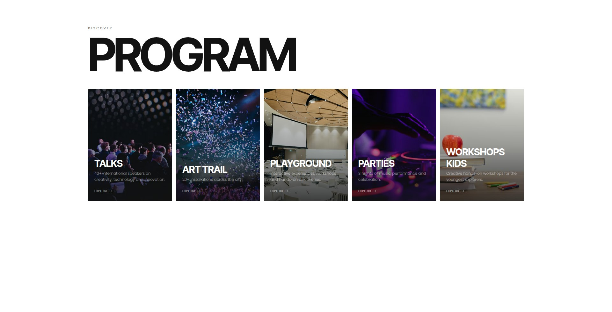
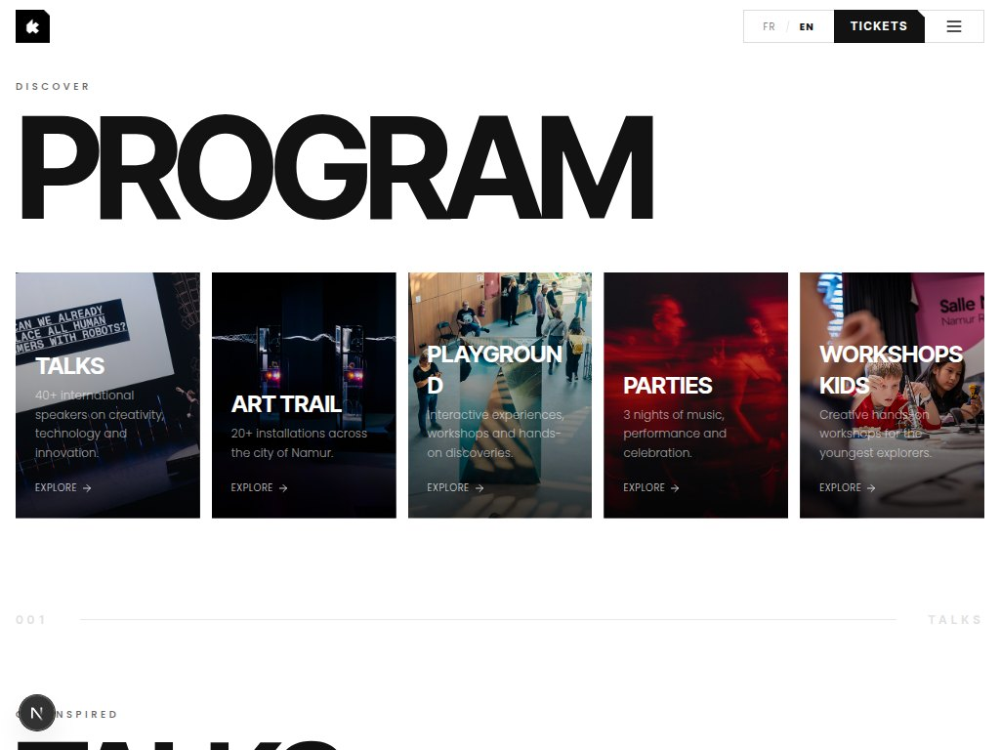
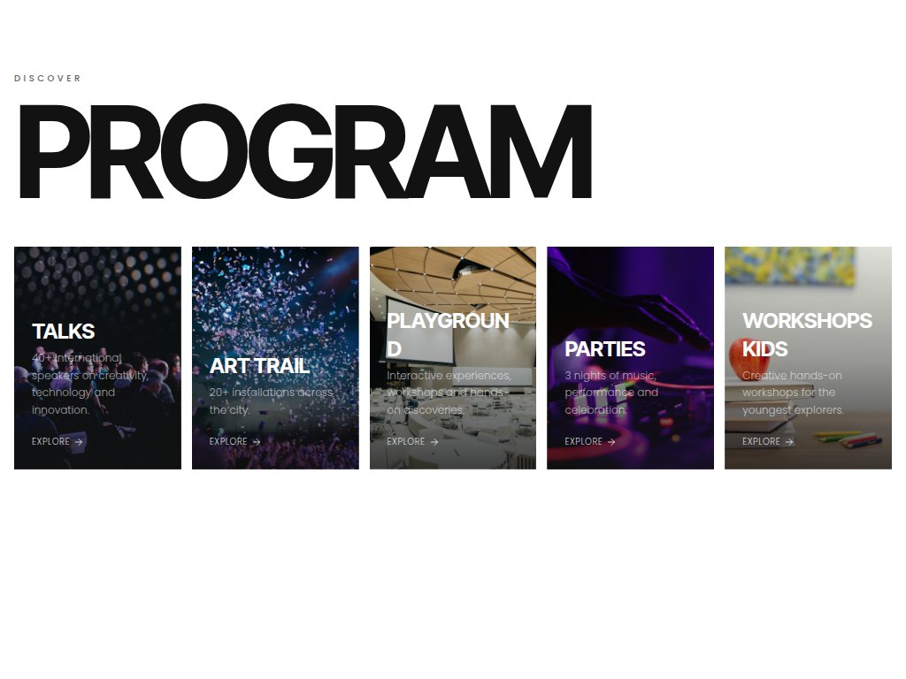
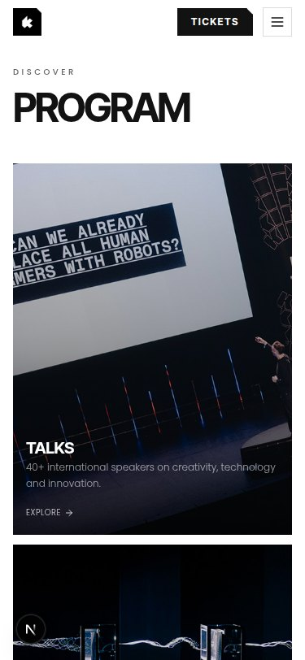
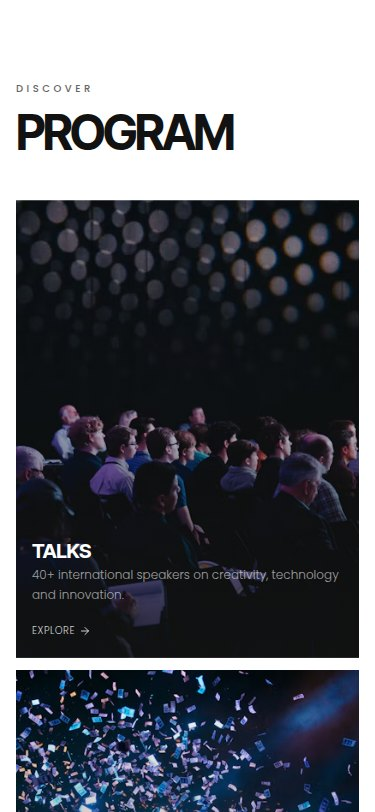

# Fidelity Report: `program-tile-grid`

- **Kind / Level:** `section` / `organism`
- **Source:** `education-event/kikkfestival-be-nextjs` (`src/components/home/ProgramGrid.tsx`, `http://127.0.0.1:3011/`)
- **Extract:** `registry/sections/program-tile-grid` (`http://127.0.0.1:3015/preview/section/program-tile-grid`)
- **Style:** `neon-brutalist` (`css-modules`, 100% `--rk-*` tokens)

## Results (`npm run fidelity`)

- `1920x980`: 8 elements (`section`, `label`, `title`, `grid`, `tile`, `tileTitle`, `tileText`, `cta`), **0 FAIL**, 16 WARN.
- `1024x768`: 8 elements, **0 FAIL**, 16 WARN.
- `375x812`: 8 elements, **0 FAIL**, 16 WARN.

## Side-by-Side Screenshots

| Viewport | Original (`127.0.0.1:3011/`) | Extract (`127.0.0.1:3015/preview/section/program-tile-grid`) |
| --- | --- | --- |
| `1920x980` |  |  |
| `1024x768` |  |  |
| `375x812` |  |  |

## Intentional Differences (WARN)

- **White-label photography & text:** Branded program photos replaced with neutral Unsplash photos while preserving exact 5-up desktop (`>= 1024px`), 2-up tablet (`>= 768px`), and 1-up mobile tile geometry and responsive `line-height` (`19px` / `32px` / `36px`).
- **Zero-width border color:** `0px` computed borders reflect inherited color tokens vs Tailwind global border color.
