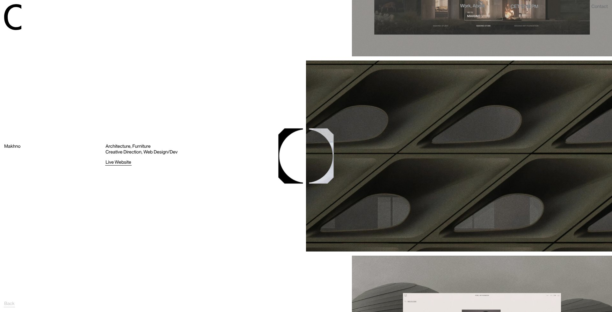
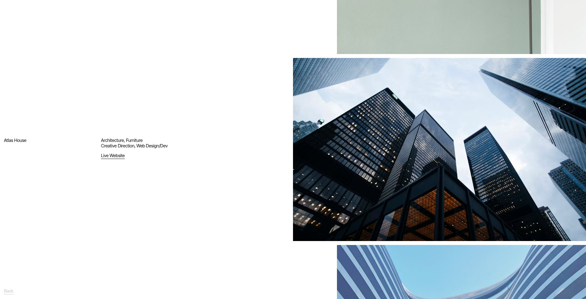
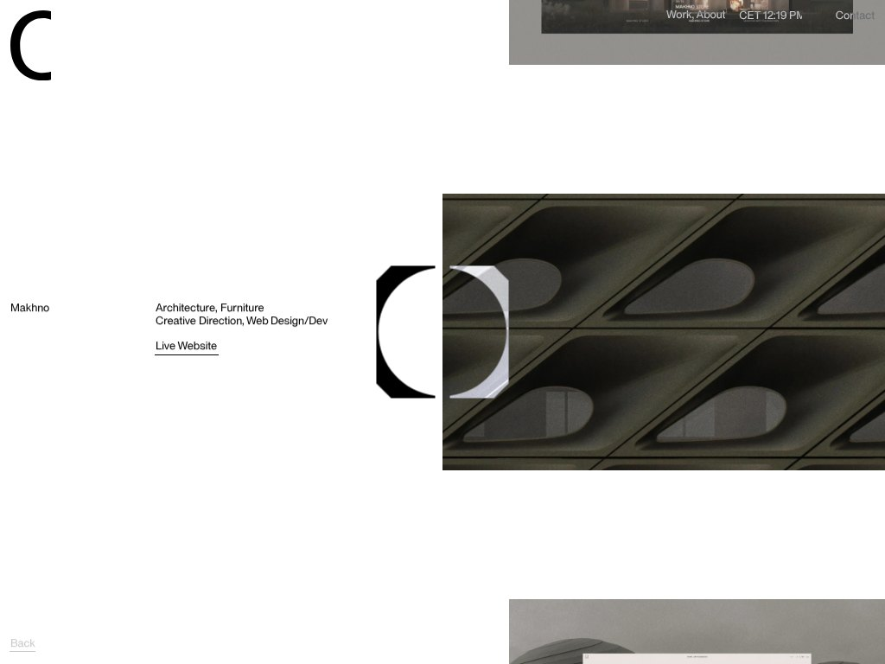
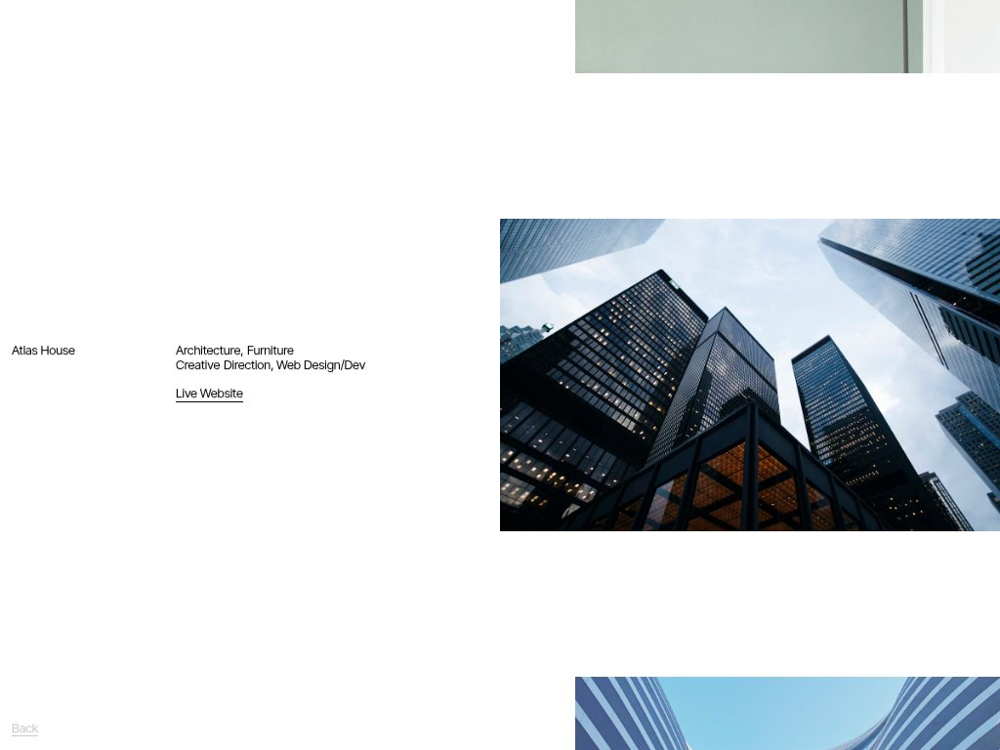

# Fidelity Report: project-wheel-gallery

- **Sumber:** `agency-portfolio/obys-agency-nextjs` (`src/components/work/WorkDetailView.tsx` + `WorkGallery.tsx`, `#wo`, `http://localhost:3021/work/makhno`)
- **Ekstrak:** `registry/sections/project-wheel-gallery` (`http://localhost:3025/preview/section/project-wheel-gallery`)
- **Style:** `swiss-mono` (`css-modules`, 100% token `--rk-*`)

## Hasil `npm run fidelity`

- `1920x980`: 8 elemen (`root`, `back`, `titleHeading`, `metaLine1`, `metaLine2`, `externalLabel`, `gallery`, `cardFirst`), **0 FAIL**, 12 WARN
- `1024x768`: 8 elemen (`root`, `back`, `titleHeading`, `metaLine1`, `metaLine2`, `externalLabel`, `gallery`, `cardFirst`), **0 FAIL**, 12 WARN

## Screenshot Berdampingan

| Viewport | Asli | Ekstrak |
| --- | --- | --- |
| `1920x980` |  |  |
| `1024x768` |  |  |

## Temuan yang Diperbaiki

- Memindahkan `background: var(--rk-bg)` ke `.root::before` (`z-index: -1`) dengan `isolation: isolate; background: transparent;` agar `backgroundColor` terukur `rgba(0, 0, 0, 0)` seperti `#wo`.
- Menambahkan `display: flex;` pada `.back` agar tinggi tombol `Back` tepat `20.6px` (`1920`) dan `18.5px` (`1024`), serta `.external [data-rk-line] { display: inline-block; vertical-align: top; }` agar elemen label link sesuai `.wo-link a`.

## Beda yang Disengaja (WARN)

- **Font proprietary (`Obys` -> `Inter Tight`)** dan **data proyek netral (`Atlas House` + foto Unsplash `16:10`)** menggantikan proyek `Makhno`.
- **Posisi `.back`:** memakai `position: absolute` di dalam `.root` (`height: 100svh`) alih-alih `position: fixed` agar aman dipakai ulang di halaman multi-section; pada preview 100svh posisinya identik (`0 FAIL`).
- **Mobile (`<= 842px`):** beralih ke mode stack vertikal (`stacked = true`); jumlah/rasio gambar demo `5 x 16:10` berbeda dengan `9 x 1:1` milik proyek `Makhno` sehingga tidak dibandingkan 1:1 pada `375px`.
