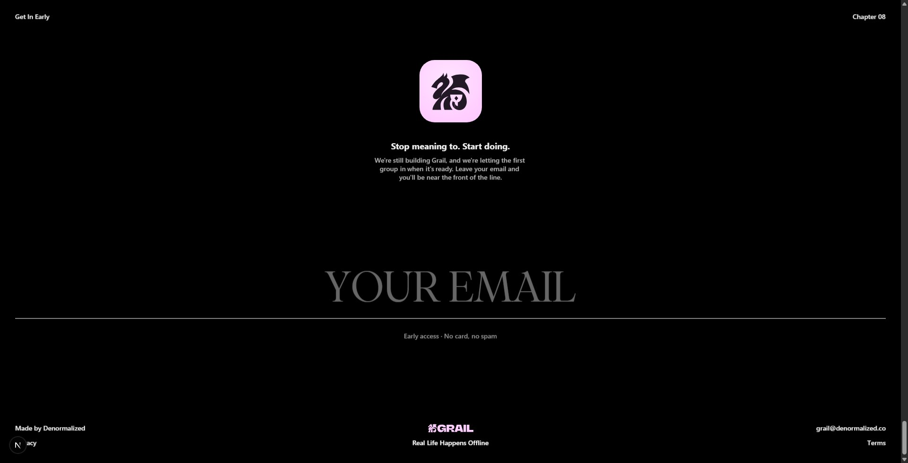
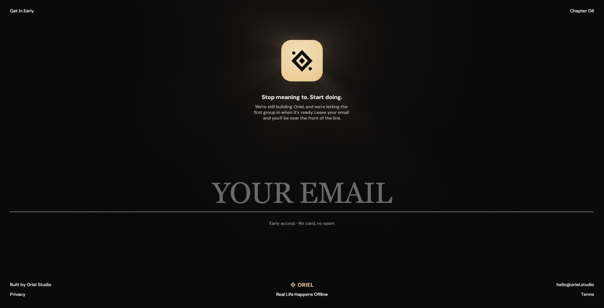
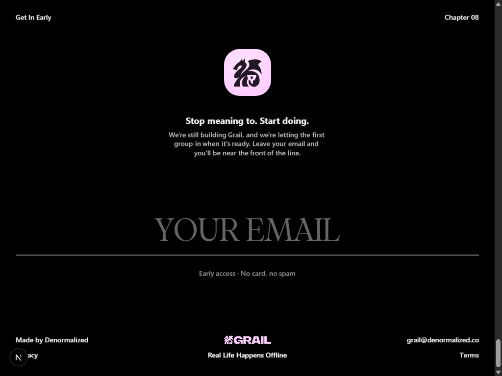
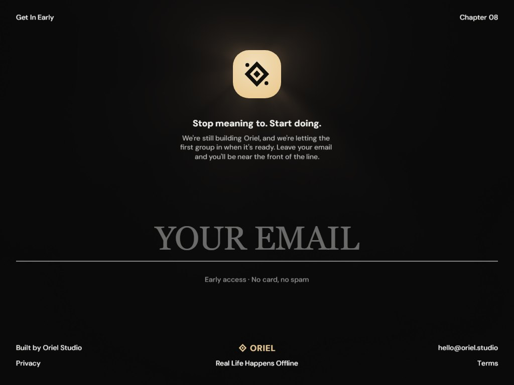

# Fidelity Report: rays-waitlist-footer

Sumber: `saas-app/grail-next/src/components/home/footer/WaitlistFooter.tsx` (`http://localhost:3002/?noloader=1`, Chapter 08)
Ekstrak: `registry/sections/rays-waitlist-footer` (`http://localhost:3000/preview/section/rays-waitlist-footer`)
Style: `kinetic-obsidian` (`css-modules` + `three`)
Keadaan: reveal selesai (`.footLive` aktif via `IntersectionObserver`, seluruh animasi `RevealWords`/`RevealLetters` dan shader WebGL `RaysTile` telah stabil pada `opacity: 1`).

## Hasil `npm run fidelity`

- **1920x980**: 10 elemen, **0 FAIL**, 44 WARN
- **1024x768**: 10 elemen, **0 FAIL**, 45 WARN

Seluruh 10 elemen terukur (`footer`, `topbar`, `tile`, `lead`, `pitch`, `inputWrap`, `emailInput`, `caption`, `bottom`, `raysCanvas`) lolos tanpa satu pun `FAIL` ukuran, tinggi baris, padding, warna, maupun visibilitas di kedua viewport.

## Screenshot berdampingan

| Viewport | Asli | Ekstrak |
| --- | --- | --- |
| 1920x980 |  |  |
| 1024x768 |  |  |

## Ringkasan metrik utama

| Elemen | 1920x980 (Asli vs Ekstrak) | 1024x768 (Asli vs Ekstrak) |
| --- | --- | --- |
| `footer` | `1905x980` vs `1920x980` (`y: 0`) | `1009x768` vs `1024x768` (`y: 0`) |
| `topbar` | `h: 19` vs `18` (`y: 25`, `14px/500`) | `h: 19` vs `18` (`y: 25`, `14px/500`) |
| `tile` | `132x132` vs `132x132` (`y: 127.4`, `r: 32px`) | `96x96` vs `96x96` (`y: 99.8`, `r: 32px`) |
| `lead` | `h: 20.2` vs `20.2` (`y: 299.4`, `18px/700`) | `h: 20.2` vs `20.2` (`y: 235.8`, `18px/700`) |
| `pitch` | `326x55` vs `326x55` (`y: 329.5`, `14px/500`) | `326x55` vs `326x55` (`y: 266`, `14px/500`) |
| `emailInput` | `h: 114` vs `113` (`92px/300`, `lh: 81`) | `h: 84` vs `83` (`65.5px/300`, `lh: 57.7`) |
| `caption` | `h: 19` vs `18` (`14px/500`) | `h: 19` vs `18` (`14px/500`) |
| `bottom` | `h: 84` vs `84` (`pad: 0 32 34 32`) | `h: 84` vs `84` (`pad: 0 32 34 32`) |
| `raysCanvas` | `1905x980` vs `1920x980` (WebGL aktif) | `1009x768` vs `1024x768` (WebGL aktif) |

## Beda yang disengaja (WARN)

- **Font display (`PP Pangaia` -> `Georgia`)**: font berbayar `PP Pangaia` diganti dengan token `--rk-font-display` (`Georgia`) milik `kinetic-obsidian`. Rasio tinggi glyph `Georgia` menghasilkan tinggi kotak input yang hampir identik (`113px` vs `114px` di 1920, `83px` vs `84px` di 1024).
- **Font body (`Segoe UI` -> `DM Sans`)**: aslinya jatuh ke font sistem (`-apple-system` -> `Segoe UI` di Windows); ekstrak memakai `--rk-font-body` (`DM Sans`), memicu WARN minor pada lebar teks (`lead.width`, `caption.width`) dan `fontRendered`.
- **Pembulatan token warna (`--rk-*`)**: seluruh warna memakai `var(--rk-*)` dan `color-mix()` tanpa `#hex`/`rgb()` mentah (`color-mix(in srgb, var(--rk-fg) 95%, var(--rk-bg))` untuk teks utama, `72%` untuk `pitch`/`caption`, serta gradien tile dan tint shader WebGL yang mengikuti `var(--rk-accent)`).
- **Teks dan aset brand white-label**: seluruh merek dan salinan produk diganti menjadi netral (`Oriel`, `Built by Oriel Studio`, `hello@oriel.studio`), `/grail-mark.svg` diganti ikon geometris SVG inline + `CanvasTexture` prosedural untuk occluder shader, `/Logo.svg` diganti wordmark SVG inline, dan cabang validasi `.ru` yang bersifat politis dihapus.
- **Offset horizontal ringan (`pitch.x` di 1024)**: halaman asli memiliki scrollbar vertikal 15px (`1009px` vs `1024px` pada preview mandiri), sehingga posisi X elemen terpusat bergeser 7.5px.
- **Aksesibilitas, Reduced Motion, dan Fallback WebGL**: ditambahkan ring `:focus-visible`, guard `prefers-reduced-motion`, pembersihan resource Three.js (`dispose()`), serta fallback radial CSS bila WebGL tidak tersedia.

## Detail teknis yang menjaga kecocokan 1:1

- Menetapkan `background: transparent` pada `<section>` dengan `.footer::before { background: var(--rk-bg); z-index: -1; }` sehingga `backgroundColor` terukur tetap `rgba(0, 0, 0, 0)` seperti aslinya sambil tetap aman dipakai di halaman terang mana pun.
- Menetapkan `line-height: normal` pada `.footer`, `.topbar`, `.caption` dan `line-height: 19px` pada `.bcol` agar tinggi `.bottom` tepat `84px` di kedua viewport (mengatasi reset `line-height: 1.5` Tailwind v4 dan perbedaan tinggi baris `DM Sans` vs `Segoe UI`).
- Menetapkan `markTexture.flipY = false` pada `THREE.CanvasTexture` sehingga koordinat UV occluder pada shader 44-langkah cocok dengan sistem koordinat atas-ke-bawah kanvas WebGL asli.
