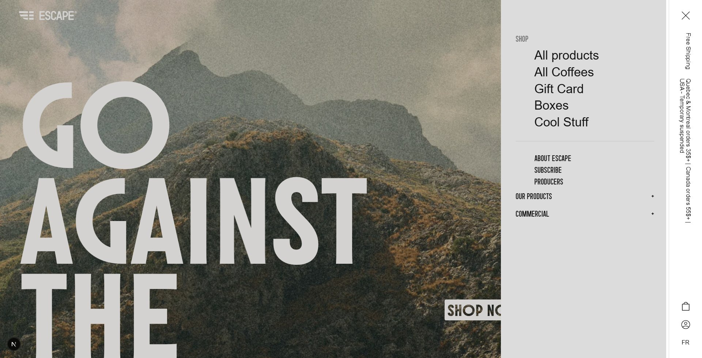
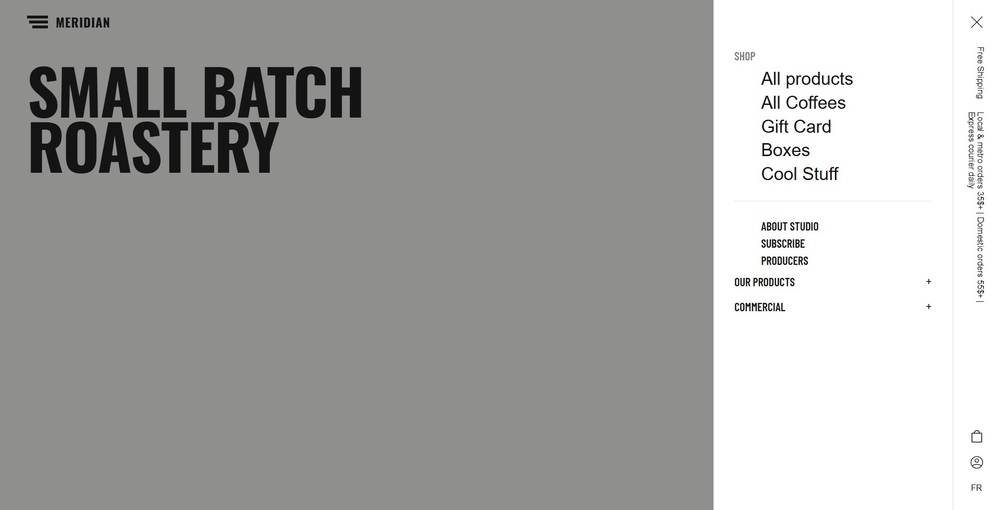
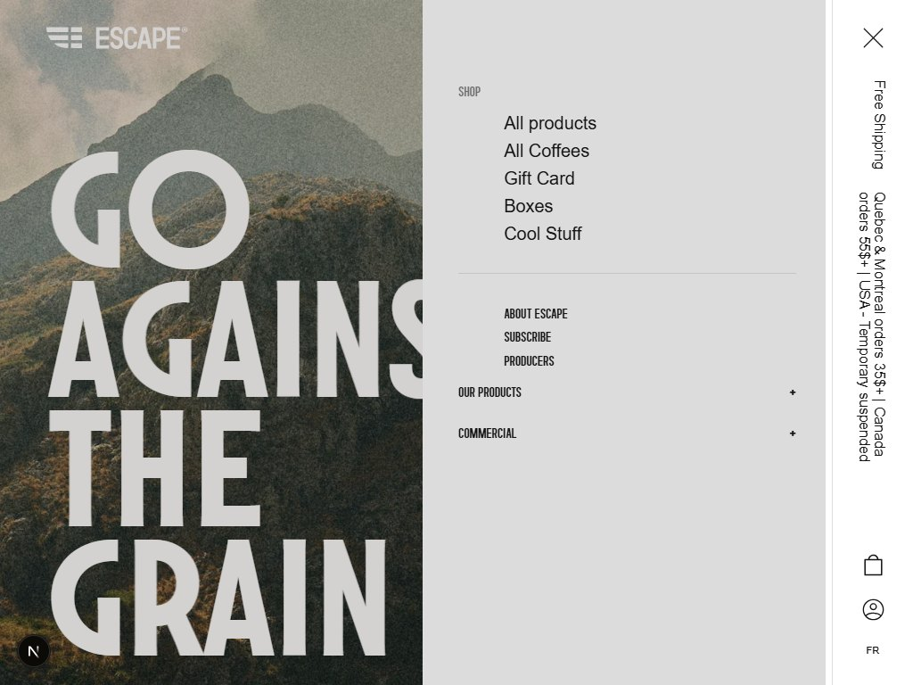
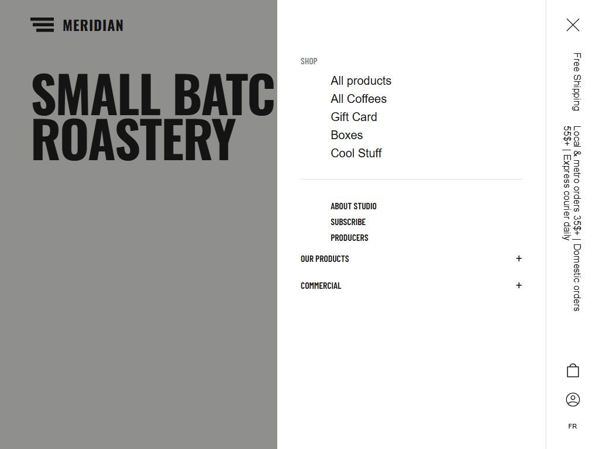

# Fidelity Report: right-rail-navbar

Sumber: `coffee-shop/escape-cafe-nextjs/src/components/StickyHeader.tsx` (localhost:3001)
Ekstrak: `registry/sections/right-rail-navbar` (localhost:3000/preview/section/right-rail-navbar)
Keadaan: drawer navigasi terbuka (tombol menu diklik lalu tunggu 650ms sampai transisi selesai), diukur pada 1920x980 dan 1024x768.

## Hasil `npm run fidelity` (diukur ulang 25 Nov dengan batas toleransi maks 4px)

- 1920x980: 15 elemen, **0 FAIL**, 12 WARN. Dimensi dan posisi rail kanan (90x980 di x=1830), ikon menu (33x33), teks promo vertikal 90deg, ikon cart/account/bahasa, dan panel drawer (460x980 di x=1370) cocok persis dengan aslinya setelah penambahan prop opsional `brandTone` (`default = "default"`).
- 1024x768: 15 elemen, **0 FAIL**, 12 WARN. Dimensi dan posisi rail kanan (90x768 di x=934), skala tipografi responsif (`min(vw, vh)`), dan panel drawer (460x768 di x=474) cocok persis dengan aslinya.

## Screenshot berdampingan

| | Asli | Ekstrak |
| --- | --- | --- |
| 1920x980 (drawer terbuka) |  |  |
| 1024x768 (drawer terbuka) |  |  |

## Beda yang disengaja (WARN)

- **Font label sempit** (`shopHeading`, `mainLink1`, `accBtn`): Garaje (berbayar) diganti **Barlow Condensed** lewat token `--rk-font-narrow` dengan bobot 600 (asli 300/400) agar ketebalan huruf mendekati visual Garaje; lebar `mainLink1` berbeda tipis (+9.8px di 1920, +7px di 1024) karena metrik font.
- **Teks de-branding**: copy promo ongkir regional (`Quebec & Montreal ...`) dan tautan `ABOUT ESCAPE` diganti teks netral (`Local & metro ...`, `ABOUT STUDIO`), serta brand mark `ESCAPE` diganti `MERIDIAN`.

## Yang diperbaiki saat verifikasi

- **Penjajaran `.logoTagline` (`MERIDIAN`)**: menghapus `position: relative` dari `.sectionRoot` agar sesuai dengan `#shopify-section-header { z-index: 3 }` asli (static) dan memindahkan padding preview dari container luar ke `<main>`. Sebelumnya `.logoTagline` tergeser ke `(159px, 150px)` dan menabrak judul `SMALL BATCH ROASTERY`; setelah diperbaiki, sejajar rapi di samping `.stickyLogo` pada `top: 30px`.

## Pembaruan 2026-11-26: props untuk dipakai ulang

Props opsional baru: `showCart` (default `true`), `showLocaleToggle` (default `true`), `locales` (default `["en", "fr"]`), `localeLabels` (default `["EN", "FR"]`), `localeToggleAriaLabels` (default teks aria lama), `brandHomeLabel`, `navAriaLabel`, `menuOpenLabel`, `menuCloseLabel`, `cartLabel`, `accountLabel`, `shopNavLabel`, `secondaryNavLabel`. Prop `*Fr` lama tetap dipakai sebagai salinan locale kedua. Path SVG ikon dipindah ke `icons.ts` (helper lokal) agar file tetap di bawah batas 260 baris. Default semua prop baru menghasilkan DOM yang sama dengan sebelumnya.

Diukur ulang 2026-11-26 dengan `scripts/fidelity-capture.ts` (label dan selector sama dengan ekstrak lama, build produksi baru):

- 1920x980: 15 elemen, 0 FAIL, 13 WARN
- 1024x768: 15 elemen, 0 FAIL, 13 WARN

WARN yang tersisa sama dengan daftar beda yang disengaja di atas, ditambah WARN `capture` karena `original-*.json` belum ternormalisasi.
