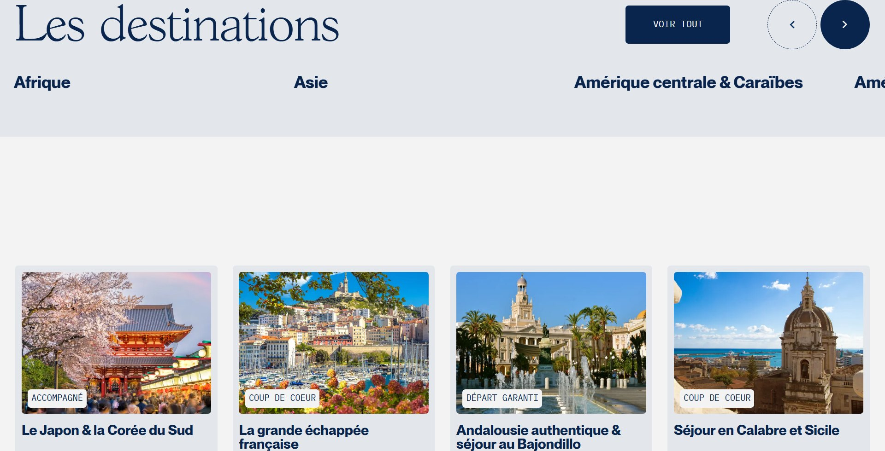
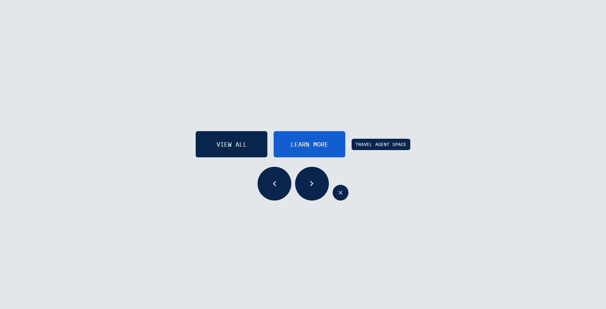
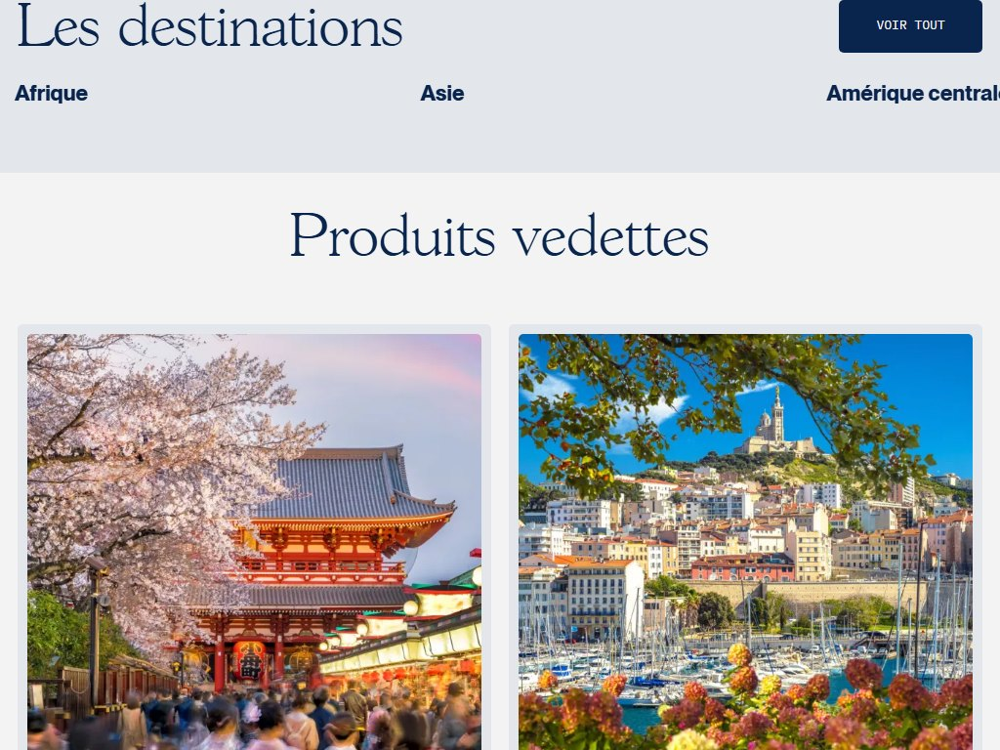
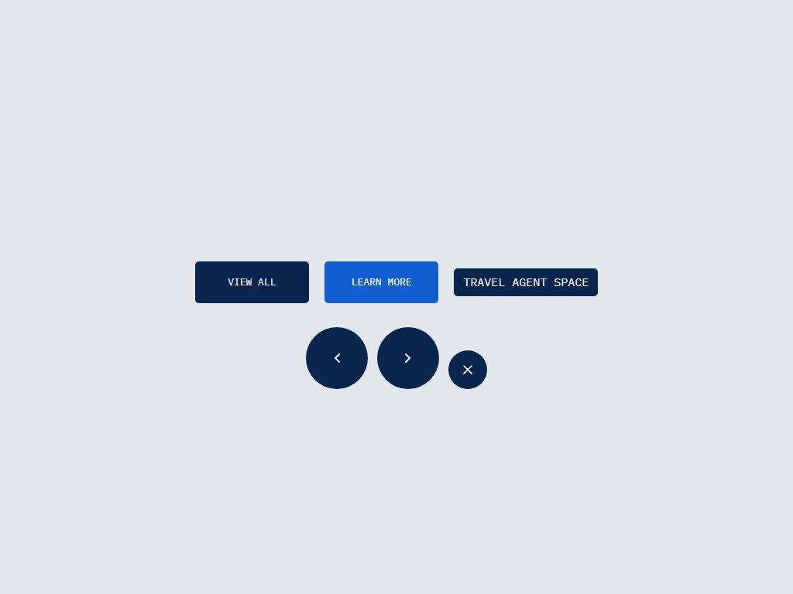

# Fidelity Report: rolling-cta-button

Sumber: `travel-services/tours-chanteclerc-nextjs` (`.cta` varian primary, secondary, arrow right, and close/small fixed button di `localhost:3001/`)
Ekstrak: `registry/ui/rolling-cta-button` (`http://localhost:3005/preview/ui/rolling-cta-button?style=azure-editorial`)
Keadaan: preview halaman komponen pada `1920x980` dan `1024x768`, 2,2 detik setelah load (`document.fonts.ready`). Di `1024x768`, tombol `.cta` di carousel & header disembunyikan oleh breakpoint tema asli sehingga hanya `primaryBtn` & `secondaryBtn` yang diukur pada showcase `1024x768`.

## Hasil `npm run fidelity:all`

- 1920x980: 4 elemen, **0 FAIL**, 14 WARN
- 1024x768: 2 elemen, **0 FAIL**, 9 WARN

## Screenshot berdampingan

| Viewport | Asli | Ekstrak |
| --- | --- | --- |
| 1920x980 |  |  |
| 1024x768 |  |  |

## Beda yang disengaja (WARN)

- **Label & teks putih-label**: teks Prancis ("VOIR TOUT", "EN SAVOIR PLUS", "PORTAIL DES AGENTS") diganti teks netral bahasa Inggris ("VIEW ALL", "LEARN MORE", "TRAVEL AGENT SPACE") sehingga lebar tombol proporsional dengan label baru.
- **Posisi `x`/`y` preview showcase**: pada showcase komponen UI, tombol ditempatkan di grid preview terpusat, bukan di posisi section masing-masing di halaman penuh.

## Temuan yang diperbaiki lewat workflow ini

- Menambahkan `overflow: hidden` pada `.inner` (`labelRoll`) karena elemen pseudo `:after` hover-roll sempat terlihat di bawah teks utama di dalam area padding `.cta`.
- Warna latar `--rk-fg` (`#0A254D`), `--rk-accent` (`#125ED1`), dan `--rk-surface` (`#F3F3F3`) dipetakan 100% ke token style `azure-editorial`.
