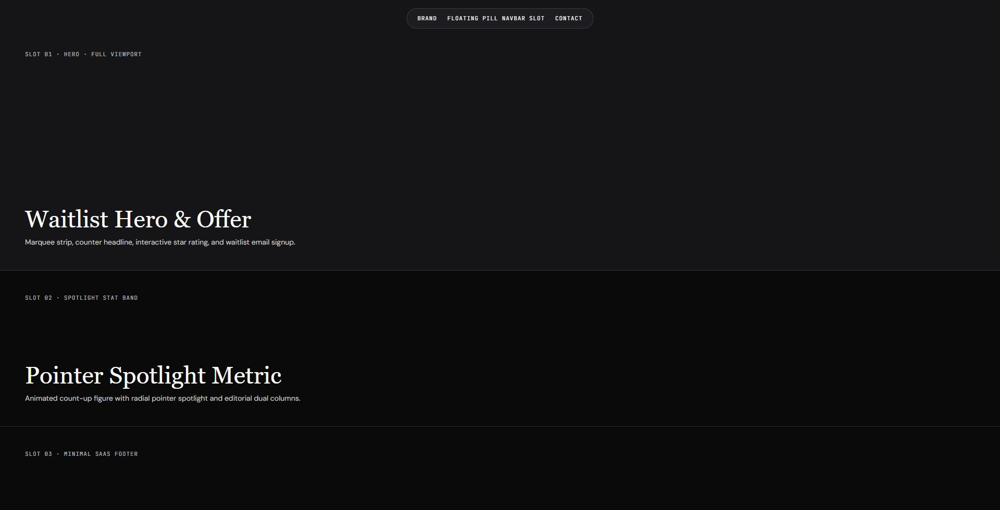
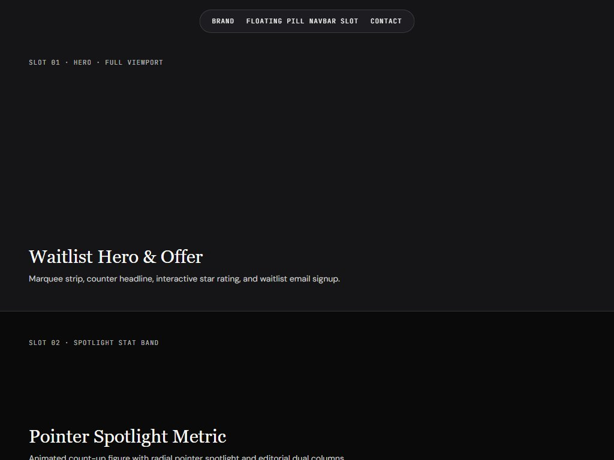
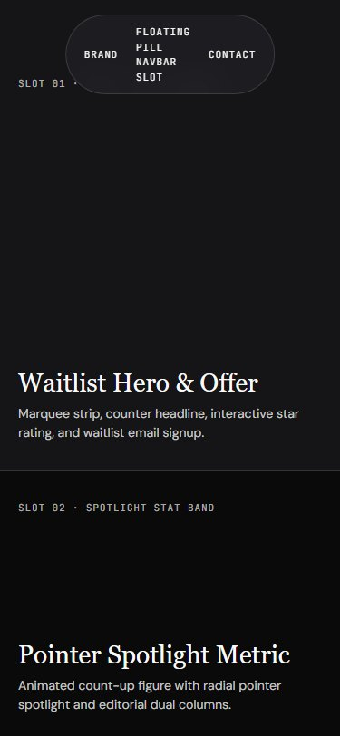

# Fidelity Report: saas-waitlist-template

Sumber: `saas-app/grail-next/src/components/landing/LandingPage.tsx` + `LandingPage.module.css` (`/v1`)
Ekstrak: `registry/templates/saas-waitlist-template` (`http://localhost:3000/preview/template/saas-waitlist-template`)
Style: `kinetic-obsidian` (`css-modules`, 100% token `--rk-*`, zero hardcoded `#hex`/`rgb()`)

## Verifikasi Geometri Shell

| Viewport | `shell.width` | Floating Navbar Slot | Slot Widths (`spotlight`, `hero`, `footer`) | Overlap / Overflow | Status |
| --- | :---: | :---: | :---: | :---: | :---: |
| `1920x980` | `1920px` | `358.8 x 38.5px` (centered `x: 780.6`) | `1920px` (`x: 0`, full-bleed) | `0` overlap / `0` overflow | **PASS** |
| `1024x768` | `1024px` | `358.8 x 38.5px` (centered `x: 332.6`) | `1024px` (`x: 0`, full-bleed) | `0` overlap / `0` overflow | **PASS** |
| `375x812` | `375px` | `231.6 x 88px` (centered `x: 71.7`) | `375px` (`x: 0`, full-bleed) | `0` overlap / `0` overflow | **PASS** |

## Screenshot Shell Template

| Desktop `1920x980` | Laptop `1024x768` | Mobile `375x812` |
| --- | --- | --- |
|  |  |  |

## Catatan Arsitektur
- Menyediakan shell vertikal `min-height: 100dvh` dengan slot floating top navbar (`navbar`) di atas ritme section `spotlight -> hero -> extra -> footer` agar transisi kontras terang-gelap-terang seperti `/v1` tampil seragam tanpa overflow horizontal.
