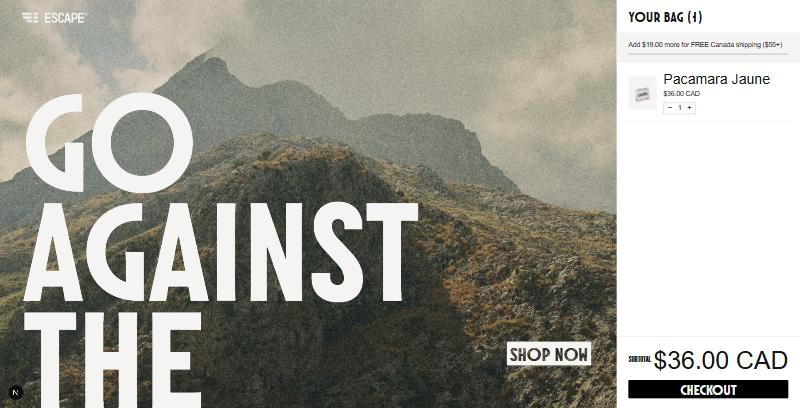
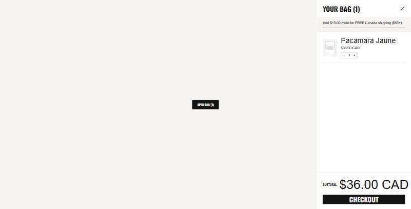
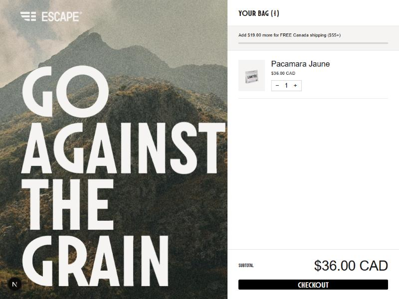
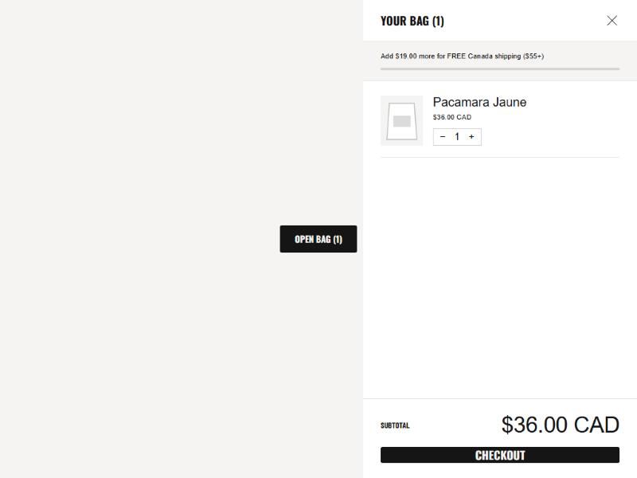

# Fidelity Report: slide-over-drawer

Sumber: `coffee-shop/escape-cafe-nextjs/src/components/CartDrawer.tsx` (localhost:3001)
Ekstrak: `registry/ui/slide-over-drawer` (localhost:3005/preview/ui/slide-over-drawer)
Keadaan: drawer terbuka, 1 item "Pacamara Jaune" $36.00 CAD.

## Hasil `npm run fidelity`

Diukur ulang setelah font display diganti ke Oswald:

- 1920x980: 16 elemen, **0 FAIL**, 7 WARN
- 1024x768: 16 elemen, **0 FAIL**, 8 WARN

Lebar judul "YOUR BAG (1)" di 1920: asli 178.4px, Oswald 173.6px (sebelumnya Barlow Condensed 143.4px).

## Screenshot berdampingan

| Viewport | Asli | Ekstrak |
| --- | --- | --- |
| 1920x980 |  |  |
| 1024x768 |  |  |

## Beda yang disengaja (WARN)

- **Font judul, label Subtotal, dan Checkout**: aslinya memakai Molitor dan Garaje (font berbayar). Ekstrak memakai Oswald untuk judul dan Checkout (lebarnya paling mendekati Molitor), serta `--rk-font-narrow` (Barlow Condensed) untuk label Subtotal. Akibatnya lebar teks judul dan label sedikit berbeda, tapi tinggi dan posisinya sama.
- **Hitam tombol Checkout**: aslinya `#000`, ekstrak memakai token `--rk-fg` (`#151515`).
- **Tombol X**: di aslinya ikonnya berukuran 0px (bug tema), jadi tidak terlihat. Di ekstrak ikonnya tetap terlihat supaya drawer bisa ditutup, tapi tidak menambah tinggi header.
- **Thumbnail**: foto produk Escape diganti gambar tas polos di preview (tanpa brand). Ukuran 68x80 dan latarnya sama.

## Temuan yang diperbaiki lewat workflow ini

- Font body aslinya tampil sebagai Arial (TWK Lausanne tidak pernah dimuat), sehingga token body diganti dari Plus Jakarta Sans ke Arial.
- Padding tombol Checkout di aslinya responsif (`min(0.347222vw, 0.617284vh)`).
- Isian progress bar di aslinya tidak tampil (div kosong disembunyikan tema), jadi `progressFill` default `false`.
- Header 5.5px lebih tinggi di 1024 karena ikon X, sudah diperbaiki.
