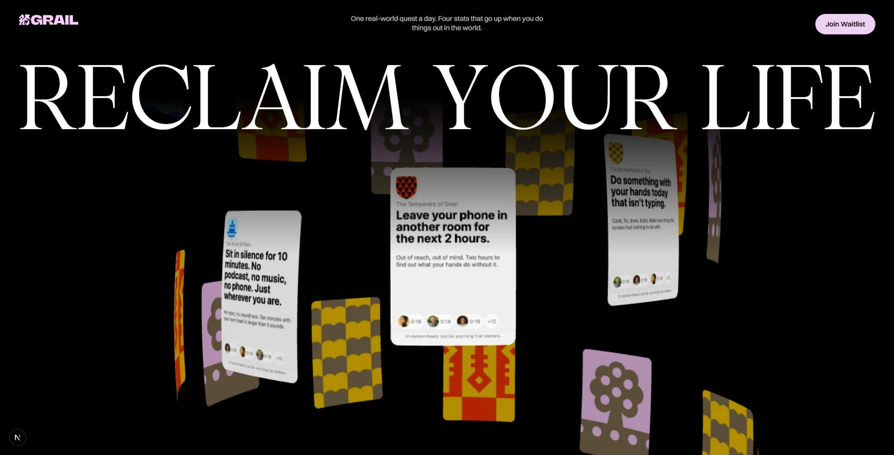
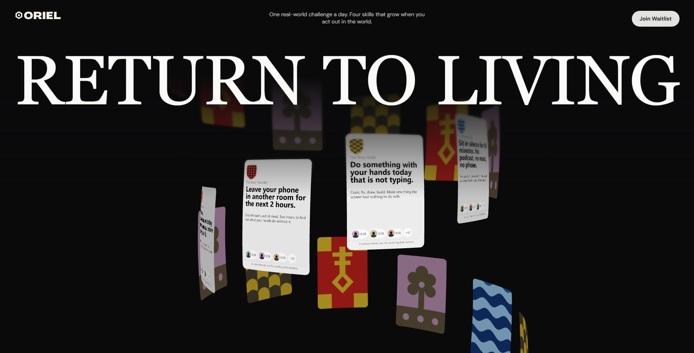
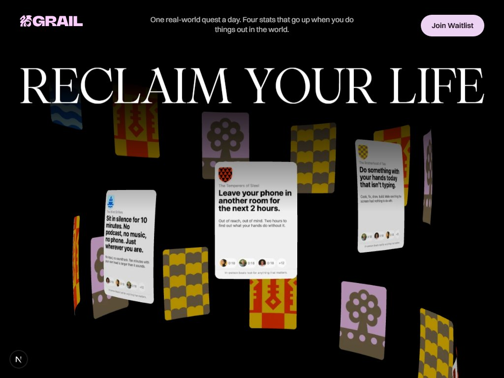
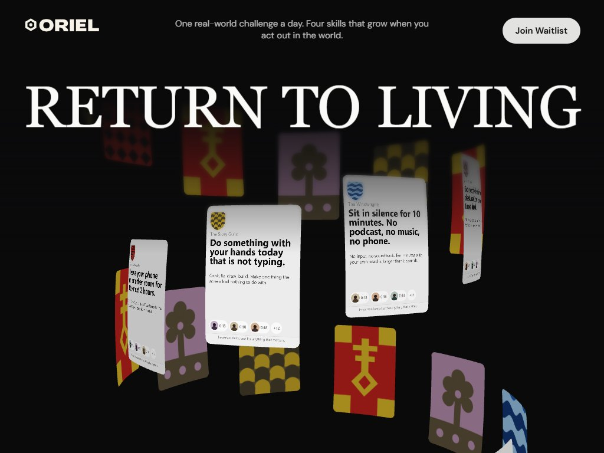

# Fidelity Report: spiral-deck-hero

Sumber: `saas-app/grail-next/src/components/home/HomeHero.tsx` + `deck/QuestDeck.tsx` (`http://localhost:3002/?noloader=1`)
Ekstrak: `registry/sections/spiral-deck-hero` (`http://localhost:3000/preview/section/spiral-deck-hero`)
Style: `kinetic-obsidian` (`css-modules` + `three`)
Keadaan: animasi masuk huruf headline dan spiral 3D selesai (`waitMs: 2600` asli, `waitMs: 2800` ekstrak).

## Screenshot berdampingan

| Viewport | Asli | Ekstrak |
| --- | --- | --- |
| 1920x980 |  |  |
| 1024x768 |  |  |

## Hasil `npm run fidelity`

- **1920x980**: 7 elemen, **0 FAIL**, 36 WARN
- **1024x768**: 7 elemen, **0 FAIL**, 37 WARN

| Elemen | 1920 Asli (w x h, fs/lh) | 1920 Ekstrak (w x h, fs/lh) | 1024 Asli (w x h, fs/lh) | 1024 Ekstrak (w x h, fs/lh) |
| --- | --- | --- | --- | --- |
| `hero` | `1905 x 980`, `16 / normal` | `1920 x 980`, `16 / normal` | `1009 x 768`, `16 / normal` | `1024 x 768`, `16 / normal` |
| `nav` | `1905 x 104`, `pad 30 40` | `1920 x 104`, `pad 30 40` | `1009 x 104`, `pad 30 40` | `1024 x 104`, `pad 30 40` |
| `logoBtn` | `127.6 x 24`, `y: 30` | `128 x 24`, `y: 30` | `127.6 x 24`, `y: 30` | `128 x 24`, `y: 30` |
| `tagline` | `430 x 40.5`, `15 / 20.3` | `430 x 40.5`, `15 / 20.3` | `430 x 40.5`, `15 / 20.3` | `430 x 40.5`, `15 / 20.3` |
| `cta` | `129.2 x 44`, `15 / normal` | `132.5 x 44`, `15 / normal` | `129.2 x 44`, `15 / normal` | `132.5 x 44`, `15 / normal` |
| `headline` | `1839.8 x 172.9`, `196.5 / 172.9` | `1839.7 x 170.7`, `194 / 170.7` | `944 x 88.7`, `100.8 / 88.7` | `943.9 x 87.6`, `99.5 / 87.6` |
| `sceneCanvas` | `1905 x 850`, `y: 130` | `1920 x 850`, `y: 130` | `1009 x 638`, `y: 130` | `1024 x 638`, `y: 130` |

## Beda yang disengaja (WARN)

- **Substitusi font (`Switzer` -> `DM Sans`, `PP Pangaia` -> `Georgia`)**: situs asli memuat font berbayar lokal `Switzer-Variable.woff2` dan `PPPangaia-Light.woff2`; ekstrak memakai token `--rk-font-body` (`DM Sans`) dan `--rk-font-display` (`Georgia`) dari style `kinetic-obsidian`. Karena metrik `DM Sans` sedikit lebih lebar, `cta.width` bergeser `3.3px` (`129.2` -> `132.5`).
- **Teks dan brand white-label**: logo diganti mark geometris + wordmark SVG `ORIEL` (`128 x 24`), tagline memakai copy netral 2 baris setara, dan headline memakai frasa 3 kata `"Return to living"` agar proporsi pas-lebar di `Georgia` (`194px` / `99.5px`) tetap menyamai tinggi headline asli (`196.5px` / `100.8px`) dalam batas ~1.3%.
- **Pembulatan token warna (`--rk-*`)**: seluruh warna memakai `var(--rk-*)` dan `color-mix()` tanpa `#hex` atau `rgb()` mentah (`--rk-fg: #fafaf8` vs `#ffffff`, `--rk-bg: #0a0a0b` vs `#000000`, pill CTA `color-mix(in srgb, var(--rk-fg) 90%, var(--rk-bg))` vs `#ecd2f3`).
- **Offset horizontal (`headline.x`, `tagline.x`)**: halaman asli panjang sehingga memiliki scrollbar vertikal `15px` (lebar konten `1905` / `1009`), sedangkan preview terisolasi `100vh` tanpa scrollbar (lebar penuh `1920` / `1024`), menggeser pusat horizontal `7.5px`.
- **Aset 3D prosedural & aksesibilitas**: seluruh 5 motif belakang kartu, lambang perisai bercahaya, dan avatar pil digambar prosedural di Canvas2D tanpa bergantung pada `/patterns/*.webp` atau `/avatars/*.webp`. Ditambahkan dukungan `prefers-reduced-motion`, `:focus-visible`, dan fallback kipas kartu CSS jika inisialisasi WebGL gagal.

## Pembaruan 2026-11-27: ukur ulang ternormalisasi

`original-*.json` dan `extract-*.json` diukur ulang dengan `scripts/fidelity-capture.ts` (scrollbar disembunyikan di kedua sisi, lebar penuh 1920/1024px). Hasil `npm run fidelity`: 1920x980 7 elemen, **0 FAIL**, 35 WARN; 1024x768 7 elemen, **0 FAIL**, 35 WARN. Catatan pergeseran pusat 7.5px akibat scrollbar di atas tidak berlaku lagi: kedua sisi kini diukur 1920/1024px. Tidak ada perubahan CSS.
