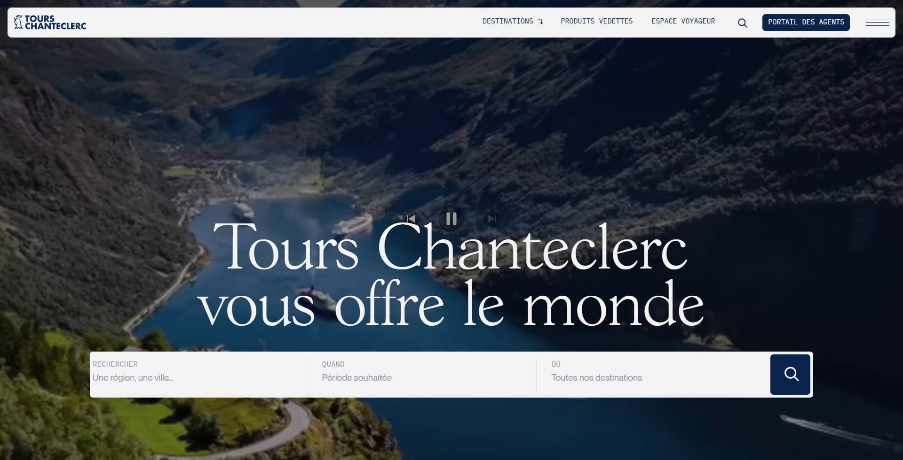
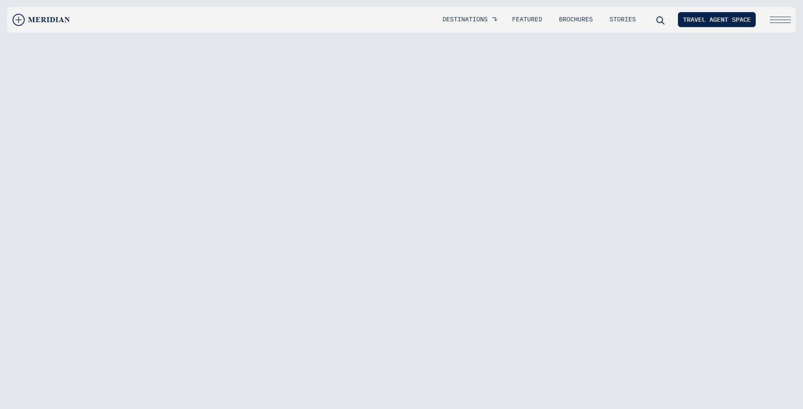
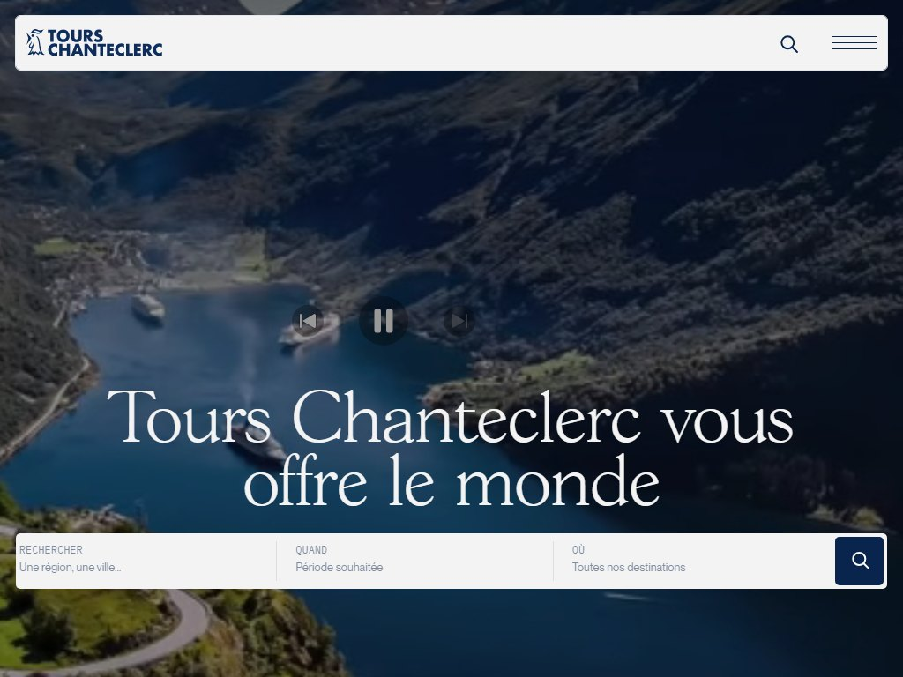
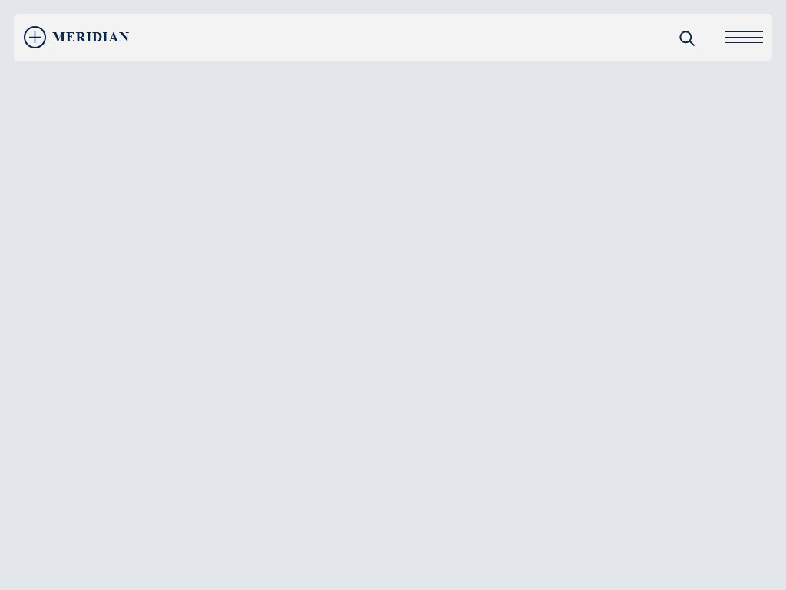

# Fidelity Report: split-dropdown-navbar

Sumber: `travel-services/tours-chanteclerc-nextjs` (`.header` floating navbar pada `localhost:3001/`)
Ekstrak: `registry/sections/split-dropdown-navbar` (`http://localhost:3005/preview/section/split-dropdown-navbar?style=azure-editorial`)
Keadaan: header posisi default (scrolled = false), menu dropdown tertutup, pada `1920x980` dan `1024x768`.

## Hasil `npm run fidelity:all`

- 1920x980: 6 elemen (`bar`, `logo`, `destinationsLink`, `searchToggle`, `portalCta`, `menuToggle`), **0 FAIL**, 7 WARN
- 1024x768: 6 elemen (`bar`, `logo`, `destinationsLink`, `searchToggle`, `portalCta`, `menuToggle`), **0 FAIL**, 6 WARN

## Screenshot berdampingan

| Viewport | Asli | Ekstrak |
| --- | --- | --- |
| 1920x980 |  |  |
| 1024x768 |  |  |

## Beda yang disengaja (WARN)

- **Brand & wordmark**: logo svg Tours Chanteclerc diganti emblem generik 154x31px (`MERIDIAN`), dan label nav diganti Inggris (`DESTINATIONS`, `FEATURED`, `BROCHURES`, `STORIES`, `TRAVEL AGENT SPACE`).
- **Font body**: `PP Neue Montreal` dipetakan ke `--rk-font-body` (`Barlow`).

## Temuan yang diperbaiki lewat workflow ini

- Menambahkan `overflow: hidden` pada `.labelRoll` agar duplikat pseudo `:after` untuk animasi hover tidak bocor di bawah padding item navigasi.
