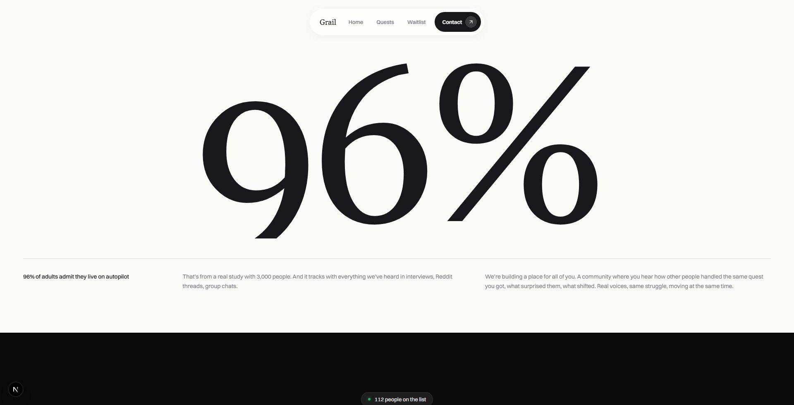
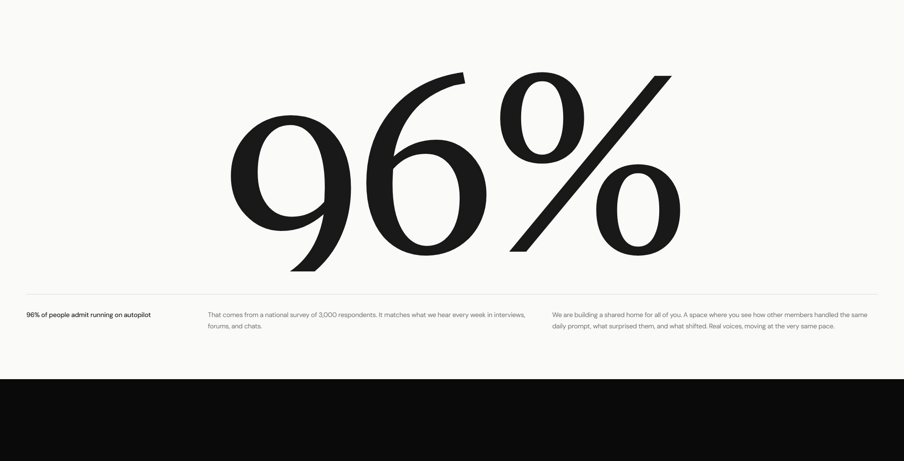
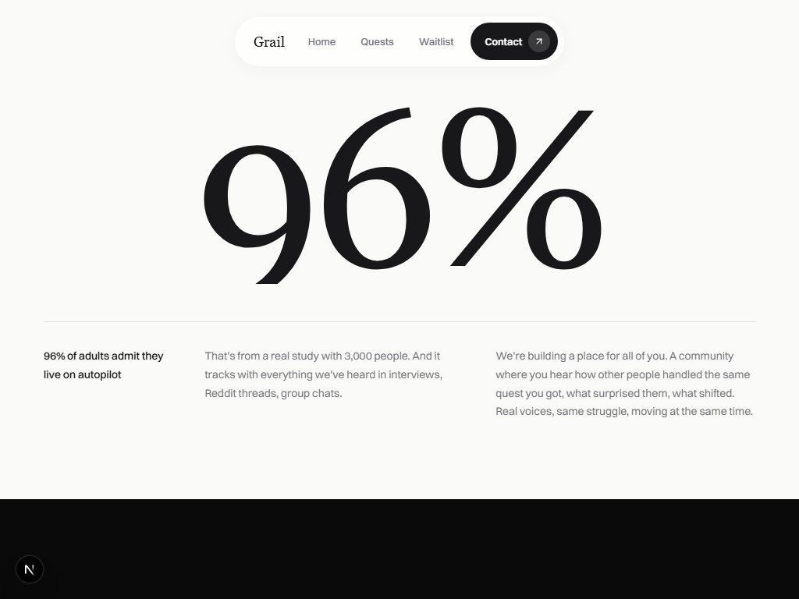
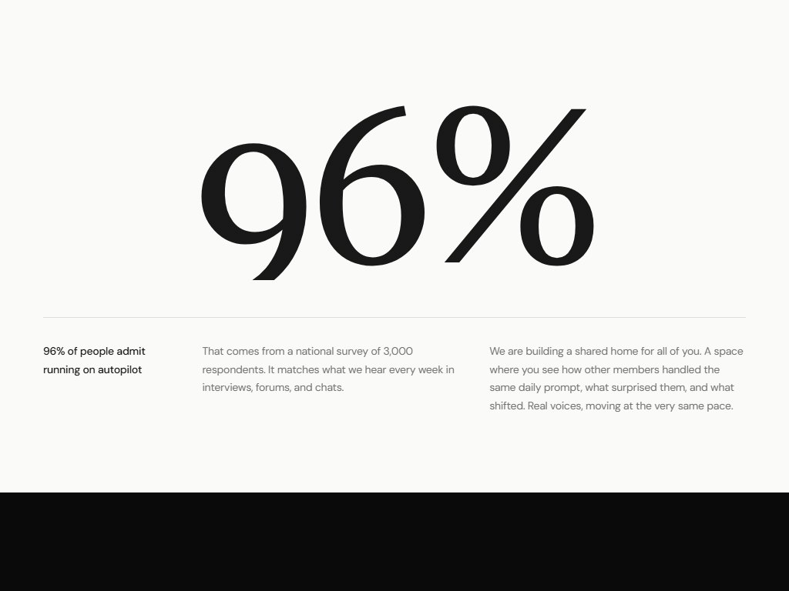

# Fidelity Report: spotlight-stat-band

Sumber: `saas-app/grail-next/src/components/landing/AutopilotStatSection.tsx` (`http://localhost:3002/v1`)
Ekstrak: `registry/sections/spotlight-stat-band` (`http://localhost:3000/preview/section/spotlight-stat-band`)
Style: `kinetic-obsidian` (`css-modules` + `motion`)
Keadaan: reveal selesai (`opacity: 1`), animasi count-up 2 detik selesai pada `96%`, ketiga kolom naratif telah muncul penuh.

## Hasil `npm run fidelity`

- **1920x980**: 8 elemen, **0 FAIL**, 37 WARN
- **1024x768**: 8 elemen, **0 FAIL**, 38 WARN

Seluruh 8 elemen terukur (`section`, `numberWrap`, `bigNumber`, `divider`, `textRow`, `col1`, `col2`, `col3`) lolos tanpa satu pun `FAIL` ukuran, padding, tinggi baris, warna, maupun visibilitas di kedua viewport:

- **1920x980**: `section` tinggi `805.5px` vs `805.5px` asli, `bigNumber` `983.4 x 457px` (`Georgia`, `537.6px`, `line-height: 457px`, `letter-spacing: -21.504px`) identik 0.0px, `divider` `1px`, `textRow` dan `col1`-`col3` `47.6px` (2 baris, `14px / 23.8px`) identik 0.0px.
- **1024x768**: `section` tinggi `663.7px` vs `663.7px` asli, `bigNumber` `524.5 x 243.7px` (`Georgia`, `286.7px`, `line-height: 243.7px`, `letter-spacing: -11.4688px`) identik 0.0px, `divider` `1px`, `textRow` dan `col1`-`col3` `119px` (5 baris, `14px / 23.8px`) identik 0.0px.

## Screenshot berdampingan

| Viewport | Asli | Ekstrak |
| --- | --- | --- |
| 1920x980 |  |  |
| 1024x768 |  |  |

## Beda yang disengaja (WARN)

- **Font body (`Switzer` -> `DM Sans`)**: aslinya memuat `Switzer-Variable.woff2` lokal; ekstrak memakai token `--rk-font-body` (`DM Sans`) milik `kinetic-obsidian`. Font display angka besar (`Georgia`) sama persis pada `bigNumber`.
- **Pembulatan token warna (`--rk-*`)**: seluruh warna memakai `var(--rk-*)` dan `color-mix()` tanpa `#hex`/`rgb()` mentah (`--stat-bg: var(--rk-fg)` untuk `#fafaf8`, `--stat-ink: color-mix(in srgb, var(--rk-bg) 94%, var(--rk-fg))` untuk `#18181b`, dan `--stat-muted: color-mix(in srgb, var(--rk-bg) 57%, var(--rk-fg))` untuk `#71717a` sekaligus memenuhi kontras WCAG AA).
- **Lebar viewport tanpa scrollbar (`bigNumber.x` di 1024)**: halaman asli `/v1` lebih tinggi dari viewport sehingga memiliki scrollbar vertikal `15px` (`width: 1009px` vs `1024px` pada preview terisolasi), menggeser `bigNumber.x` sebesar `7.5px` (terpusat penuh).
- **Teks white-label**: copy tiga kolom diganti teks netral dengan jumlah baris dan panjang karakter setara (1/2/2 baris di 1920 dan 2/3/5 baris di 1024).
- **Aksesibilitas & Reduced Motion**: ditambahkan `aria-label` final pada angka count-up, `aria-hidden="true"` pada `divider`, ring `:focus-visible`, pembersihan `cancelAnimationFrame` yang aman untuk React StrictMode, serta dukungan `useReducedMotion` / `prefers-reduced-motion`.

## Detail teknis yang menjaga kecocokan 1:1

- Permukaan latar terang `#fafaf8` (`var(--rk-fg)`) dilukis lewat `.section::before` di dalam `isolation: isolate`, sehingga komponen tampil mandiri di atas latar gelap sambil mempertahankan `getComputedStyle(section).backgroundColor` (`rgba(0, 0, 0, 0)`) seperti halaman asli.
- Menetapkan `line-height: normal` pada `.section` dan `margin: 0` pada `.colText` agar reset Tailwind v4 tidak mengubah tinggi baris blok.

## Pembaruan 2026-11-27: ukur ulang ternormalisasi

`original-*.json` dan `extract-*.json` diukur ulang dengan `scripts/fidelity-capture.ts` (scrollbar disembunyikan di kedua sisi, lebar penuh 1920/1024px). Tanpa scrollbar, kolom 1024 di aslinya selebar 332.8px dan teks Switzer jadi 4 baris (sebelumnya 5 baris di lebar 1009px), sedangkan copy ekstrak dengan DM Sans tetap 5 baris: `section.height` 663.7 vs 639.9 dan `col1`-`col3` 119 vs 95.2 (5 FAIL).

Perbaikan CSS: `.colText` diberi `letter-spacing: -0.017em` sebagai kompensasi font pengganti. Angkanya dari pengukuran copy asli yang sama di kedua font pada 14px: DM Sans 820px vs Switzer 788px (129 glyph) dan 1324px vs 1277px (202 glyph), jadi DM Sans ~0.017em lebih lebar per glyph. Kolom 3 ekstrak kini 4 baris di 1024 dan tetap 2 baris di 1920.

Hasil `npm run fidelity` (sebelum -> sesudah): 1024x768 5 FAIL, 37 WARN -> **0 FAIL**, 40 WARN; 1920x980 0 FAIL, 37 WARN -> **0 FAIL**, 40 WARN (WARN tambahan: `letterSpacing` beda dari aslinya). Bukti ekstrak diambil dari dev server; perlu capture ulang dari build produksi.
