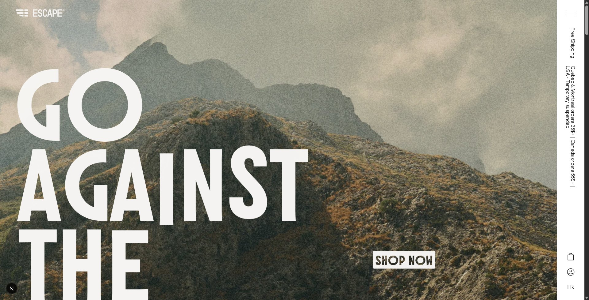
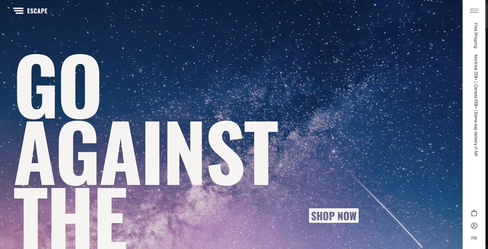
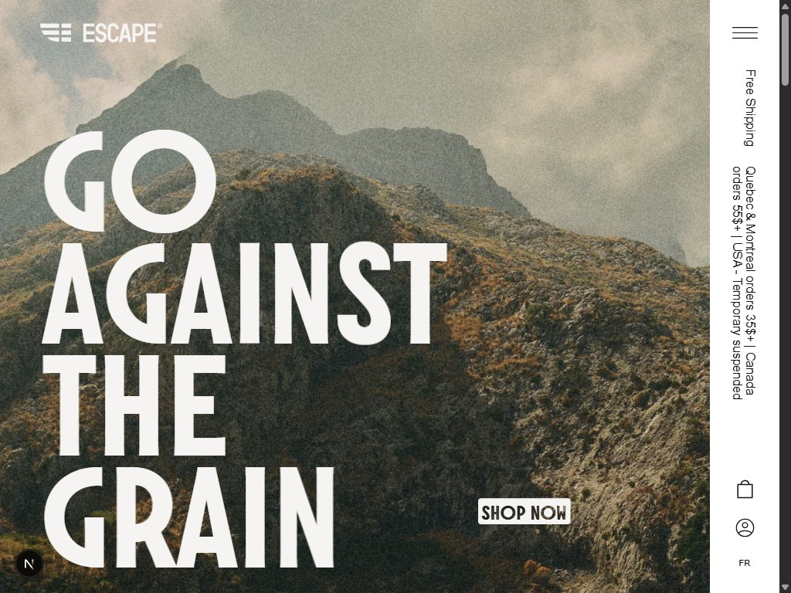
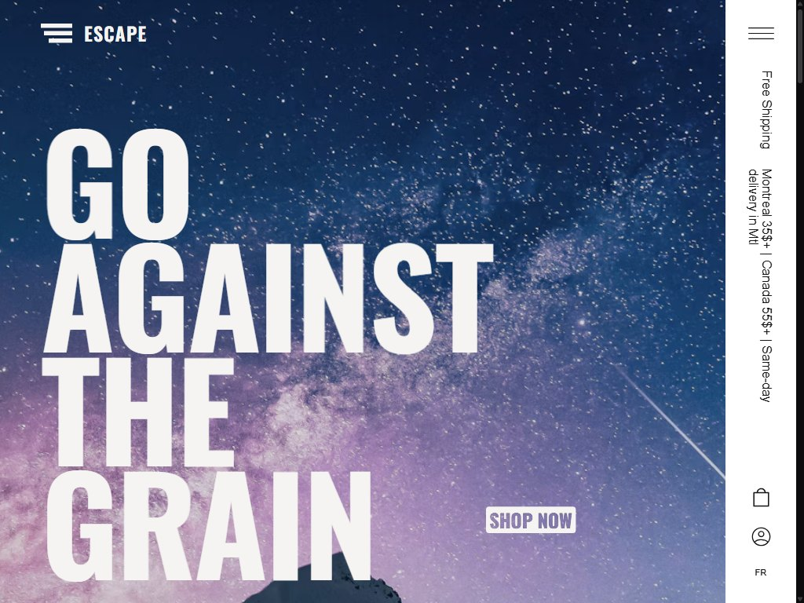
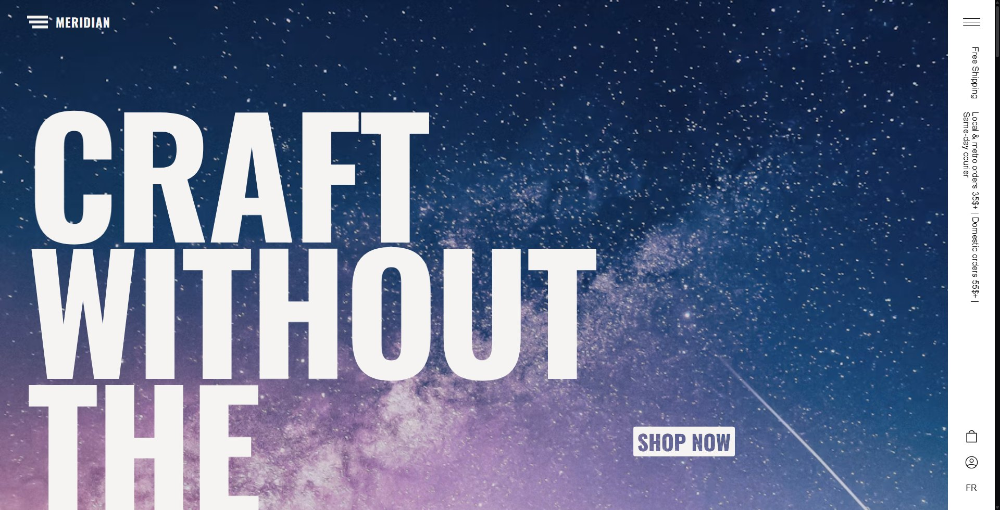
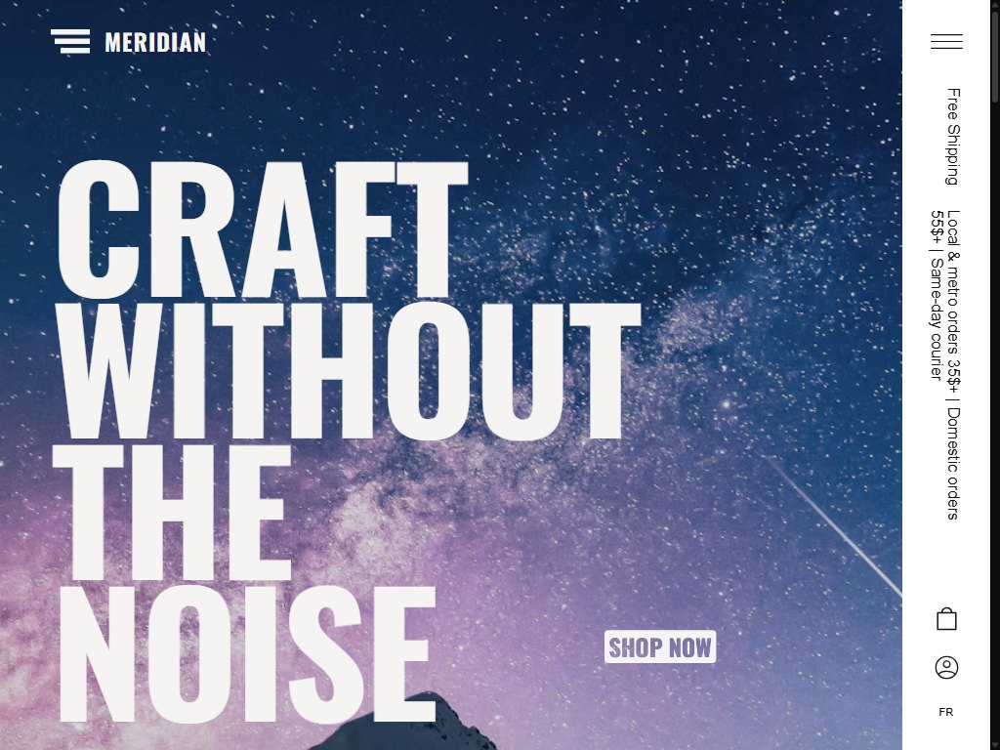

# Fidelity Report: `storefront-demo-page`

- **Kind / Level:** `page` / `page`
- **Composes:** `templates/editorial-storefront-template`, `sections/right-rail-navbar`, `sections/editorial-storefront-hero`, `sections/interactive-quiz`, `sections/collection-split-showcase`, `sections/editorial-mission-split`, `sections/kinetic-manifesto-steps`, `sections/editorial-dark-footer`, `ui/slide-over-drawer`
- **Reference Source (Step 1 Assembly Proof):** `coffee-shop/escape-cafe-nextjs` (`http://localhost:3001/`)
- **Live Extract Preview:** `http://localhost:3000/preview/page/storefront-demo-page`
- **Tolerance Gate (`scripts/fidelity-compare.ts`):** `Math.min(4, Math.max(1, Math.abs(a) * 0.02))` (maksimal `4px` pada semua dimensi besar).

## Step 1: Assembly Fidelity Proof (vs Full Escape Coffee Homepage)

Before swapping to neutral sample data, `demo-data.ts` was populated with reference storefront copy and measured across all 7 top-level structural regions (`rail`, `hero`, `quiz`, `collections`, `mission`, `manifesto`, `footer`) at both desktop viewports under the tightened `4px` max tolerance cap.

| Viewport | Elements Checked | Content Width (`calc(100vw - 90px)`) | Hero Height | FAIL | WARN | Result |
| --- | ---: | :---: | :---: | ---: | ---: | --- |
| `1920x980` | 7 | `1830px` vs `1830px` | `2120.3px` vs `2120.3px` | **0** | 5 | **PASS** |
| `1024x768` | 7 | `934px` vs `934px` | `1461.4px` vs `1461.4px` | **0** | 5 | **PASS** |

### Side-by-Side Visual Proof (Step 1 Assembly)

| Viewport | Original (`localhost:3001/`) | Extract (`localhost:3000/preview/page/storefront-demo-page`) |
| --- | --- | --- |
| `1920x980` |  |  |
| `1024x768` |  |  |

### Issues Caught & Fixed During Assembly Verification
1. **Template width `calc(100% - 90px)` vs `calc(100vw - 90px)`:** Previously `.contentColumn` used `calc(100% - 90px)`, making content `10px` narrower (`1820px` vs `1830px` at `1920`, `924px` vs `934px` at `1024`), which shifted all downstream sections and caused `collections.height` to shrink `8.4px`. Tightening `fidelity-compare.ts` to a `4px` max cap caught all 8 FAILs immediately; switching `.contentColumn` to `calc(100vw - 90px)` matched Escape's exact `1830px` / `934px` width and `collections.height`.
2. **Hero `.desc` font-metric wrapping at `1830px`:** At `562px` column width, substitute font `Oswald` wrapped 1 extra line (`+34.6px`) compared to paid `Molitor`. Applying `letter-spacing: var(--rk-display-tracking)` (`-0.02em`) on `.desc` locked `hero.height` to exact `2120.3px` (`1920`) and `1461.4px` (`1024`) with `0.0px` drift across every section `y` offset down to the footer (`8396px` / `5145.1px`), and standalone `editorial-storefront-hero` was re-measured to confirm zero height regression.
3. **Top-left brand contrast over dark hero:** Added optional `brandTone="inverted"` (`default = "default"`) to `right-rail-navbar` and re-measured `right-rail-navbar` standalone (`15 elements, 0 FAIL` at both `1920x980` and `1024x768`).

### Documented Intentional WARNs (Step 1)
- `rail.x` (`1815` vs `1820` at `1920`, `919` vs `924` at `1024`): Windows Chrome scrollbar `15px` on Escape vs custom `10px` scrollbar on Rakitek preview shell.
- `rail.text`, `quiz.text`, `collections.text`, `mission.text`: concise sample text excerpts (`2` quiz questions vs `5`).

## Step 2: Neutral Sample Data Swap & Visual Check

After locking in Step 1 (`0 FAIL` under `4px` cap), `demo-data.ts` was swapped to neutral white-label sample copy (`MERIDIAN`, `"Craft Without the Noise"`, neutral lots `Solstice` / `Nocturne` / `Altitude`, neutral address and footer). Rebuilt and verified visually and geometrically:

| Viewport | Content Width | Right Rail | Vertical Stack (`hero -> footer`) | Overlap / Clipping / Overflow |
| --- | ---: | --- | --- | --- |
| `1920x980` | `1830px` | `90x980` at `x=1820` | `y=0 -> 9519.9px` (monotonic) | **0 overlap, 0 clipping, 0 horizontal overflow** |
| `1024x768` | `934px` | `90x768` at `x=924` | `y=0 -> 6133.4px` (monotonic) | **0 overlap, 0 clipping, 0 horizontal overflow** |

### Neutral Sample Data Screenshots

| `1920x980` (Neutral) | `1024x768` (Neutral) |
| --- | --- |
|  |  |
