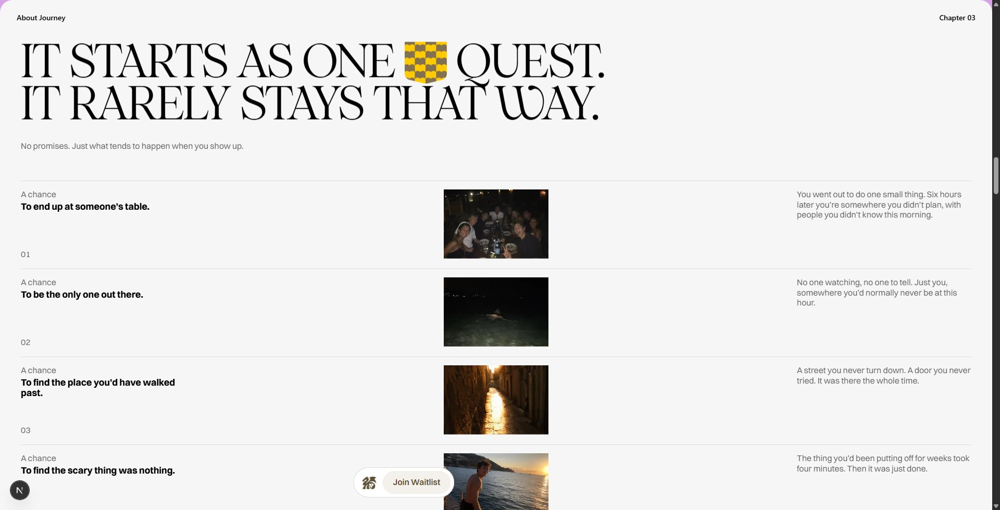
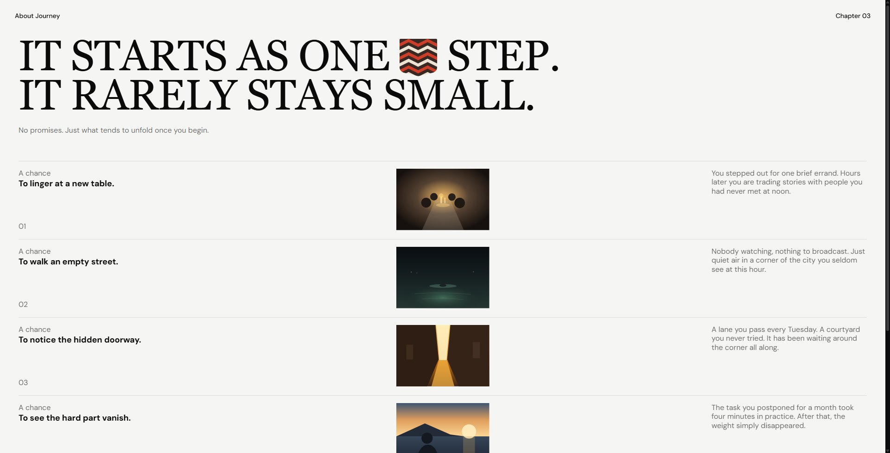
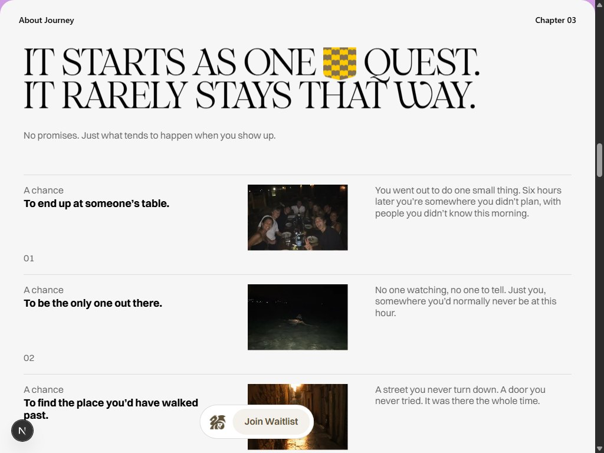
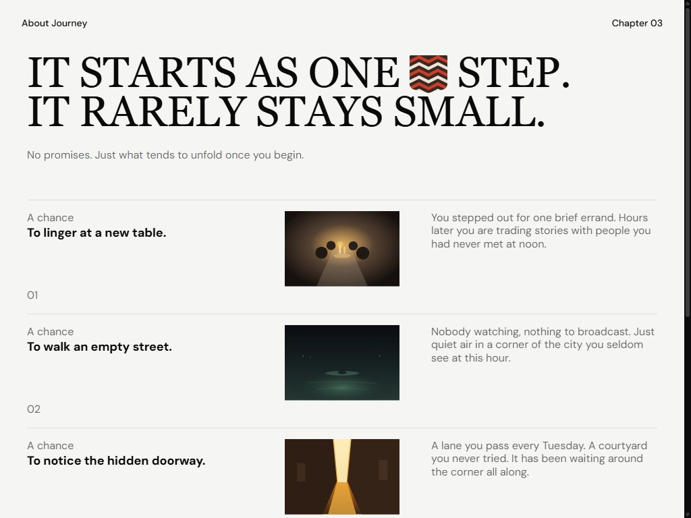

# Fidelity Report: story-chances-list

Sumber: `saas-app/grail-next/src/components/home/JourneySection.tsx` + `Colontitle.tsx` + `HomePage.module.css` (`http://localhost:3002/?noloader=1`, Chapter 03 `.section5`)
Ekstrak: `registry/sections/story-chances-list` (`http://localhost:3000/preview/section/story-chances-list`)
Style: `kinetic-obsidian` (`css-modules`, zero external dependencies)
Keadaan: headline `.headIn` selesai (`opacity: 1`, `translateY(0)`), emblem crest aktif, seluruh baris terukur dalam keadaan settled (`--rp: 1`).

## Hasil `npm run fidelity`

- **1920x980**: 14 elemen, **0 FAIL**, 69 WARN
- **1024x768**: 14 elemen, **0 FAIL**, 69 WARN

Seluruh 14 elemen terukur (`section`, `colontitle`, `inner`, `head`, `crest`, `sub`, `list`, `row1`, `row1Left`, `row1Label`, `row1Title`, `row1Num`, `row1Photo`, `row1Desc`) lolos dengan **0 FAIL** pada kedua viewport, dengan tinggi baris, tinggi list (`845px`), ukuran emblem (`81x81` dan `55.9x55.9`), dan kotak foto (`201x133` dan `170x112`) identik hingga `0.0px`.

## Screenshot berdampingan

| Viewport | Asli | Ekstrak |
| --- | --- | --- |
| 1920x980 |  |  |
| 1024x768 |  |  |

## Ringkasan Metrik Utama

| Elemen | 1920x980 (Asli vs Ekstrak) | 1024x768 (Asli vs Ekstrak) |
| --- | --- | --- |
| `section` | `1905x1329` vs `1910x1329.8` (`bg: #f6f6f6` vs `color-mix 98%`) | `1009x1248` vs `1014x1248.1` |
| `colontitle` | `x: 32, y: 25, h: 18.3` vs `x: 32, y: 25, h: 18.3` | `x: 32, y: 25, h: 18.3` vs `x: 32, y: 25, h: 18.3` |
| `inner` | `pad: 80/40/137.2/40, h: 1329` vs `pad: 80/40/137.2/40, h: 1329.8` | `pad: 80/40/107.5/40, h: 1248` vs `pad: 80/40/107.5/40, h: 1248.1` |
| `head` | `92px / 81px, h: 165` vs `92px / 81px, h: 165.8` | `63.5px / 55.9px, h: 113.7` vs `63.5px / 55.9px, h: 113.7` |
| `crest` | `81x81` vs `81x81` | `55.9x55.9` vs `55.9x55.9` |
| `sub` | `471x19.8` vs `471x19.8` | `471x19.8` vs `471x19.8` |
| `list` | `h: 845` vs `h: 845` | `h: 845` vs `h: 845` |
| `row1` | `h: 169, pt: 17, gap: normal 5%` vs `h: 169, pt: 17, gap: normal 5%` | `h: 169, pt: 17, gap: normal 5%` vs `h: 169, pt: 17, gap: normal 5%` |
| `row1Left` | `331x152` vs `331x152` | `331x152` vs `331x152` |
| `row1Label` / `row1Title` / `row1Num` | `19.8 / 20.2 / 21` vs `19.8 / 20.2 / 21` | `19.8 / 20.2 / 21` vs `19.8 / 20.2 / 21` |
| `row1Photo` | `201x133` vs `201x133` | `170x112` vs `170x112` |
| `row1Desc` | `335x152, lh: 19.8` vs `335x152, lh: 19.8` | `333.1x152, lh: 19.8` vs `335x152, lh: 19.8` |

## Beda yang disengaja (WARN)

- **Substitusi font berbayar dan sistem (`PP Pangaia` -> `Georgia`, `Switzer`/`Segoe UI` -> `DM Sans`)**: situs asli memuat font komersial lokal `PP Pangaia` dan `Switzer` serta system font pada colontitle; ekstrak memakai token `--rk-font-display` (`Georgia`) dan `--rk-font-body` (`DM Sans`) dari preset `kinetic-obsidian`. Karena lebar karakter `Georgia` sedikit lebih besar daripada `PP Pangaia`, posisi horizontal `crest.x` bergeser mengikuti ujung kata `ONE` (`776.6` -> `861.7` pada 1920, `548.2` -> `607` pada 1024), namun jumlah baris tetap 2 baris dan tinggi `head` identik (`165.8` vs `165` di 1920; `113.7` vs `113.7` di 1024).
- **Pembulatan token warna (`--rk-*` + `color-mix()`)**: seluruh warna memakai `var(--rk-bg)` (`#0a0a0b` vs `#000000`, delta 11), latar lembaran terang `color-mix(in srgb, var(--rk-fg) 98%, var(--rk-bg))` (`rgb(245, 245, 243)` vs `#f6f6f6`, delta 3), dan warna sekunder `color-mix(in srgb, var(--rk-bg) 60%, transparent)` tanpa `#hex`/`rgb()` mentah.
- **Teks white-label dan aset SVG prosedural (`artwork.ts`)**: seluruh copy (`headlineTopPrefix`, `headlineTopSuffix`, `headlineBottom`, `subtitle`, 5 item baris) bersifat netral white-label dengan panjang baris terkalibrasi agar jumlah baris dan tinggi tetap 1:1. Lima gambar baris, lima pola emblem heraldik yang berotasi setiap `1.4s`, dan mask perisai emblem dikemas sebagai SVG data-URI mandiri tanpa ketergantungan `/story/*.jpg`, `/patterns/*.webp`, atau `/guild-crest.svg`.
- **Reset `border-radius` di stage preview section**: `styles.module.css` tetap menetapkan `border-radius: 24px` pada `.section` persis seperti aslinya; pada halaman `/preview/section/story-chances-list`, aturan global `[data-rk-preview-stage="section"] > *` di `apps/web/src/app/globals.css` sengaja menormalkan `border-radius: 0 !important` untuk tampilan full-bleed stage preview (tercatat sebagai WARN pada `section.borderRadius`).
- **Lebar scrollbar dan overlay halaman induk**: halaman preview memakai scrollbar tipis `8px` (`1910px` / `1014px`) dibanding scrollbar standar `15px` pada situs asli (`1905px` / `1009px`). Pil melayang `Join Waitlist` di bagian bawah screenshot asli merupakan sibling overlay milik `HomeClient.tsx`, bukan bagian dari `JourneySection.tsx`.
- **Aksesibilitas & Reduced Motion**: mendukung `prefers-reduced-motion: reduce` baik pada animasi CSS maupun `IntersectionObserver` / rAF parallax, melewati parallax pada perangkat `(pointer: coarse)`, dan menyediakan indikator `:focus-visible`.
