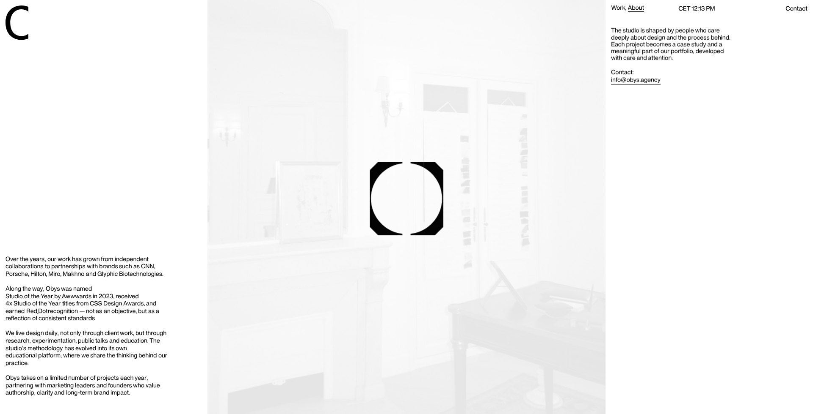
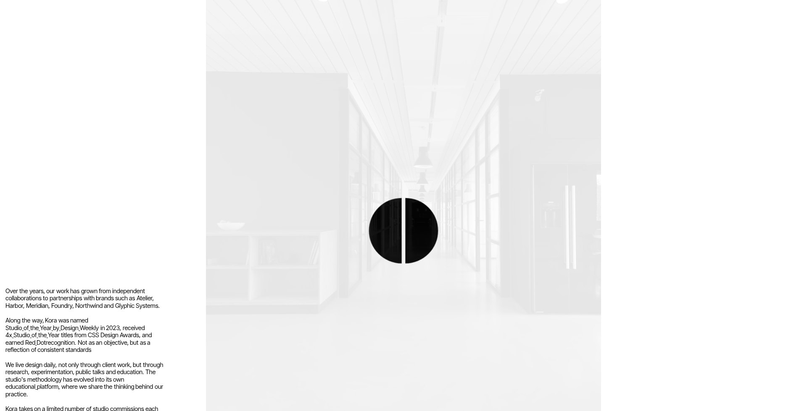
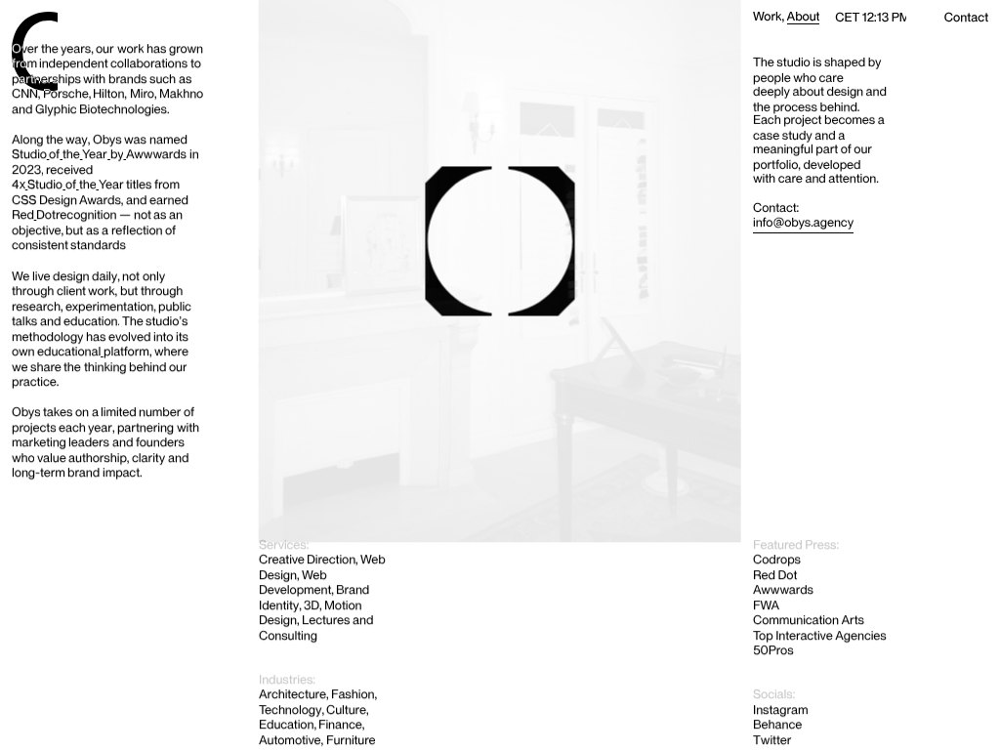
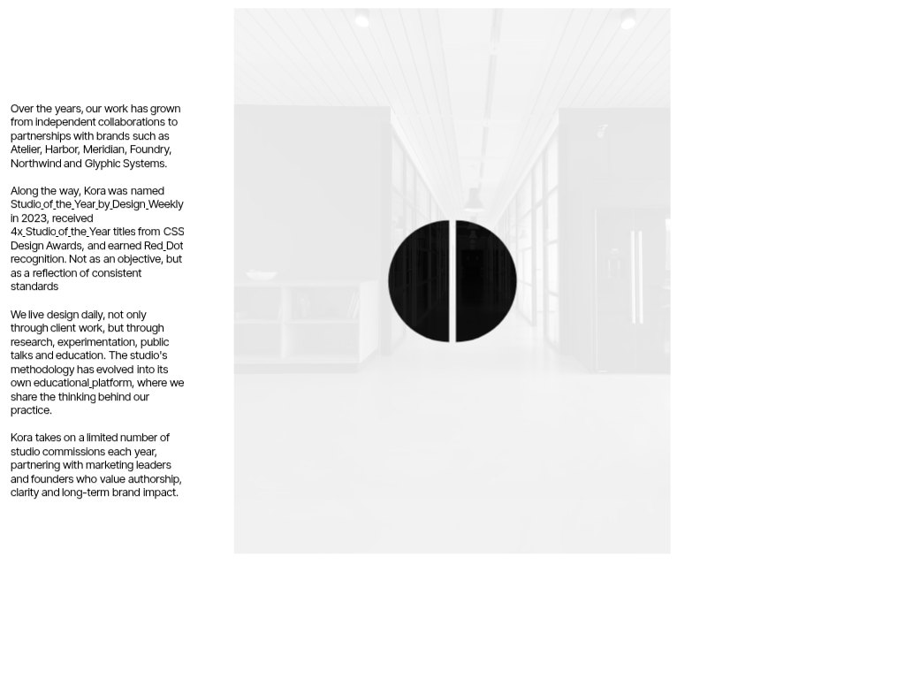
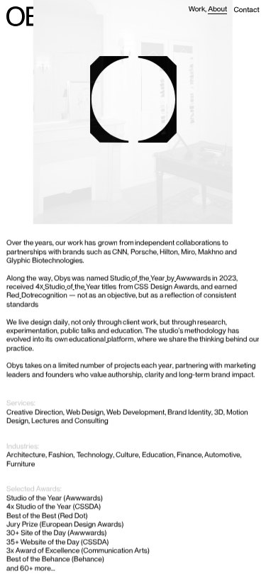
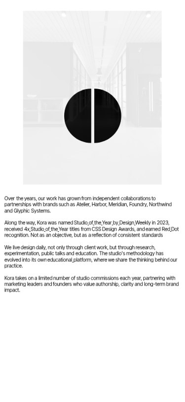

# Fidelity Report: studio-hover-reel

- **Sumber:** `agency-portfolio/obys-agency-nextjs` (`src/components/about/StudioVisualCarousel.tsx` + `#ab-co-vis-wrap` / `#ab-co-ov` / `#logo`, `http://localhost:3021/about`)
- **Ekstrak:** `registry/sections/studio-hover-reel` (`http://localhost:3025/preview/section/studio-hover-reel`)
- **Style:** `swiss-mono` (`css-modules`, 100% token `--rk-*`)

## Hasil `npm run fidelity`

- `1920x980`: 8 elemen (`root`, `stage`, `hoverTarget`, `gallery`, `overview`, `overviewP1`, `overviewLink`, `markSvg`), **0 FAIL**, 20 WARN
- `1024x768`: 8 elemen (`root`, `stage`, `hoverTarget`, `gallery`, `overview`, `overviewP1`, `overviewLink`, `markSvg`), **0 FAIL**, 20 WARN
- `375x812`: 8 elemen (`root`, `stage`, `hoverTarget`, `gallery`, `overview`, `overviewP1`, `overviewLink`, `markSvg`), **0 FAIL**, 19 WARN

## Screenshot Berdampingan

| Viewport | Asli | Ekstrak |
| --- | --- | --- |
| `1920x980` |  |  |
| `1024x768` |  |  |
| `375x812` |  |  |

## Temuan yang Diperbaiki

- Memindahkan latar `var(--rk-bg)` ke `.root::before` (`z-index: -1`) dengan `isolation: isolate; background: transparent;` pada `.root` agar `computedStyle.backgroundColor` bernilai `rgba(0, 0, 0, 0)` sama dengan `#ab-co-vis-wrap` sambil menjaga kanvas putih mandiri dan `mix-blend-mode: difference` pada `.mark`.
- Membungkus `preview.tsx` dengan `display: flow-root; background: var(--rk-bg)` agar `margin-top: calc(var(--rk-u) * 6)` tidak collapse keluar dari `StandalonePreview`.
- Menyesuaikan panjang copy overview netral (`Kora`, mitra contoh) agar jumlah baris di `375x812` identik dengan aslinya (`216.8px`).

## Beda yang Disengaja (WARN)

- **Font proprietary (`Obys` -> `Inter Tight`)** serta **foto arsip & logo tengah netral** (`markPaths` geometris).
- **Posisi `y` pada capture:** halaman asli di-scroll ke `#ab-co-vis-wrap` (`y: -0.2`), sedangkan preview standalone mulai dari `y: 80` (`margin-top: 6rem`).
