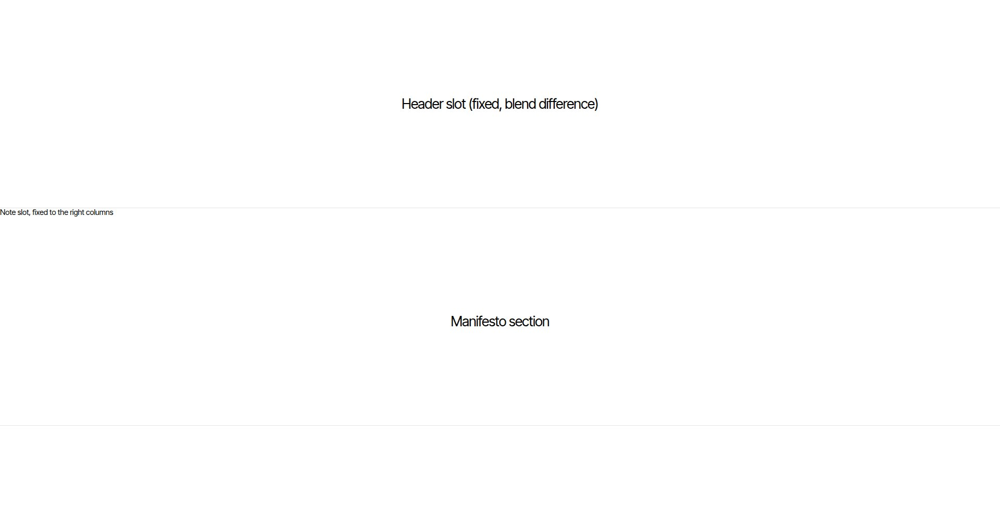
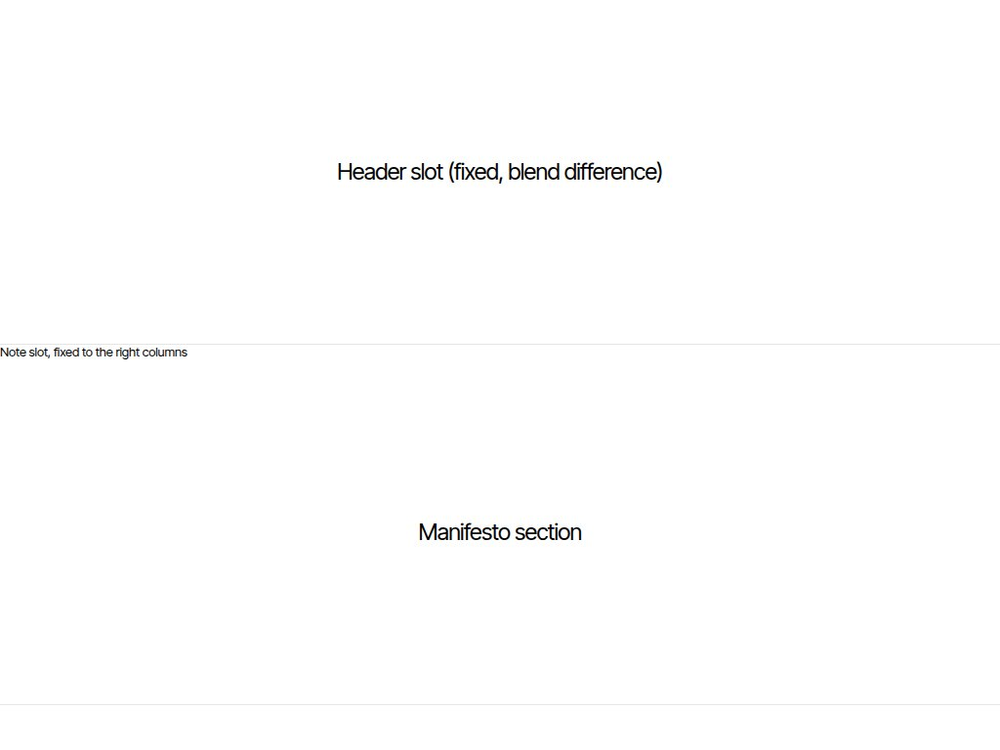
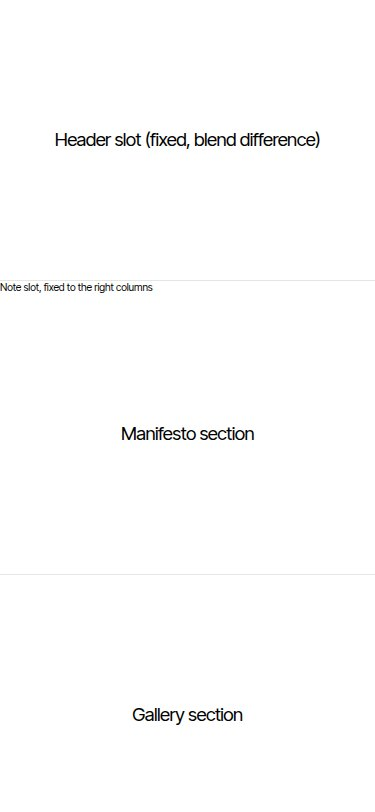

# Fidelity Report: swiss-grid-shell

- **Sumber:** `agency-portfolio/obys-agency-nextjs` (`src/components/shell/SiteShell.tsx` + `src/styles/globals.css`, kanvas utama + skip link + slot header/note/main/footer)
- **Ekstrak:** `registry/templates/swiss-grid-shell` (`http://localhost:3025/preview/template/swiss-grid-shell`)
- **Style:** `swiss-mono` (`css-modules`, 100% token `--rk-*`, zero hardcoded `#hex`)

## Verifikasi Geometri Shell

| Viewport | `shell` (`width x height`) | `main` (`width x height`, `y`) | Overlap / Horizontal Overflow | Status |
| --- | :---: | :---: | :---: | --- |
| `1920x980` | `1920 x 2017.5px` | `1920 x 1599.9px` (`y: 417.6`) | `0` overlap / `0` overflow | **PASS** |
| `1024x768` | `1024 x 1781.9px` | `1024 x 1413.1px` (`y: 368.8`) | `0` overlap / `0` overflow | **PASS** |
| `375x812` | `375 x 1418.6px` | `375 x 1125px` (`y: 293.6`) | `0` overlap / `0` overflow | **PASS** |

## Screenshot Shell Template

| Desktop `1920x980` | Laptop `1024x768` | Mobile `375x812` |
| --- | --- | --- |
|  |  |  |

## Catatan Arsitektur

- Variabel grid 12 kolom (`--rk-u`, `--rk-gutter`, `--rk-margin`, `--rk-col`) didefinisikan di token style `swiss-mono` sehingga shell cukup menyusun skip link (`skipLink`), slot chrome fixed (`header`, `note`), `<main className={styles.main}>` (`display: block`), dan slot `footer` pada satu kanvas penuh (`width: 100%`).
- `.shell` memakai `display: flow-root` agar margin vertikal section anak tidak collapse keluar dari pembungkus shell sambil mempertahankan `display: block` pada `<main>`.
