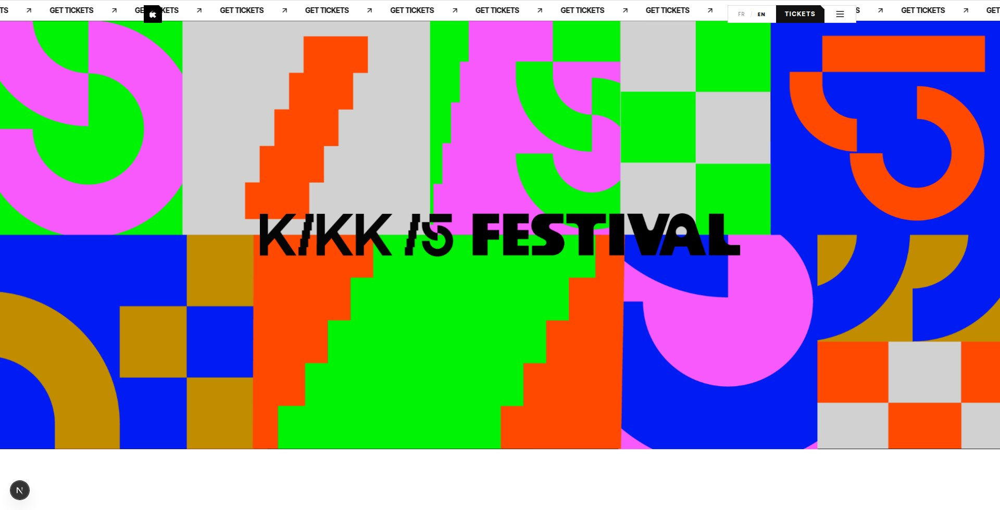
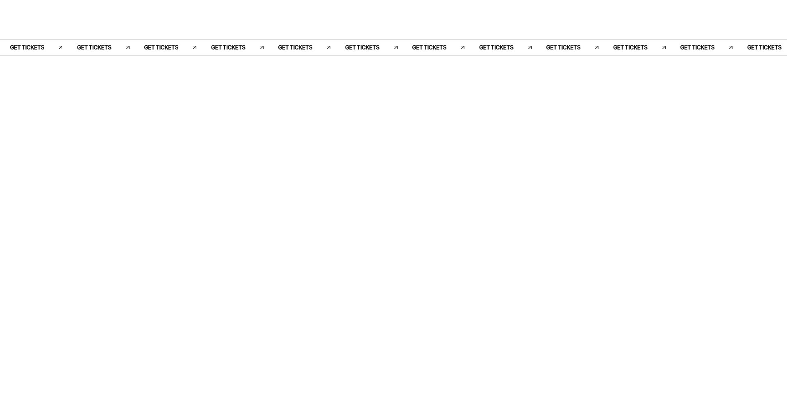
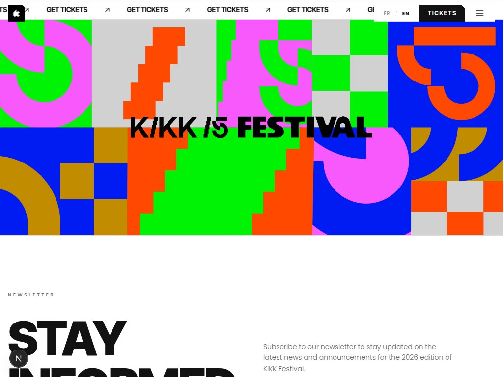
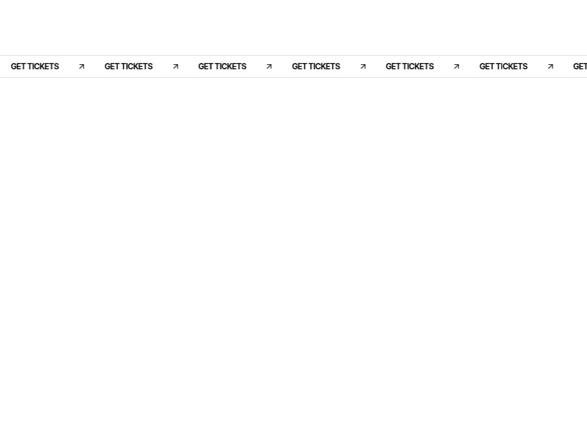

# Fidelity Report: `ticket-marquee-bar`

- **Kind / Level:** `section` / `organism`
- **Source:** `education-event/kikkfestival-be-nextjs` (`src/components/home/TicketsMarquee.tsx` + `src/styles/globals.css`, `http://127.0.0.1:3011/`)
- **Extract:** `registry/sections/ticket-marquee-bar` (`http://127.0.0.1:3015/preview/section/ticket-marquee-bar`)
- **Style:** `neon-brutalist` (`css-modules`, 100% `--rk-*` tokens)

## Results (`npm run fidelity`)

- `1920x980`: 3 elements (`bar`, `text`, `arrow`), **0 FAIL**, 9 WARN.
- `1024x768`: 3 elements (`bar`, `text`, `arrow`), **0 FAIL**, 9 WARN.

Exact `1920 x 40px` and `1024 x 40px` bar geometry with `1px` top/bottom `rgba(18, 18, 18, 0.15)` borders.

## Side-by-Side Screenshots

| Viewport | Original (`127.0.0.1:3011/`) | Extract (`127.0.0.1:3015/preview/section/ticket-marquee-bar`) |
| --- | --- | --- |
| `1920x980` |  |  |
| `1024x768` |  |  |

## Intentional Differences (WARN)

- **Marquee animation phase (`x`) & preview offset (`y`):** Continuous CSS `marquee-scroll` animation moves `text` and `arrow` horizontally each frame; preview pads `96px 0` around the bar.
- **Zero-width border color:** `0px` computed borders on `text`/`arrow` reflect inherited `rgb(18, 18, 18)`.
