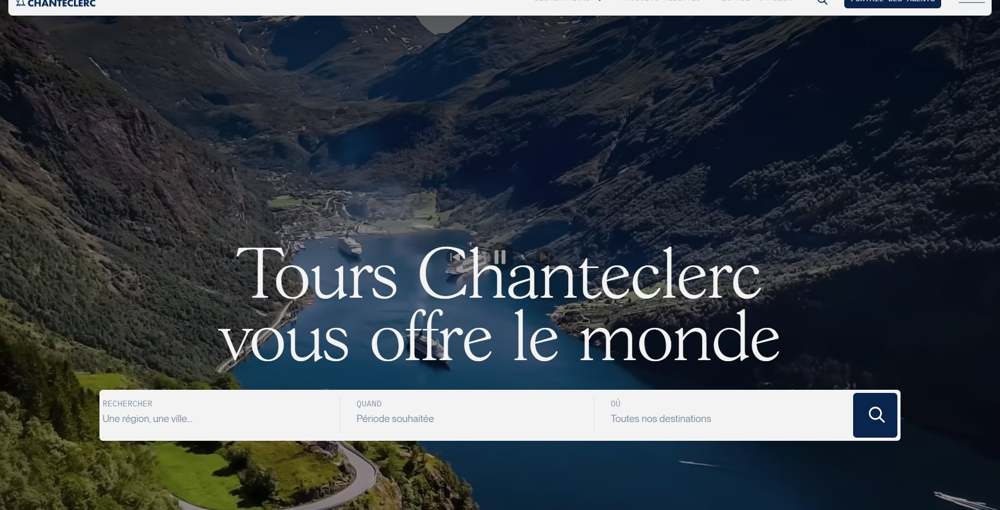
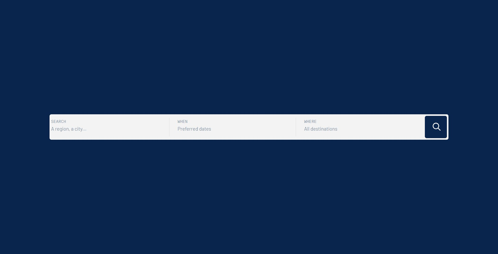
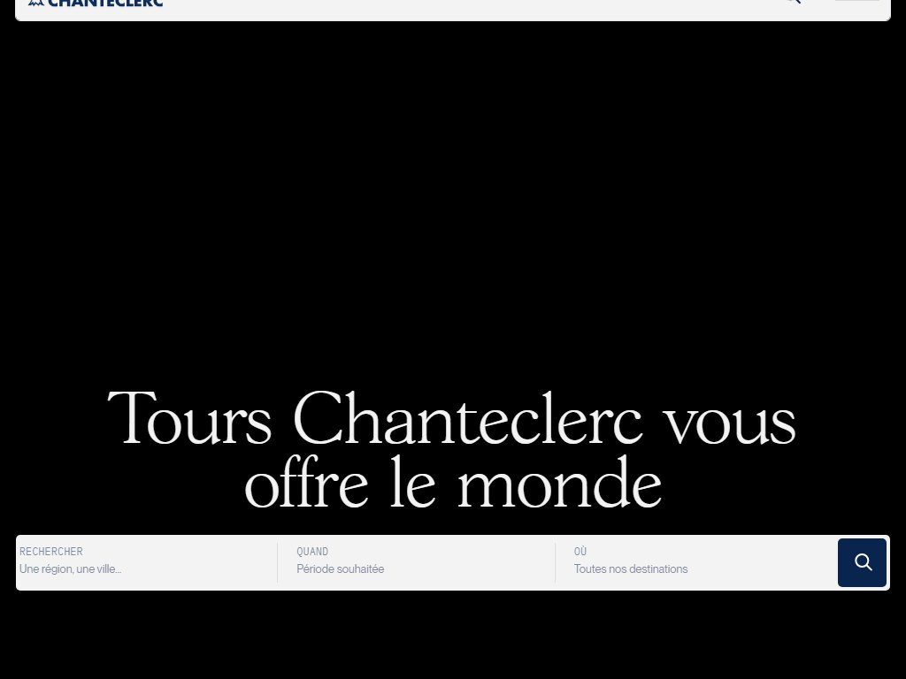
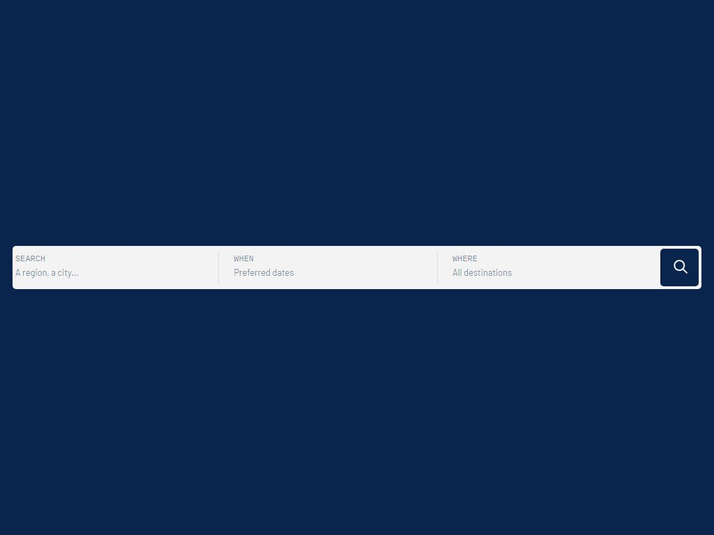

# Fidelity Report: trip-search-bar

Sumber: `travel-services/tours-chanteclerc-nextjs` (`header.hero .search-bar` pada `localhost:3001/`)
Ekstrak: `registry/ui/trip-search-bar` (`http://localhost:3005/preview/ui/trip-search-bar?style=azure-editorial`)
Keadaan: preview komponen pada `1920x980` dan `1024x768`, 2,2 detik setelah load (`document.fonts.ready`).

## Hasil `npm run fidelity:all`

- 1920x980: 5 elemen (`bar`, `queryField`, `datesField`, `destField`, `submitBtn`), **0 FAIL**, 14 WARN
- 1024x768: 5 elemen (`bar`, `queryField`, `datesField`, `destField`, `submitBtn`), **0 FAIL**, 14 WARN

## Screenshot berdampingan

| Viewport | Asli | Ekstrak |
| --- | --- | --- |
| 1920x980 |  |  |
| 1024x768 |  |  |

## Beda yang disengaja (WARN)

- **Font body**: font komersial `PP Neue Montreal` dipetakan ke `--rk-font-body` (`Barlow`, selisih lebar metrik ~0.48% pada pengujian `measureText`).
- **Teks netral**: label & placeholder Prancis ("RECHERCHER / Une region, une ville...", "QUAND", "OU") diganti copy netral ("SEARCH / A region, a city...", "WHEN / Preferred dates", "WHERE / All destinations").
- **Posisi `x`/`y` showcase**: bar diukur dalam kanvas preview terpusat, sedangkan versi penuh hero terintegrasi di `video-expand-hero` dan `voyage-editorial-demo-page`.
