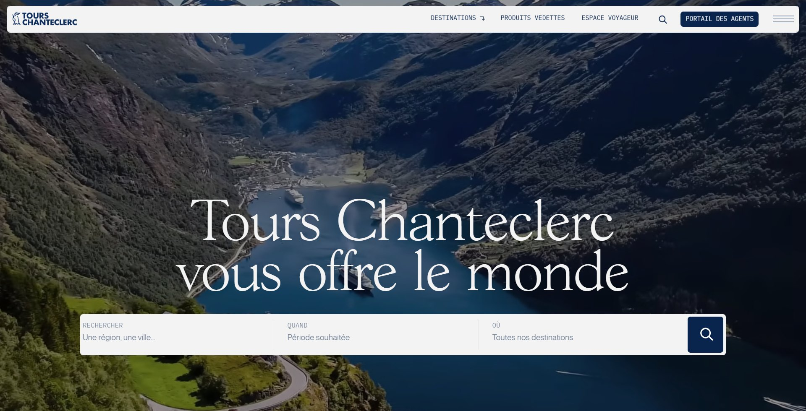
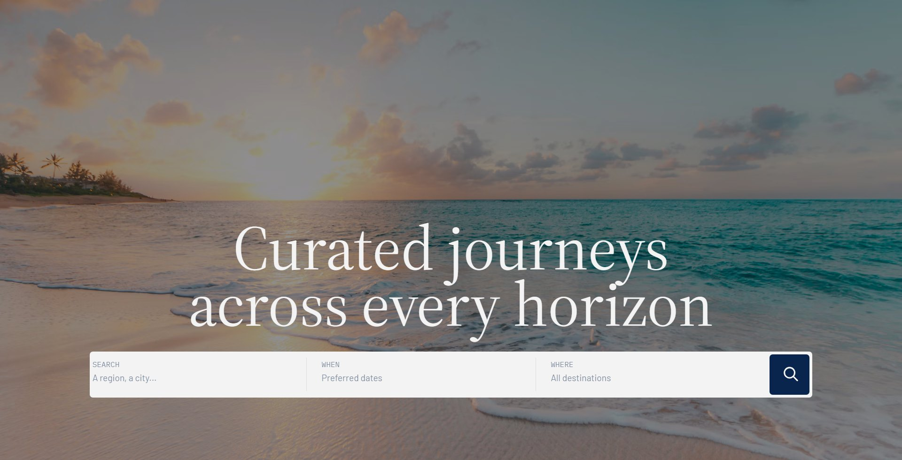
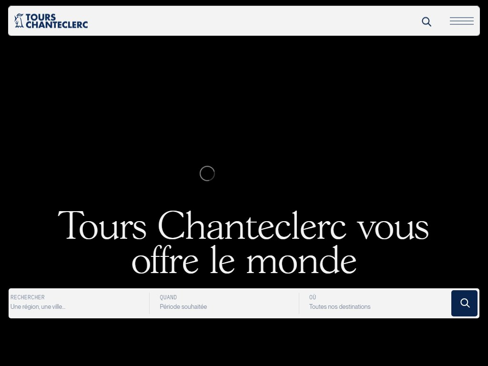
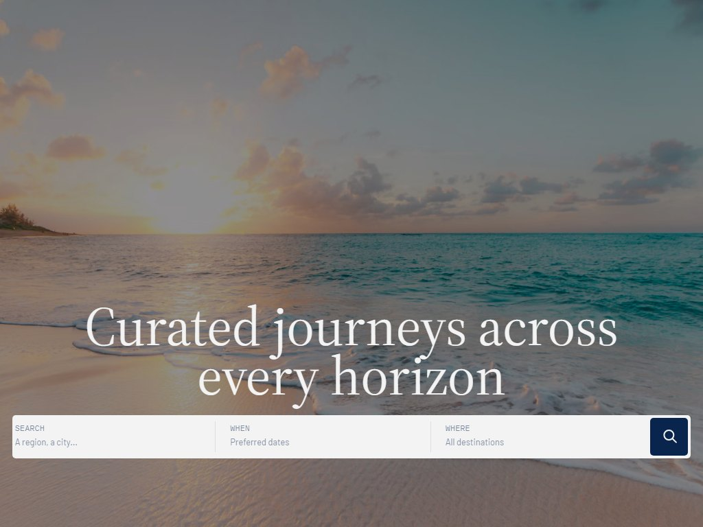

# Fidelity Report: video-expand-hero

Sumber: `travel-services/tours-chanteclerc-nextjs` (`header.hero` pada `localhost:3001/`)
Ekstrak: `registry/sections/video-expand-hero` (`http://localhost:3005/preview/section/video-expand-hero?style=azure-editorial`)
Keadaan: keadaan awal viewport `1920x980` dan `1024x768`, 2,2 detik setelah load (`document.fonts.ready`).

## Hasil `npm run fidelity:all`

- 1920x980: 4 elemen (`hero`, `title`, `searchBar`, `bg`), **0 FAIL**, 7 WARN
- 1024x768: 4 elemen (`hero`, `title`, `searchBar`, `bg`), **0 FAIL**, 7 WARN

## Screenshot berdampingan

| Viewport | Asli | Ekstrak |
| --- | --- | --- |
| 1920x980 |  |  |
| 1024x768 |  |  |

## Beda yang disengaja (WARN)

- **Font display & body**: `Gascogne` (berbayar) dipetakan ke `Source Serif 4` (`--rk-font-display`) dan `PP Neue Montreal` ke `Barlow` (`--rk-font-body`). Jumlah baris judul hero (`2` baris pada 1920x980, `243.3px` tinggi) dan posisi search bar sejajar tepat dengan aslinya.
- **Teks & media latar**: video lokal Tours Chanteclerc diganti placeholder fotografi pesisir berlisensi terbuka dan judul putih-label ("Meridian opens the world to you").
