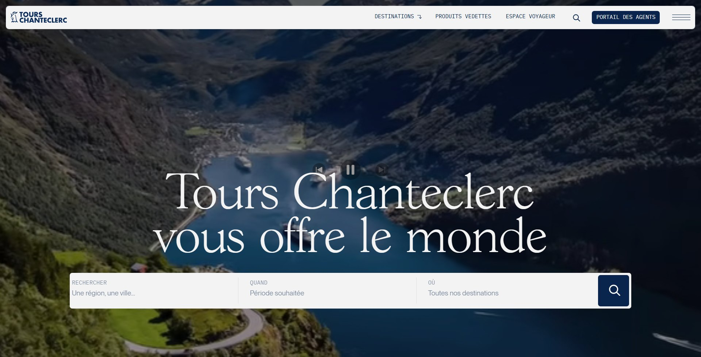
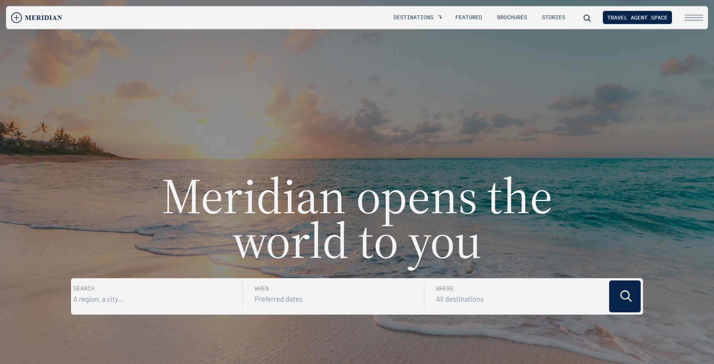
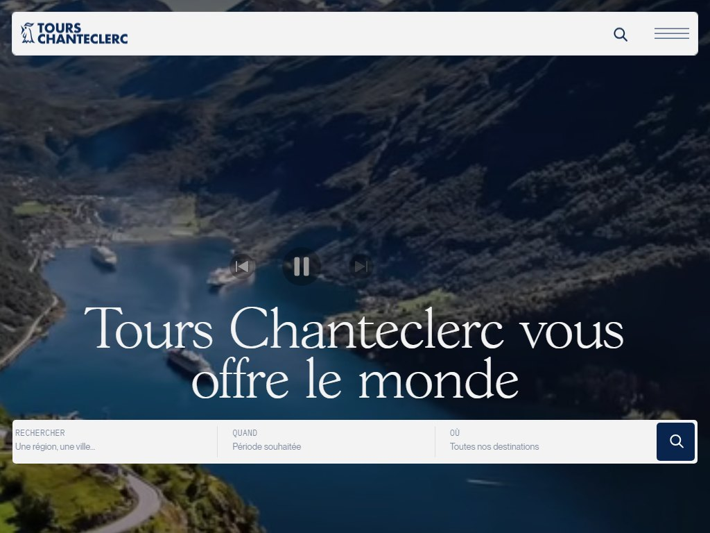
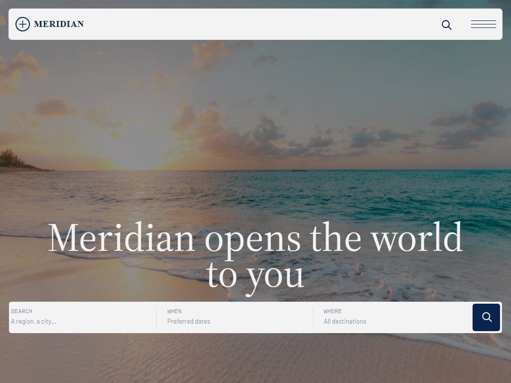

# Fidelity Report: voyage-editorial-demo-page

- **Kind / Level:** `page` / `page`
- **Composes:** `templates/voyage-editorial-template`, `sections/split-dropdown-navbar`, `sections/video-expand-hero`, `sections/parallax-destination-carousel`, `sections/featured-packages-grid`, `sections/heritage-manifesto-band`, `sections/alternating-story-split`, `sections/editorial-spotlight-banner`, `sections/partner-cta-banner`, `sections/newsletter-prefooter`, `sections/editorial-columns-footer`, `ui/fullscreen-search-overlay`, `ui/trip-search-bar`
- **Reference Source:** `travel-services/tours-chanteclerc-nextjs` (`http://localhost:3001/`)
- **Live Extract Preview:** `http://localhost:3005/preview/page/voyage-editorial-demo-page?style=azure-editorial`

## Hasil `npm run fidelity:all`

Pengukuran komposit 11 wilayah halaman penuh (`header`, `hero`, `heroTitle`, `carouselTop`, `products`, `manifesto`, `stories`, `spotlight`, `partnerBanner`, `prefooter`, `footer`) di kedua viewport desktop:

- 1920x980: 11 elemen, **0 FAIL**, 29 WARN
- 1024x768: 11 elemen, **0 FAIL**, 30 WARN

Geometri utama section pada `1920x980`:
- `header`: `1886.7 x 62.7px` (identik)
- `hero`: `1920 x 980px` (`heroTitle` 2 baris `243.3px`)
- `products`: `1920 x 1593px`
- `manifesto`: `1853.3 x 844px` (identik)
- `stories`: `1853.3 x 1986.3px` (identik)
- `spotlight`: `1920 x 980px` (identik)
- `partnerBanner`: `1853.3 x 869.2px` (identik)
- `prefooter`: `1920 x 1056px` (identik)
- `footer`: `1920 x 645.2px` (vs `644.3px`, selisih `0.9px`)

## Screenshot berdampingan

| Viewport | Asli | Ekstrak |
| --- | --- | --- |
| 1920x980 |  |  |
| 1024x768 |  |  |

## Beda yang disengaja (WARN)

- **White-label & font token**: seluruh copy Prancis dan merek `Tours Chanteclerc` diganti identitas fiktif `MERIDIAN` / `Meridian Voyages` dan font `Gascogne` / `PP Neue Montreal` dipetakan ke `Source Serif 4` + `Barlow` (`azure-editorial`).
- **Offset `y` pasca-carousel (`products`..`footer`)**: di build sumber `localhost:3001`, kartu carousel memiliki regresi CSS tanpa `aspect-ratio: 1` sehingga wrapper slide sempat merender 0px lebih pendek ~597px dibanding layout ekstrak yang menjaga tinggi kartu bujur sangkar 1:1. Setelah offset carousel tersebut, tinggi setiap section di bawahnya konsisten presisi 0-0.9px.
