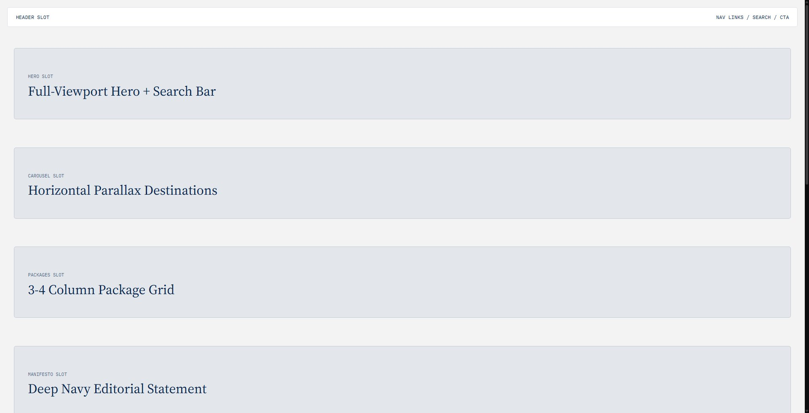
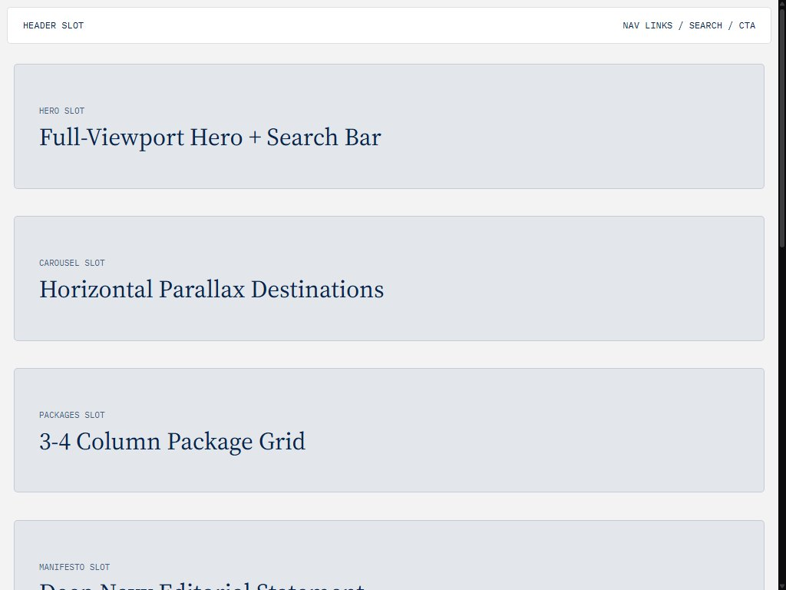

# Fidelity Report: voyage-editorial-template

Sumber: `travel-services/tours-chanteclerc-nextjs` (struktur layout root di `src/app/layout.tsx` & `src/app/page.tsx`: `.header`, `.pageWrapper > main#MainContent`, `.prefooter`, `.footer` + modal `.search`)
Ekstrak: `registry/templates/voyage-editorial-template` (`http://localhost:3005/preview/template/voyage-editorial-template?style=azure-editorial`)
Style: `azure-editorial` (`css-modules`, 100% token `--rk-*`, zero hardcoded `#hex`/`rgb()`)

## Verifikasi Geometri Shell

| Viewport | `docW` | `winW` | `shellW` | `mainW` | Overlap / Overflow | Status |
| --- | :---: | :---: | :---: | :---: | :---: | --- |
| `1920x980` | `1910px` | `1920px` | `1910px` | `1910px` | `0` horizontal overflow (`overflow-x: clip`) | **PASS** |
| `1024x768` | `1014px` | `1024px` | `1014px` | `1014px` | `0` horizontal overflow (`overflow-x: clip`) | **PASS** |

## Screenshot Shell Template

| Desktop `1920x980` | Laptop `1024x768` |
| --- | --- |
|  |  |

## Catatan Arsitektur

- Menyediakan slot eksplisit (`header`, `overlay`, `hero`, `carousel`, `packages`, `manifesto`, `stories`, `spotlight`, `partnerBanner`, `prefooter`, `footer`) di atas token responsif `--w: 1440` (`--p: 25`) desktop & `--w: 375` (`--p: 10`) mobile.
- Menggunakan `overflow-x: clip` pada `.shell` dan layering `z-index` antara `.headerSlot` (`20`), `.pageWrapper` (`3`), `.prefooterRegion` (`3`), dan `.footerRegion` (`2`) agar efek header melayang & reveal prefooter ke footer tetap mulus tanpa horizontal scrollbar.
