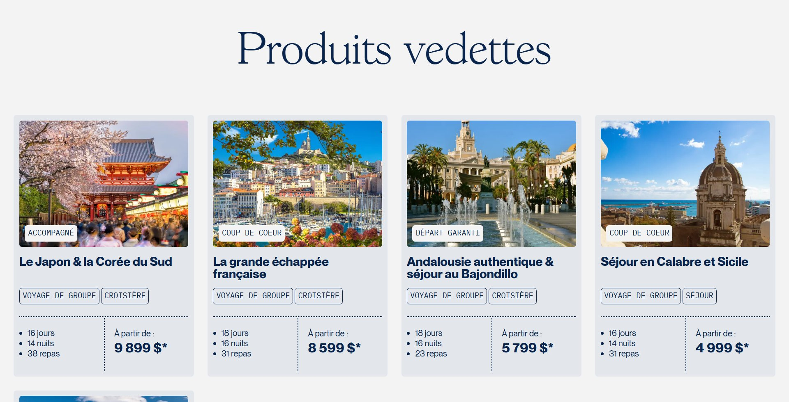
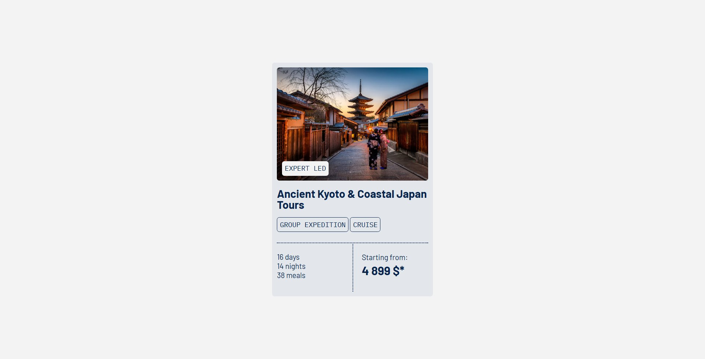
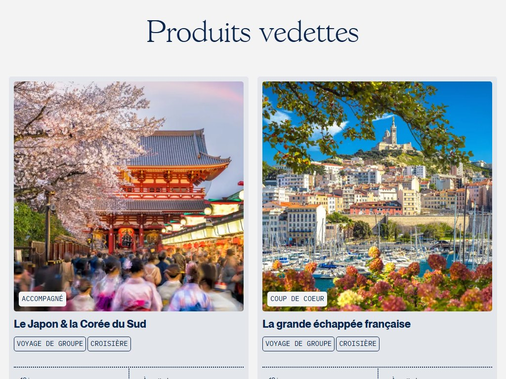
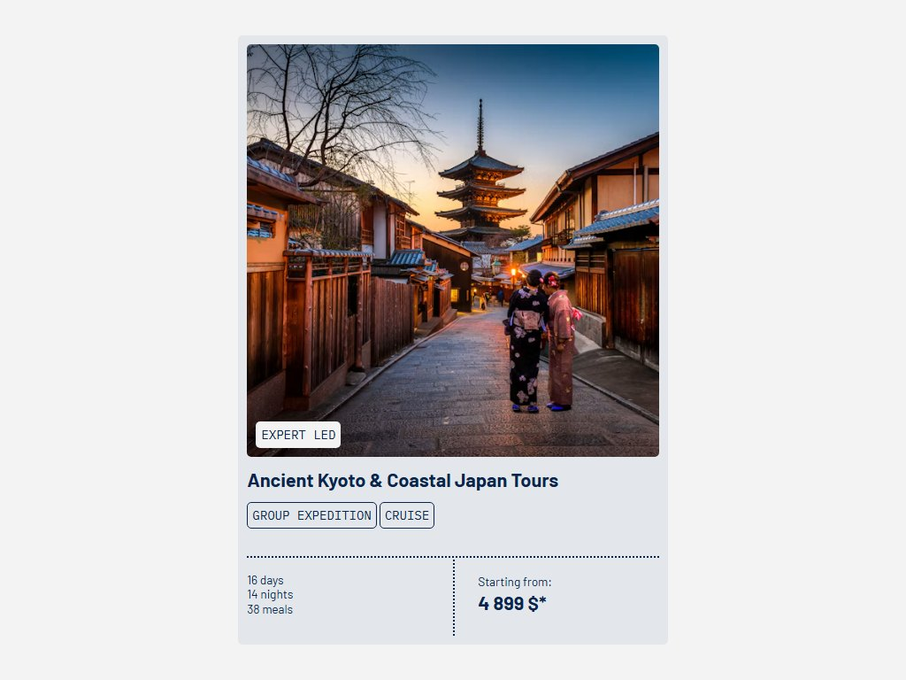

# Fidelity Report: voyage-package-card

Sumber: `travel-services/tours-chanteclerc-nextjs` (`.productsList__list .product-card` pada `localhost:3001/`)
Ekstrak: `registry/ui/voyage-package-card` (`http://localhost:3005/preview/ui/voyage-package-card?style=azure-editorial`)
Keadaan: preview komponen kartu `438.3 x 638.2px` pada `1920x980` dan `1024x768`, 2,2 detik setelah load (`document.fonts.ready`).

## Hasil `npm run fidelity:all`

- 1920x980: 7 elemen (`card`, `imgWrap`, `badge`, `title`, `typeTag`, `specTable`, `price`), **0 FAIL**, 26 WARN
- 1024x768: 7 elemen (`card`, `imgWrap`, `badge`, `title`, `typeTag`, `specTable`, `price`), **0 FAIL**, 26 WARN

## Screenshot berdampingan

| Viewport | Asli | Ekstrak |
| --- | --- | --- |
| 1920x980 |  |  |
| 1024x768 |  |  |

## Beda yang disengaja (WARN)

- **Font body & label mono**: `PP Neue Montreal` diganti `Barlow` melalui token `--rk-font-body`, label mono tetap memakai `IBM Plex Mono` via `--rk-font-mono`.
- **Sample media & data netral**: foto dan data produk Tours Chanteclerc diganti sample netral (`Ancient Kyoto & Coastal Japan Tours`, badge `EXPERT LED`, tag `GROUP EXPEDITION` / `CRUISE`).
- **Posisi `x`/`y` showcase**: kartu berdiri sendiri di kanvas preview, tidak berada di posisi offset section `#productsList`.
