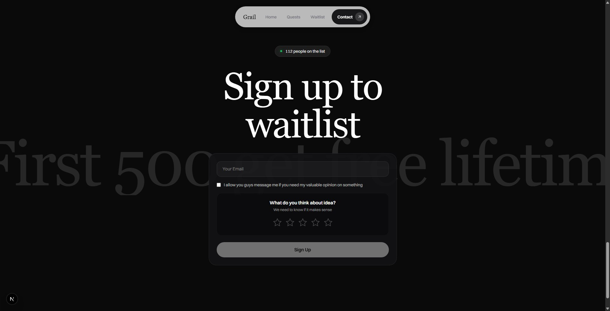
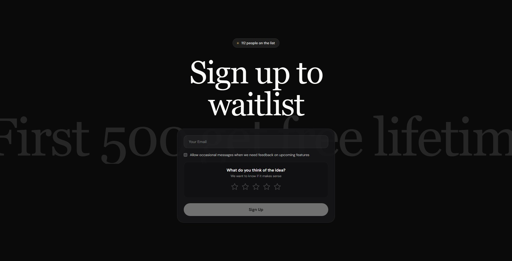
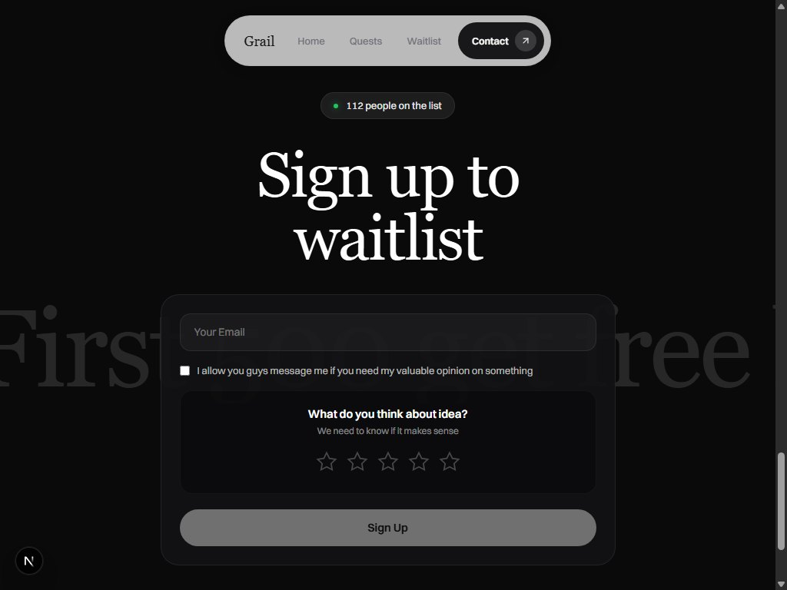
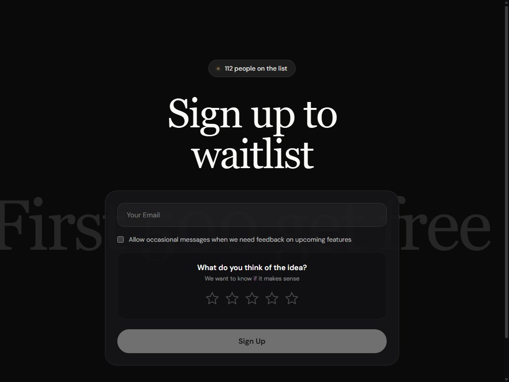

# Fidelity Report: waitlist-hero

Sumber: `saas-app/grail-next/src/components/landing/WaitlistSection.tsx` (`http://localhost:3002/v1`, `#pricing`)
Ekstrak: `registry/sections/waitlist-hero` (`http://localhost:3000/preview/section/waitlist-hero`)
Style: `kinetic-obsidian` (`css-modules` + `motion`)
Keadaan: reveal selesai (`opacity: 1`), `memberCount={112}`, email kosong (tombol `Sign Up` dalam state disabled `opacity: 0.4`).

## Hasil `npm run fidelity`

- **1920x980**: 13 elemen, **0 FAIL**, 61 WARN
- **1024x768**: 13 elemen, **0 FAIL**, 61 WARN

Seluruh 13 elemen terukur (`section`, `marqueeText`, `inner`, `countPill`, `headline`, `card`, `input`, `checkLabel`, `ratingBlock`, `ratingTitle`, `ratingSub`, `stars`, `submitBtn`) lolos tanpa satu pun `FAIL` ukuran, padding, tinggi baris, warna, maupun visibilitas di kedua viewport.

## Screenshot berdampingan

| Viewport | Asli | Ekstrak |
| --- | --- | --- |
| 1920x980 |  |  |
| 1024x768 |  |  |

## Beda yang disengaja (WARN)

- **Font body (`Switzer` -> `DM Sans`)**: aslinya memuat file lokal `Switzer-Variable.woff2`; ekstrak memakai token `--rk-font-body` (`DM Sans`) milik `kinetic-obsidian`. Font display (`Georgia`) sama persis pada `marqueeText` dan `headline`.
- **Pembulatan token warna (`--rk-*`)**: seluruh warna memakai `var(--rk-*)` dan `color-mix()` tanpa `#hex`/`rgb()` mentah (`--rk-fg: #fafaf8` vs `#ffffff`, `--rk-surface` 94% vs `#121214f0`, `--rk-bg` 30% vs `#0000004d`). Titik live `countDot` dan warna pesan error memakai `var(--rk-accent)`.
- **Posisi horizontal marquee (`marqueeText.x`)**: marquee berjalan kontinu (`60s linear infinite`), sehingga frame capture menangkap offset X sedikit berbeda.
- **Teks white-label**: copy form dipoles menjadi netral dengan jumlah baris dan panjang karakter setara (`checkLabel`, `ratingTitle`, `ratingSub`).
- **Aksesibilitas & Reduced Motion**: ditambahkan `aria-label`/`aria-pressed`/`role="group"` pada kontrol form dan bintang, `aria-hidden="true"` pada marquee dekoratif, ring `:focus-visible`, serta dukungan `prefers-reduced-motion` (`useReducedMotion`).

## Detail teknis yang menjaga kecocokan 1:1

- Menetapkan `line-height: normal` pada `.section` agar reset `line-height: 1.5` dari Tailwind v4 tidak mempertinggi `countPill`, `input`, `ratingTitle`, `ratingSub`, dan `submitBtn`.
- Menetapkan `.star svg { display: inline; vertical-align: baseline; }` agar tinggi blok `.stars` tetap `37px` seperti di situs asli (bukan `32px` akibat `svg { display: block }` dari preflight Tailwind).
