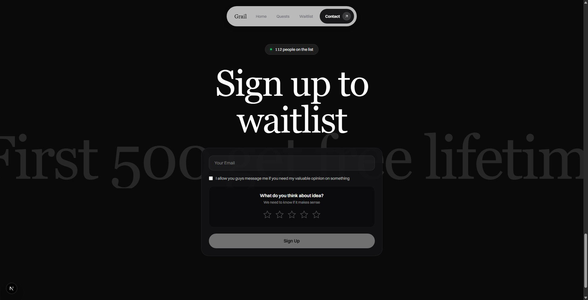
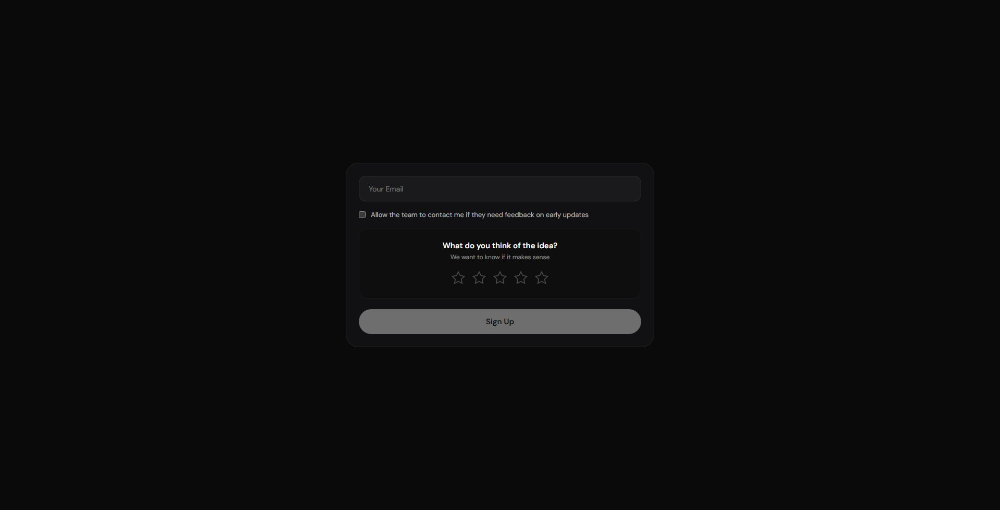
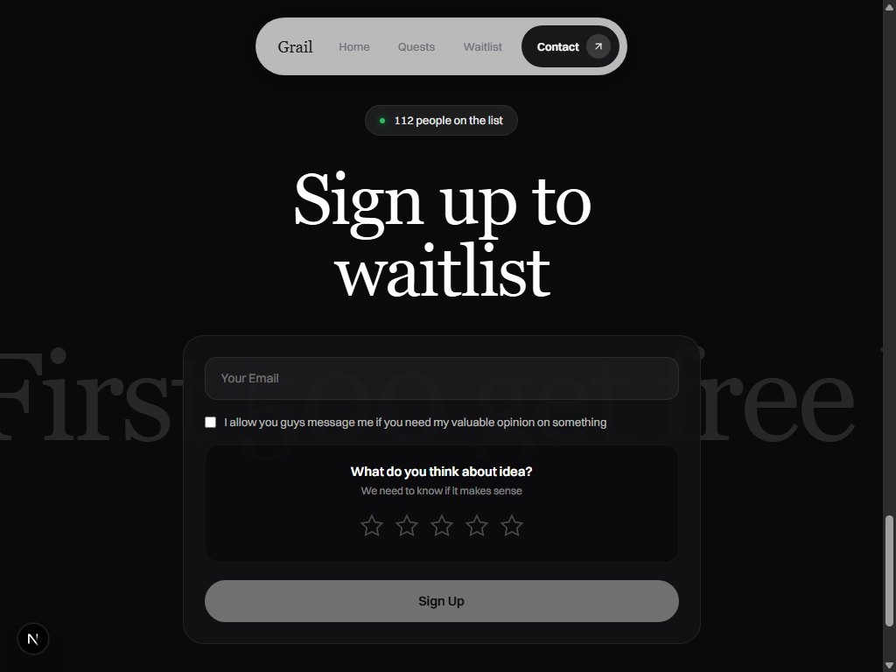
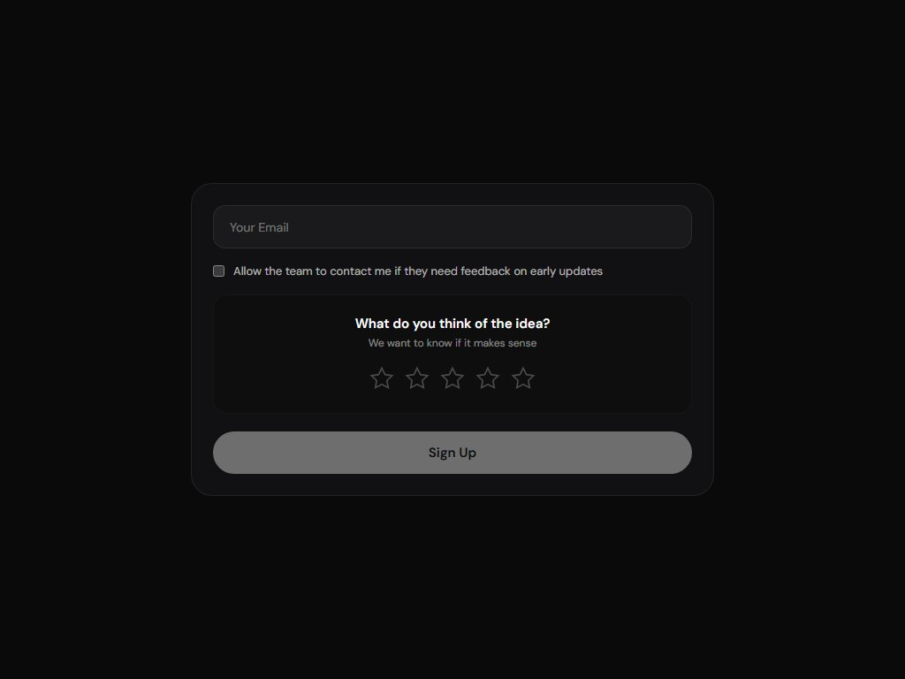

# Fidelity Report: waitlist-input

Sumber: `saas-app/grail-next` (`.card`, `.input`, `.checkLabel`, `.ratingBlock`, `.submitBtn` di `#pricing` pada `http://localhost:3002/v1`)
Ekstrak: `registry/ui/waitlist-input` (`http://localhost:3000/preview/ui/waitlist-input`)
Keadaan: preview komponen waitlist card pada `1920x980` dan `1024x768`, 2,2 detik setelah load (`document.fonts.ready`).

Catatan pengukuran: di web asli, kartu form waitlist berada di dalam section `#pricing` di bawah headline dan marquee (koordinat vertikal lebih rendah), sedangkan di preview ekstrak kartu ditampilkan terpusat pada panggung gelap selebar kontainer asli (`max-width: 640px; padding: 0 24px` -> kartu `592px`). Semua dimensi komponen, padding, border-radius, gap, dan jarak vertikal relatif antar elemen di dalam kartu (`input.y - card.y = 25px`, `checkLabel.y - card.y = 90px`, `submitBtn.y - card.y = 280.5px`) identik 1:1.

## Hasil `npm run fidelity`

- **1920x980**: 4 elemen, **0 FAIL**, 21 WARN.
  - `card`: `592 x 353.5px`, `padding: 24px`, `gap: 16px`, `border-radius: 24px`, `backgroundColor` tepat `0.94` alpha (`0` WARN).
  - `input`: `542 x 49px`, `padding: 14px 18px`, `border-radius: 14px`, `fontSize: 14px`, `lineHeight: normal`, `display: block`.
  - `checkLabel`: `542 x 19.5px`, `gap: 10px`, `fontSize: 13px`, `lineHeight: 19.5px`, `display: flex`.
  - `submitBtn`: `542 x 48px`, `padding: 14px 24px`, `border-radius: 100px`, `fontSize: 15px`, `fontWeight: 600`, `color: rgb(10, 10, 11)` (`0` WARN), `display: block`.
- **1024x768**: 4 elemen, **0 FAIL**, 25 WARN.
  - Seluruh ukuran (`card` `592 x 353.5px`, `input` `542 x 49px`, `checkLabel` `542 x 19.5px`, `submitBtn` `542 x 48px`), padding, font-size, dan radius identik 1:1.

## Screenshot berdampingan

| Viewport | Asli | Ekstrak |
| --- | --- | --- |
| 1920x980 |  |  |
| 1024x768 |  |  |

## Beda yang disengaja (WARN)

- **Font body**: font lokal **Switzer** di sumber asli diganti **DM Sans** melalui token `--rk-font-body` pada preset `kinetic-obsidian`.
- **Pembulatan warna token**: putih murni `#ffffff` (`rgb(255, 255, 255)`) pada teks, border transparan, dan latar tombol dipetakan ke token `--rk-fg` (`#fafaf8`, `rgb(250, 250, 248)`) melalui `var(--rk-*)` dan `color-mix()` (tanpa hardcoded hex/rgb), muncul sebagai WARN token rounding dengan selisih maksimal 7 dari batas 24.
- **Teks default netral**: teks opt-in checkbox asli diparafrase menjadi copy netral lewat prop `optInLabel` (tetap satu baris `19.5px`).
- **Posisi `x`/`y`**: di web asli kartu berada di bawah marquee dan judul `#pricing` pada halaman yang memiliki scrollbar vertikal (menggeser `x` sebesar `7.5px` di `1024x768`), sedangkan di preview terisolasi kartu berada di tengah layar.
