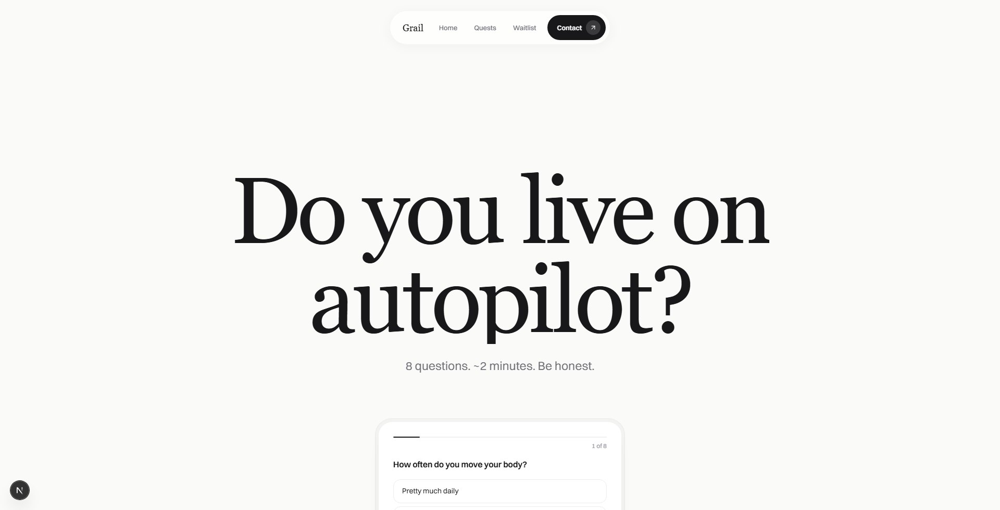
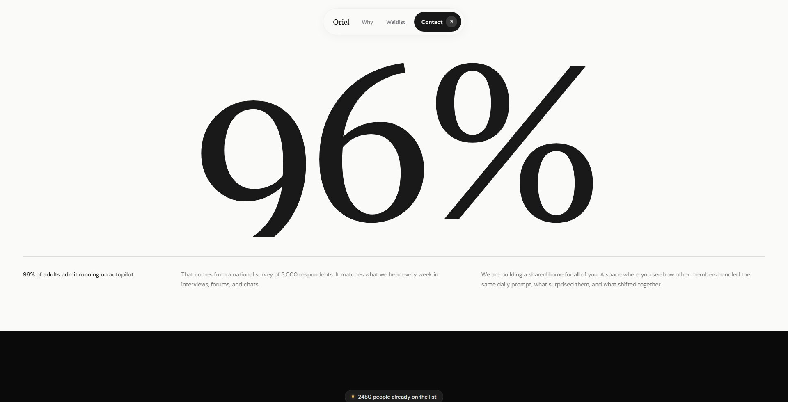
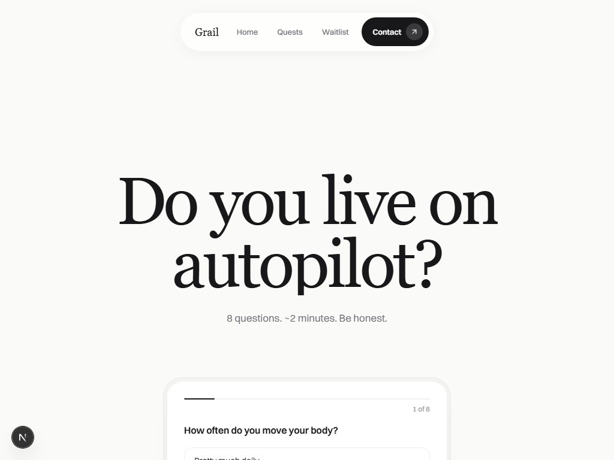
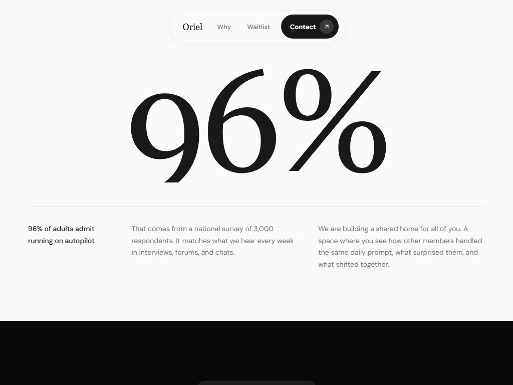

# Fidelity Report: `waitlist-landing-demo-page`

- **Kind / Level:** `page` / `page`
- **Composes:** `templates/saas-waitlist-template`, `sections/floating-pill-navbar`, `sections/spotlight-stat-band`, `sections/waitlist-hero`, `sections/minimal-saas-footer`
- **Reference Source:** `saas-app/grail-next` (`http://localhost:3002/v1`)
- **Live Extract Preview:** `http://localhost:3000/preview/page/waitlist-landing-demo-page`
- **Tolerance Gate (`scripts/fidelity-compare.ts`):** `Math.min(4, Math.max(1, Math.abs(a) * 0.02))` (maksimal `4px`).

## Hasil Verifikasi Fidelity (Data Netral White-Label `Oriel`)

| Viewport | Elements Checked (`nav`, `spotlight`, `hero`, `footer`) | FAIL | WARN | Result |
| --- | ---: | ---: | ---: | --- |
| `1920x980` | 4 | **0** | 26 | **PASS** |
| `1024x768` | 4 | **0** | 26 | **PASS** |

## Screenshot Berdampingan

| Viewport | Original (`localhost:3002/v1`) | Extract (`localhost:3000/preview/page/waitlist-landing-demo-page`) |
| --- | --- | --- |
| `1920x980` |  |  |
| `1024x768` |  |  |

## Beda yang Disengaja (WARN)
- **Komposisi section `/v1`:** halaman demo merangkai 4 organisme utama (`floating-pill-navbar`, `spotlight-stat-band`, `waitlist-hero`, `minimal-saas-footer`) tanpa section kuis/video biner (`/landing/propose.mp4`), sehingga koordinat `y` lebih ringkas dengan ritme visual terang -> gelap -> terang yang utuh dan bebas overlap/overflow.
- **Substitusi font & token warna `--rk-*`:** `Switzer` -> `DM Sans`, warna `#18181b`/`#fff` -> token semantik `--rk-*` (`color-mix`), dan teks netral `Oriel`.
